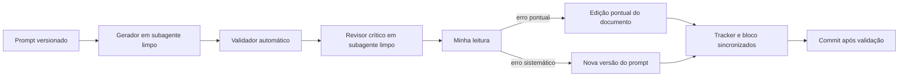

# Da Reunião ao Documento: Design Docs do Sistema de Webhooks

Pacote de design docs (PRD, RFC, FDD, 7 ADRs e Tracker) da feature de webhooks de notificação de pedidos, produzido com IA a partir de [`TRANSCRICAO.md`](TRANSCRICAO.md) e do código deste repositório. Este README conta como o pacote foi feito. Para ler os documentos, vá direto para [Como navegar a entrega](#como-navegar-a-entrega).

## Sobre o desafio

O ponto de partida é um Order Management System em Node.js, TypeScript, Express, Prisma e MySQL, e a transcrição de uma reunião de cerca de 55 minutos em que cinco pessoas (tech lead, PM, dois engenheiros e segurança) decidem como construir webhooks de mudança de status de pedido para três clientes B2B. Nada foi registrado além da transcrição. A tarefa era transformar essa conversa em documentação acionável, em alturas diferentes: o PRD diz por que e o quê, o RFC propõe a arquitetura e expõe alternativas e questões em aberto, cada ADR registra uma decisão, o FDD detalha como implementar e o Tracker liga cada item à fala da reunião ou ao arquivo do código de onde ele veio. O enunciado original está no [repositório base](https://github.com/devfullcycle/mba-ia-desafio-design-docs-com-ia/blob/main/README.md).

A dificuldade real não era escrever, era **não inventar**. A reunião descarta ideias, adia outras, deixa pontos sem resposta e tem falas que se corrigem minutos depois; o código não tem nada de eventos, filas ou webhooks. Uma IA usada com pedidos genéricos transforma descarte em requisito, completa lacunas com "boas práticas" e cita falas que não dizem o que o texto afirma. Por isso o processo foi montado em torno de uma regra: todo requisito, decisão, restrição ou número aponta para `[hh:mm] Nome` ou para um caminho real do código, e o que é interpretação aparece rotulado como **Proposta (a validar)**, **Hipótese** ou **Derivada**, quase sempre acompanhado de uma questão em aberto. O código da aplicação (`src/`, `prisma/`, `tests/`, configurações) e a transcrição não foram alterados.

## Ferramentas de IA utilizadas

| Ferramenta | Papel no processo |
| --- | --- |
| **Claude Code** (CLI), modelo **Claude Opus 5.5** | Orquestrador de todas as missões: leu o código e a transcrição, escreveu e versionou os prompts, aplicou as correções, escreveu os scripts locais de apoio (validador, sincronização do tracker, sorteio da auditoria, checagem de diagramas) e preparou cada commit para a minha validação. |
| **Subagentes do Claude Code em contexto limpo** | Três usos, sempre sem o histórico da conversa: (1) **gerador**, que recebia só o prompt versionado e as entradas dele e escrevia o documento; (2) **revisor crítico adversarial**, que procurava erro com prova (falante trocado, descarte virando requisito, proposta sem rótulo, altura errada) e devolvia também "Notas sobre o prompt"; (3) **auditor** do tracker, que conferiu linhas sorteadas contra a transcrição. Separar quem escreve de quem revisa achou boa parte dos erros que passavam no validador. |
| **Busca e leitura de documentação na web** (ferramentas do Claude Code) | Primeiro, para levantar formatos de referência (MADR 4.0, templates de RFC). Depois, para **verificar hipóteses** em vez de deixá-las no texto: pool de conexões e transações interativas do Prisma 5.22.0, módulo `crypto` e `fetch` do Node 20, leituras com bloqueio (`SKIP LOCKED`) do MySQL 8.0. |
| **Prompts do curso** (PRD e FDD) | Ponto de partida dos prompts de PRD e FDD. O de PRD foi convertido de modo entrevista para modo evidência e perdeu os valores padrão sem origem; o de FDD teve o esqueleto reconstruído. O material do curso não é redistribuído neste repositório. |

Ferramentas de apoio escritas com a IA e executadas sem ela: um validador em Node com 9 grupos de checagem (estrutura, evidências, ADR, RFC, FDD, PRD, tracker, README, consistência) e o parse dos diagramas mermaid com `mermaid` 11.4.1 e `jsdom`. Esses scripts, os prompts e o plano ficam só na minha máquina (ver [Workflow adotado](#workflow-adotado)).

## Workflow adotado

### Como organizei o trabalho

Dividi o trabalho em 13 missões (M00 a M12), descritas num plano local. Cada missão rodou numa **janela de contexto nova**, começando pela leitura do plano e das **Notas de passagem** deixadas pela missão anterior (o que foi entregue, o que ficou em conflito, o que a próxima precisa saber). Da M04 em diante, toda missão terminava do mesmo jeito: validador automático, apresentação do que foi gerado, **minha validação** e só então um commit `docs(mNN): ...` com os entregáveis. Plano, prompts, catálogos, scripts e o log de iterações ficaram fora do versionamento; por isso os prompts aparecem abaixo copiados em blocos de código.

### Ordem de produção

Primeiro a base (M00 a M03): plano e validador, catálogo da transcrição, mapa do código, regras comuns e prompt do revisor. Depois os documentos na ordem sugerida pelo enunciado: ADRs (M04), RFC (M05), FDD em duas partes (M06 e M07) e PRD (M08), que virou consolidação em linguagem de produto. O tracker foi construído junto: cada missão de documento entregava as linhas dele. Por fim, auditoria do tracker (M09), revisão cruzada do pacote (M10), este README (M11) e checklist final (M12).

### Como organizei a interação com a IA

Nenhum documento foi gerado direto da transcrição. Primeiro a IA extraiu um **catálogo de evidências** (cada afirmação útil da reunião com trecho literal, `[hh:mm] Nome` e status: fechado, descartado, adiado, em aberto ou corrigido na própria reunião) e um **mapa do código** (cada ponto de integração com caminho e símbolo). Os prompts de documento liam esses catálogos, e cada documento passava pelo mesmo ciclo:



Erro pontual virava edição do documento. Erro repetido, ou induzido pelo próprio prompt, virava nova versão do prompt, com o motivo no histórico dele. Na maioria dos casos o documento já revisado foi corrigido por edição, sem regenerar, para não perder o que estava certo.

Duas regras dadas a todos os prompts sustentaram a coerência do pacote:

- **Rótulos**: o que a reunião não decidiu aparece como **Proposta (a validar)**, **Hipótese** ou **Derivada**, nunca como decisão.
- **Fronteira de altura**: uma matriz tema x documento limita o que cada documento pode conter. DDL, payload e matriz de erros só no FDD; termos de arquitetura fora do corpo dos requisitos do PRD; cada fato tem um ADR dono e os outros documentos linkam.

## Prompts customizados

Foram 9 prompts, cada um com versão e histórico no próprio arquivo: regras comuns (v4), extração da transcrição (v3), mapeamento do código (v2), ADR (v5), RFC (v3), FDD (v5), PRD (v3), tracker (v4) e revisor crítico (v12). Abaixo, trechos copiados dos arquivos reais; só as quebras de linha foram ajustadas para leitura, e `[...]` marca corte. Nos dois primeiros, o texto da v1 foi recuperado do histórico das sessões do Claude Code, para mostrar o antes e o depois.

### 1. Extração dirigida da transcrição (v1 e v3)

O prompt pede **catalogar**, não resumir. A v1 já tinha atomicidade, alternativas rejeitadas e proibição de conhecimento externo, mas a saída citava a pergunta que levantou uma opção em vez da fala que a rejeitou, misturava o número decidido com estimativas vagas e marcava como "corrigida" uma opção que tinha sido decidida contra. A v2 corrigiu isso e regrediu em outros pontos (ver [Iterações e ajustes](#iterações-e-ajustes)); a v3 acrescentou, entre outras, a separação entre "ficou em aberto na reunião" e "ninguém falou disso".

Regras 1, 3 e 8 na **v1**:

```text
1. **Atomicidade**: uma fala com três fatos gera três itens. Dois números diferentes nunca
   dividem o mesmo item. Exceção: uma lista que forma um único contrato (ex.: lista de campos
   de um payload, lista de headers) pode ficar em um item só, desde que o resumo enumere todos
   os elementos.
3. **Alternativas rejeitadas**: toda opção levantada e não adotada vira um item `DESCARTADO`,
   com o motivo do descarte e quem descartou. Isso inclui as rejeitadas de forma implícita (uma
   pergunta propõe X e a resposta escolhe Y) e as contrapropostas numéricas (alguém sugere outro
   valor e ele é recusado).
8. **Conhecimento externo proibido**: nada de completar com boas práticas, valores típicos de
   mercado ou suposições. Se a reunião não definiu algo que parece necessário (ex.: um valor
   que ficou vago), registre o que foi dito e marque o status como `em aberto`.
```

As mesmas regras na **v3** (as frases novas entraram na v2 e na v3):

```text
1. **Atomicidade**: uma fala com três fatos gera três itens. Todo número **decidido** tem um
   item em que ele é o assunto principal. Números citados só como argumento (ex.: o motivo de
   um descarte) podem aparecer no Resumo do item que eles sustentam. Estimativas vagas ou
   superadas por um número decidido depois **não** entram no item do número decidido: vão para
   "Armadilhas". Exceção: uma lista que forma um único contrato (ex.: lista de campos de um
   payload, lista de headers, progressão de intervalos) pode ficar em um item só, desde que o
   resumo enumere todos os elementos.
3. **Alternativas rejeitadas**: toda opção levantada e não adotada vira um item `DESCARTADO`,
   com o motivo do descarte e quem descartou. Isso inclui as rejeitadas de forma implícita (uma
   pergunta propõe X e a resposta escolhe Y) e as contrapropostas numéricas (alguém sugere outro
   valor e ele é recusado). O Trecho literal de um `DESCARTADO` é a fala que **rejeita ou dá o
   motivo**, nunca a pergunta que levantou a opção; a pergunta entra só na Localização. Uma
   decisão afirmada em forma de negação ("tem que ser X, **não** Y") também gera um
   `DESCARTADO` para Y, além do item `DECISAO` para X: os dois itens existem mesmo citando a
   mesma fala.
8. **Conhecimento externo proibido**: nada de completar com boas práticas, valores típicos de
   mercado ou suposições. Se a reunião não definiu algo que parece necessário (ex.: um valor
   que ficou vago), registre o que foi dito e marque o status como `em aberto`. Distinga os dois
   tipos de `EM-ABERTO`: o ponto que alguém **deixou em aberto na reunião** (cite quem) e a
   **lacuna** que ninguém levantou; nesse caso o Resumo começa com `**Lacuna**:`, porque os
   documentos vão tratá-la como proposta a validar, não como questão levantada por um
   participante.
```

### 2. ADR (v1 e v5)

A v1 seguia o caminho óbvio: timestamp em cada frase, decisores com fala, lacuna resolvida com uma proposta concreta. Depois de uma primeira rodada de correções, os ADRs passavam no validador e no revisor e mesmo assim eram ruins de ler e prometiam o que o desenho não garante. Com duas passadas de revisão cujos critérios eu escrevi, o padrão mudou.

Trechos da **v1** (regras 2, 5 e um item da regra 7):

```text
2. **Status**: todos os 7 são `Aceito`, porque foram fechados na reunião. [...] Liste:
   - **Decisores**: quem propôs e quem fechou, cada um com a fala (`[09:08] Larissa`).
   - **Consultados**: quem opinou, questionou ou concordou com a decisão, com a fala.
5. **Decisão**: o que foi decidido, em frases curtas e afirmativas, cada uma com a fala que a
   sustenta (regra 3.3 das regras comuns: a fala com o conteúdo ou o fechamento). Detalhe de
   implementação não entra: termine com uma frase "Detalhes de implementação: FDD, seção N
   Título" apontando para o esqueleto do FDD (seção 7 deste prompt).
7. [...]
   - Ponto deixado sem definição pela reunião que afeta a decisão (lacuna da seção 5.3 das
     regras comuns): entra como Negativa com `**Proposta (a validar):**`, a proposta concreta,
     a fala que deixou o ponto sem definição e para onde a resolução vai (FDD ou questão do RFC).
     Nunca diga que alguém "levantou" uma lacuna.
```

Os mesmos pontos na **v5**:

```text
### 3.1 Citações a serviço da leitura

1. O corpo do ADR (Status, Contexto, Fatores de decisão, Decisão, Alternativas Consideradas,
   Consequências, Confirmação, Questões em aberto, Recomendações) **não tem timestamps**. O
   raciocínio se sustenta sozinho.
2. A rastreabilidade completa fica na seção **Referências**, organizada por ID (decisão, cada
   alternativa, cada consequência), com a fala `[hh:mm] Nome` e uma frase do que ela sustenta.
   [...]
6. A fala citada nas Referências sustenta a frase inteira, no alcance em que foi dita. Não
   generalize uma fala ("nada novo" dito sobre o logger não vira regra da feature; o UUID
   decidido para a outbox não vira regra de todas as tabelas).

### 3.2 Status e papéis

[...]
3. Decisor é quem **propôs ou fechou** alguma parte da seção Decisão. Anotar, registrar ou
   confirmar não é decidir. Quem só opinou, perguntou ou concordou é consultado.
4. Uma pessoa não aparece nas duas listas do mesmo ADR. Se ninguém além dos decisores opinou,
   escreva isso.

### 3.4 ADR registra decisão arquitetural, não implementação

[...]
3. A Decisão não promete o que o desenho não assegura. Se uma consequência, hipótese ou
   questão contradiz uma garantia da Decisão, reescreva a Decisão (seção 3.6).

### 3.9 Lacunas e propostas (exceção às regras comuns, seção 3.6)

Em ADR, lacuna da reunião não vira `**Proposta (a validar):**` com solução escolhida: vira
consequência `**Derivada:**` que descreve o efeito do ponto indefinido e uma questão em aberto
com as opções. `**Proposta (a validar):**` só aparece na seção Confirmação (teste ou revisão
que a reunião não pediu).
```

### 3. Revisor crítico (v12)

O revisor rodou em subagente de contexto limpo sobre os ADRs, o RFC, o FDD e o PRD (o tracker teve uma auditoria própria por amostragem) e, na M10, sobre o pacote inteiro. A v1 foi testada contra um trecho com 19 erros plantados (acusou 17); a v2 acusou os 19. Trecho da versão final:

```text
## 1. Papel

Você é revisor técnico adversarial do time de Pedidos. Seu trabalho é **achar o que está
errado**, não elogiar nem reescrever. Você supõe que o documento foi gerado por uma IA que pode
ter inventado números, trocado falantes, promovido alternativas descartadas a requisito e
misturado alturas. Cada achado seu precisa de prova; achado sem prova não é reportado. Você
não corrige o documento: diz o que está errado, mostra a evidência e sugere a correção.

## 3. Checagens (trecho)

| C1 | Evidência ausente ou errada | Afirmação (requisito, decisão, número, restrição) sem
`[hh:mm] Nome` nem caminho; citação cujo timestamp não existe; falante trocado (a fala existe,
mas é de outra pessoa); fala que não diz o que o texto afirma; [...] |
| C2 | Item da lista de exclusão como requisito ou decisão | Qualquer item da seção 5 das regras
comuns (descartado, adiado, em aberto, armadilha) escrito como requisito, decisão aceita,
objetivo, critério de aceite ou comportamento do sistema. Lacuna apresentada como questão
"levantada por" alguém. Proposta sem o rótulo `**Proposta (a validar):**`; interpretação sem
`**Hipótese:**`. |

## 6. Disciplina do revisor (trecho)

- **Sem prova, sem achado.** Se suspeita mas não consegue provar, não reporte como achado;
  anote na linha Observação do resumo como "suspeita não confirmada" e diga o que conferir.
- **Modo pacote** (missão de revisão cruzada): além das sete checagens em cada documento,
  compare entre documentos os fatos-chave (2 s, 10 s, 5 tentativas, progressão do backoff,
  64 KB, 24 h, 100 entregas, ADMIN, headers, estados, endpoints) e reporte toda divergência
  como C3. Procure também, como C3 Média: (a) proposta do FDD que encurta ou anula uma garantia
  da Decisão ou de uma Positiva de um ADR sem Derivada e questão no ADR; [...]
- **Achado induzido pelo prompt gerador**: se o documento cumpre uma regra do prompt que o
  gerou e a regra contradiz um ADR ou outro prompt, o achado vai na tabela normalmente e
  ganha, além disso, uma linha obrigatória em "Notas sobre o prompt" com a regra e a seção.
```

Pedir ao revisor uma seção extra de "Notas sobre o prompt" foi o que transformou achados repetidos em versões novas dos prompts geradores.

## Iterações e ajustes

Foram **25 iterações principais** registradas (cada uma é uma correção relevante sobre saída da IA, com o que ela errou, como o erro foi detectado e como foi corrigido) e **32 versões novas de prompt** além das 9 iniciais. Nenhum documento passou de primeira: todos tiveram pelo menos um ciclo de geração, revisão e correção, e o pacote inteiro teve um ciclo a mais na revisão cruzada. Os casos mais instrutivos, com antes e depois:

### Catálogo da transcrição: o descarte que citava a pergunta (M01)

- **Antes**: a v1 do prompt de extração rodou em subagente limpo, cobriu o checklist e passou no validador. Lendo o catálogo, achei três falhas sistemáticas: em 5 itens `DESCARTADO` o trecho literal era a pergunta que levantou a opção, não a fala que a rejeitou (webhooks de entrada, estado "failed" na outbox, filtro no envio, id auto incremental, renderizar o payload no envio); o "mesmo Prisma client" de `[09:11] Bruno` foi marcado como "corrigido na própria reunião", quando era uma opção ambígua decidida contra em `[09:30] Bruno`; e o item das 5 tentativas misturava o número decidido com a estimativa vaga "12 ou 24 horas".
- **Depois**: v2 do prompt com regras novas para os três casos (parte delas no trecho acima) e reexecução. A v2 corrigiu tudo, mas exagerou na cautela: perdeu o descarte "worker no mesmo processo da API", rebaixou os "últimos 100" envios do histórico para "em aberto" e misturou lacunas com pontos deixados em aberto na reunião. Corrigi por edição pontual e criei a v3 sem reexecutar, para não perder os ganhos da v2. Lição: nova versão de prompt pode regredir; comparar com a saída anterior item a item.

### ADRs aprovados pela máquina e reprovados na leitura (M04)

- **Antes**: a primeira saída tinha erros que dois revisores e a minha leitura acharam (em 6 ADRs, quem originou parte da decisão aparecia só como consultado; o "nada novo" dito sobre o logger virou regra da feature inteira; um lote de 10 eventos sem origem, que eu achei, apareceu como proposta). Corrigidos esses, os ADRs passavam no validador e no revisor. Na minha leitura ainda estavam ruins: corpo cheio de timestamps e de narrativa da reunião, Decisão com nome de arquivo e caminho de endpoint, alternativas impossíveis, e promessas que o desenho não cumpre: ordem de entrega por pedido mesmo com retry, "5 tentativas" com uma janela de quase 15 h que depende de uma contagem que a reunião não fechou, propostas escolhendo a solução de lacunas.
- **Depois**: escrevi os critérios de duas passadas de revisão; os da primeira foram aplicados ao ADR-002 e, depois de validados, aos outros seis. Corpo sem timestamps e origem nas Referências por ID; Decisão só arquitetural, com o detalhe levado para notas do FDD; contradição previsível vira consequência **Derivada** com o cenário e uma questão em aberto com opções viáveis; hipóteses verificadas na documentação oficial do Prisma, do Node 20 e do MySQL 8.0. Os 7 ADRs terminaram com 30 questões em aberto (31 depois da revisão cruzada) e a nota "Aceito quanto a ..." no Status quando a questão afeta o núcleo da decisão. O padrão virou a v3 e depois a v4 do prompt de ADR, com checagens novas no validador.

### PRD reprovado por citar a armadilha (M08)

- **Antes**: o prompt de PRD do curso é de entrevista (uma pergunta por vez) e traz valores padrão sem origem, como p95 de 150 ms e disponibilidade de 99,9%. Usado como estava, faria o PRD perguntar o que a reunião já respondeu ou inventar metas. Já convertido para modo evidência, o PRD gerado foi **reprovado** pelo revisor com um achado Alta: citava `[09:31] Marcos` como origem de "o usuário informa o cliente", fala que é justamente uma armadilha do catálogo ("Customer_id implícito do JWT", corrigido em `[09:32] Larissa`: o cliente vai no body ou no path). Também havia citação única no fim de frase cobrindo vários fatos, inclusive um que a fala citada contradiz, e proposta do FDD tratada como fato.
- **Depois**: correção de 21 trechos, um requisito fundido em outro antes de entrar no tracker, e a v2 do prompt de PRD, que exige uma fala para cada fato da frase e corrige três linhas da tabela de pontos em aberto (desde a v1, o prompt fixa numa tabela de 18 linhas como cada ponto que a reunião não decidiu aparece no texto de produto, alinhado às propostas do FDD). Parte da causa estava no próprio prompt, escrito pela IA: ele mandava citar falas que generalizavam e contradizia o FDD em dois pontos.

### Tracker verde e ainda errado (M09)

- **Antes**: o tracker passava em todas as checagens automáticas (formato, timestamps existentes, 100% de cobertura). Uma auditoria em subagente limpo sobre 25 linhas sorteadas com semente fixa, mais 2 escolhidas, achou **9 parciais**: fala que dá só o objetivo e não a decisão, fala de um participante quando o resumo depende de outro, consequência apontando para a premissa que ela contradiz (`[09:12] Diego`, "o cliente recebe em ordem") em vez da decisão que a causa (`[09:17] Larissa`, o backoff), e um "Sim." sob uma marcação de minuto que vale para duas falas.
- **Depois**: todas corrigidas, 3 linhas novas com segunda fonte no código e a v3 do prompt de tracker. Lição: o validador garante que a fala existe, não que ela sustenta o item.

### Pacote coerente documento a documento, incoerente no conjunto (M10)

- **Antes**: cada documento já tinha sido aprovado isoladamente pelo revisor. Uma tabela de consistência com 21 fatos-chave e dois revisores em modo pacote acharam 14 divergências e 30 achados Média ou Baixa, nenhum número diferente entre documentos: o problema era rótulo de proposta perdido ao atravessar documentos (o tracker afirmava como fato caminhos de rota que o FDD trata como proposta), garantias mais largas que a do ADR dono (o PRD listava de forma fechada os casos sem ordem de entrega) e propostas do FDD que encurtavam garantias de ADR sem voltar a ele (rotação repetida da secret dentro das 24 h).
- **Depois**: edição pontual no PRD, no RFC, no FDD, no tracker e nos ADR-002 a ADR-007 (inclusive uma questão nova no ADR-004) e versão nova de 6 prompts. Parte dos achados tinha sido **induzida pelos próprios prompts**: o de PRD mandava citar a fala errada para o recorte por webhook e listar só dois casos sem ordem; o de FDD mandava contar como envio uma tentativa sem chamada HTTP.

### Todas as iterações

| ITER | Missão | O que a IA errou | Correção |
| --- | --- | --- | --- |
| 01 | M00 | Gravou o caractere proibido (U+2014) dentro do próprio validador que deveria procurá-lo | Constante montada por código, sem o caractere no fonte |
| 02 | M00 | Validador quebrava com erro de execução quando o README não existia | Arquivo ausente relatado como falha de critério |
| 03 | M00 | Reintroduziu o caractere proibido nas notas do plano, ao escrever o escape dele | Trechos reescritos; regra de citar só o nome "U+2014" |
| 04 | M00 | Commitou plano, prompts e scripts, que o enunciado não pede no repositório | Commit desfeito antes de qualquer push; apoio local fora do git; minha validação antes de cada commit; critério "só entregáveis" no validador |
| 05 | M01 | Descartes citando a pergunta; opção ambígua marcada como correção; número misturado com estimativa | Prompt de extração v2, reexecutado |
| 06 | M01 | A v2 perdeu um descarte, rebaixou um número aceito e misturou lacuna com questão levantada | Edição pontual e v3 |
| 07 | M02 | Validador lia `@prisma/client` como caminho; o subagente contornou escrevendo o pacote com entidade HTML | Validador corrigido; pacote escrito por extenso |
| 08 | M02 | Duas leituras de fala sem rótulo de hipótese no mapa do código | Rótulo e v2 do prompt de mapeamento |
| 09 | M03 | Revisor v1 acusou 17 de 19 erros plantados; o exemplo do prompt era o próprio erro do caso de teste | Revisor v2, que acusou 19 de 19 |
| 10 | M04 | Decisores errados, falas generalizadas, lacuna como fato, número inventado; parte causada pelo prompt v1 | Edição dos 7 ADRs e prompt de ADR v2 |
| 11 | M04 | Corpo com timestamps, implementação na Decisão, promessas que o desenho não cumpre | Primeira passada de revisão minha; novo padrão de ADR |
| 12 | M04 | Termos ambíguos, opções inviáveis, hipóteses verificáveis não verificadas; caractere de controle gravado no validador | Segunda passada; documentação oficial consultada; regras comuns v2, revisor v3 |
| 13 | M04 | 42 achados Média ou Baixa do revisor (referências faltando, dependência entre ADRs registrada de um lado só) | Edição dos ADRs; prompt de ADR v4, revisor v4; checagem nova no validador |
| 14 | M05 | Regra de citação em conflito com a citação híbrida do RFC; quem levantou uma alternativa trocado | Regras comuns v3, revisor v5; edição do RFC |
| 15 | M05 | Passos do fluxo com garantias sem a ressalva da questão em aberto; links faltando | Edição por script, dentro do limite de 2000 palavras; prompt de RFC v2 |
| 16 | M06 | Antes de gerar: cerca de 30 pontos do FDD sem definição, que o gerador resolveria cada vez de um jeito | Tabela de 30 propostas de referência no prompt de FDD v1 |
| 17 | M06 | Propostas absorvidas como fato em objetivos e exclusões; efeito de proposta não propagado | Edição do FDD; prompt de FDD v2 |
| 18 | M07 | Cerca de 11 pontos da parte 2 sem definição; Tipo fora do vocabulário porque o prompt proibia ler onde ele estava definido | Prompt de FDD v3 com mais 11 propostas |
| 19 | M07 | Propostas retomadas sem rótulo; critérios verificando proposta como fato; mock que não funciona em ESM | Edição de 50 trechos; prompt de FDD v4 |
| 20 | M08 | Antes de gerar: o prompt do curso, em modo entrevista e com metas sem origem, levaria a IA a perguntar o que a reunião já respondeu ou a inventar metas | Prompt de PRD v1 em modo evidência, com a tabela de pontos em aberto |
| 21 | M08 | PRD reprovado: fala da armadilha como origem, citação única cobrindo vários fatos | Edição de 21 trechos; prompt de PRD v2 |
| 22 | M09 | Tracker com 9 de 27 linhas auditadas parciais | Linhas corrigidas; prompt de tracker v3 |
| 23 | M10 | 14 divergências e 30 achados no pacote | Edição pontual no PRD, RFC, FDD, tracker e ADR-002 a ADR-007 |
| 24 | M10 | Achados induzidos pelos próprios prompts | Versão nova de 6 prompts |
| 25 | M11 | Rascunho deste README com contagens erradas, atribuições trocadas (quem achou cada erro, qual versão de prompt o corrigiu) e generalizações sobre o processo, reprovado por um revisor em subagente limpo; seção Workflow com mais detalhe do que o enunciado pede, apontada por mim | Edição pontual e Workflow enxugado; texto das v1 dos prompts recuperado do histórico das sessões |

## Como navegar a entrega

```text
.
├── README.md                 este arquivo (processo)
├── TRANSCRICAO.md            reunião original (não alterada)
└── docs/
    ├── PRD.md                produto: problema, público, escopo, metas, requisitos
    ├── RFC.md                proposta técnica, alternativas e questões em aberto
    ├── FDD.md                especificação de implementação
    ├── TRACKER.md            origem de cada item
    └── adrs/
        ├── README.md         do repositório base (não alterado)
        ├── ADR-001-outbox-transacional-no-mysql.md
        ├── ADR-002-worker-separado-com-polling.md
        ├── ADR-003-retry-com-backoff-e-dlq.md
        ├── ADR-004-assinatura-hmac-sha256-por-endpoint.md
        ├── ADR-005-entrega-at-least-once-com-x-event-id.md
        ├── ADR-006-reuso-dos-padroes-do-projeto.md
        └── ADR-007-payload-snapshot-e-filtro-na-insercao.md
```

Ordem sugerida de leitura:

1. **[PRD](docs/PRD.md)**: por que a feature existe (três clientes B2B consultando pedidos de tempos em tempos, um deles ameaçando migrar), o que entra e o que fica fora, metas e critérios de aceitação. 116 itens com ID, 12 requisitos funcionais, 8 itens fora de escopo.
2. **[RFC](docs/RFC.md)**: a proposta em menos de 2000 palavras, com diagrama de componentes, 5 alternativas descartadas na reunião e 12 questões em aberto. A seção "Decisões relacionadas" linka os 7 ADRs.
3. **ADRs**, uma decisão por arquivo:
   - [ADR-001: Outbox transacional no MySQL](docs/adrs/ADR-001-outbox-transacional-no-mysql.md)
   - [ADR-002: Worker separado com polling de 2 segundos](docs/adrs/ADR-002-worker-separado-com-polling.md)
   - [ADR-003: Retry com backoff exponencial e DLQ em tabela separada](docs/adrs/ADR-003-retry-com-backoff-e-dlq.md)
   - [ADR-004: Assinatura HMAC-SHA256 com secret por endpoint](docs/adrs/ADR-004-assinatura-hmac-sha256-por-endpoint.md)
   - [ADR-005: Entrega at-least-once com deduplicação por X-Event-Id](docs/adrs/ADR-005-entrega-at-least-once-com-x-event-id.md)
   - [ADR-006: Reuso dos padrões do projeto no módulo de webhooks](docs/adrs/ADR-006-reuso-dos-padroes-do-projeto.md)
   - [ADR-007: Payload em snapshot e filtro por status na inserção da outbox](docs/adrs/ADR-007-payload-snapshot-e-filtro-na-insercao.md)
4. **[FDD](docs/FDD.md)**: modelo de dados, fluxos (outbox, worker, retry, DLQ, rotação de secret), 7 contratos HTTP completos, matriz de erros `WEBHOOK_*`, resiliência, observabilidade, a seção "Integração com o sistema existente" com 21 itens de integração ligados a caminhos reais do código, critérios de aceite técnicos e parâmetros.
5. **[Tracker](docs/TRACKER.md)**: 426 linhas, uma por item dos documentos (cobertura de 100%), 87,3% com origem numa fala `[hh:mm] Nome` e 54 com origem num arquivo do código.

Para ler os documentos:

- **IDs** como `PRD-FR-03`, `RFC-QA-08`, `FDD-CONTRATO-02` e `ADR-003-CONS-04` são os mesmos do tracker. Número que falta na sequência é item removido numa revisão.
- **Proposta (a validar)**, **Hipótese** e **Derivada** marcam o que a reunião não decidiu. Tudo o que não tem rótulo foi decidido na reunião ou existe no código.
- **Questões em aberto** ficam no RFC (`RFC-QA-NN`) e no fim de cada ADR. As que afetam o núcleo de uma decisão aparecem também como nota no Status do ADR.
- Caminho seguido de `(novo)` é arquivo que a feature vai criar; caminho sem o marcador existe hoje no repositório.
