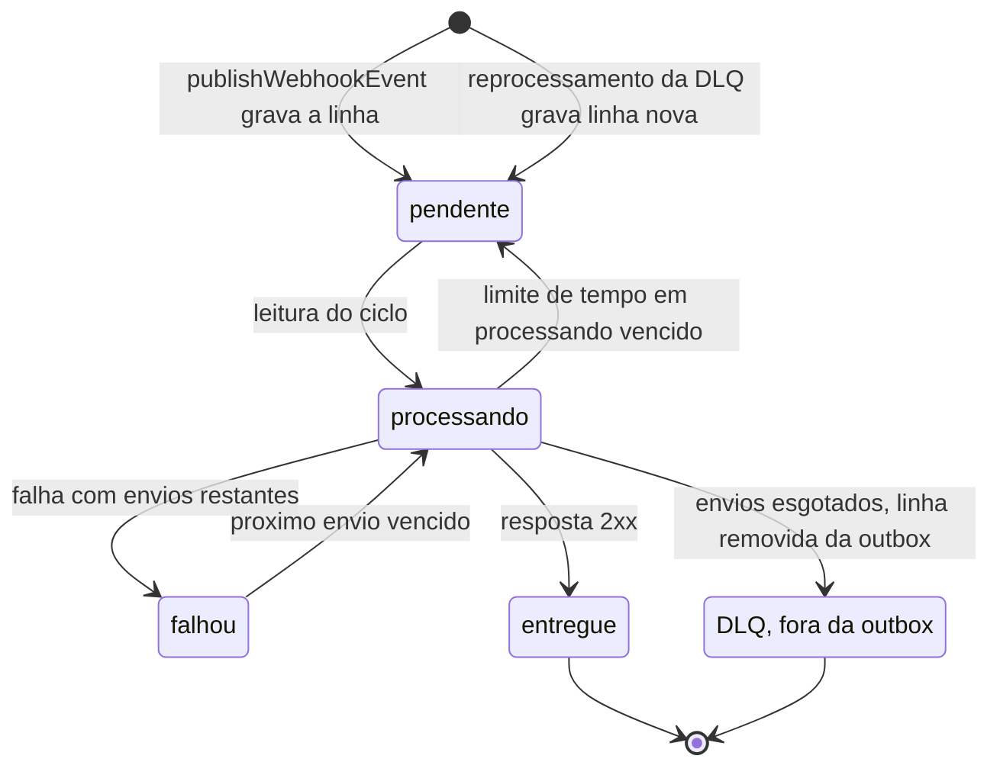
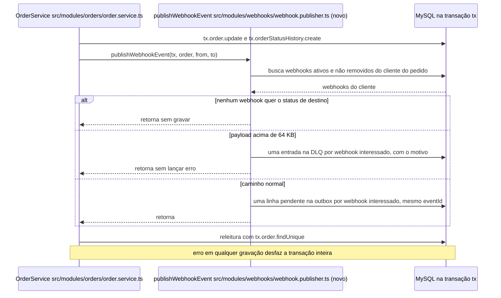
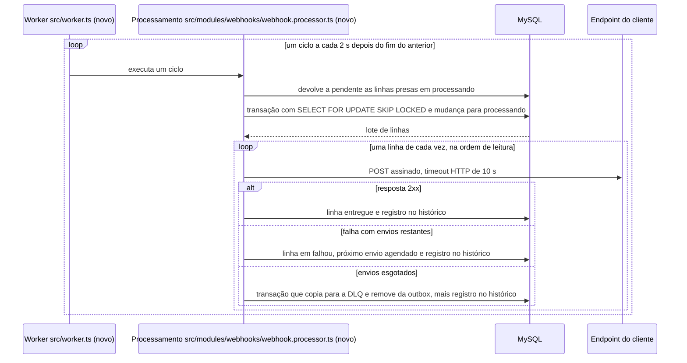
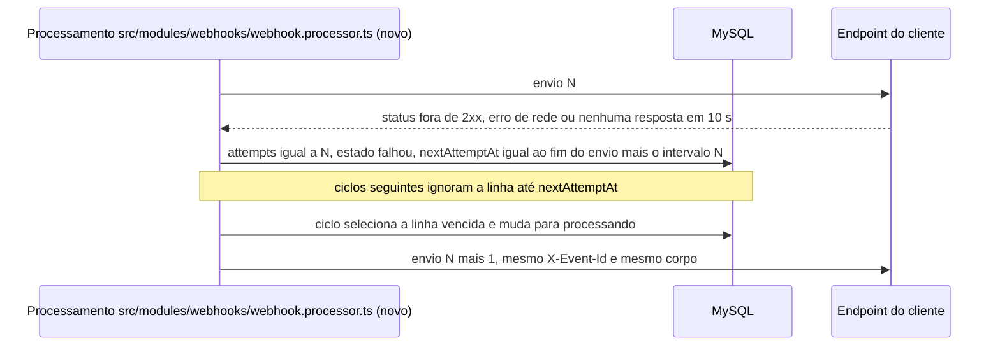
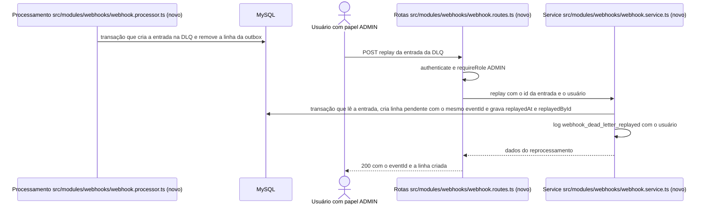

# FDD: Sistema de Webhooks de Notificação de Pedidos

| Campo | Valor |
| --- | --- |
| Versão | 0.1 (parte 1: seções 1 a 6) |
| Data | 2026-10-19 (redação; reunião técnica de quinta-feira) |
| Autoria | Documento de design aberto pela Tech Lead, Larissa, com revisão de Bruno e Diego antes de codar (`[09:50] Larissa`) |
| Status | Em revisão |
| Documentos relacionados | [PRD](PRD.md), [RFC](RFC.md), [Decisões relacionadas (ADR-001 a ADR-007)](RFC.md#decisões-relacionadas) |

Convenções: **Proposta (a validar)** marca valor que a reunião não fixou, com a fala ou o caminho que a motiva e a questão ligada; **Hipótese** marca comportamento a confirmar, com o modo de confirmar. Caminho com `(novo)` ainda não existe. **Status do pedido** é o `OrderStatus` (`prisma/schema.prisma`); **estado da outbox** é o estado técnico da linha (pendente, processando, falhou, entregue). **Evento** é uma mudança de status do pedido, **linha da outbox** é o registro que o worker lê e **envio** é cada chamada HTTP ao cliente. **DLQ** é a tabela `webhook_dead_letter`. **Timestamp do payload** é o momento da mudança e **`X-Timestamp`** é o momento do envio. **Secret do endpoint** é a chave de um webhook, sem relação com o `JWT_SECRET` (`src/config/env.ts`).

## 1. Contexto e motivação técnica

`OrderService.changeStatus` (`src/modules/orders/order.service.ts`) roda inteiro numa transação interativa do Prisma: lê o pedido, valida a transição, debita ou repõe estoque só nas transições previstas em `src/modules/orders/order.status.ts`, atualiza o pedido e grava o histórico. Avisar o cliente dentro dessa transação faria um cliente lento travar a mudança de status de outros pedidos ([ADR-001](adrs/ADR-001-outbox-transacional-no-mysql.md)). O projeto não tem fila nem processo de background: a única entry-point é `src/server.ts`, e o `docker-compose.yml` sobe só o MySQL 8.0.

Três clientes B2B pedem notificação de mudança de status do pedido abaixo de 10 s, no lugar do polling em `GET /api/v1/orders` (negócio no [PRD](PRD.md)). A arquitetura está no [RFC](RFC.md) e nas decisões ADR-001 a ADR-007 ([Decisões relacionadas](RFC.md#decisões-relacionadas)). Este documento detalha tabelas, fluxos e contratos para implementar essas decisões.

## 2. Objetivos técnicos

- **FDD-OBJ-01**: numa mudança de status feita pelo `changeStatus` com pelo menos um webhook interessado, a linha da outbox existe se, e somente se, a transação da mudança foi confirmada ([ADR-001](adrs/ADR-001-outbox-transacional-no-mysql.md)) (`[09:06] Diego`, `[09:40] Bruno`). Vale para payload de até 64 KB; acima disso, na proposta do FDD-FLUXO-02, o evento confirmado vai para a DLQ em vez da outbox (questão 2 do [ADR-007](adrs/ADR-007-payload-snapshot-e-filtro-na-insercao.md)).
- **FDD-OBJ-02**: no caminho feliz (fila sem linhas à frente e cliente respondendo), o primeiro envio acontece até 2 s depois da gravação da linha, atraso causado pelo intervalo de polling ([ADR-002](adrs/ADR-002-worker-separado-com-polling.md)) (`[09:10] Larissa`). Esse atraso serve à meta de notificação abaixo de 10 s (`[09:02] Marcos`), cujo alcance (só o primeiro envio ou todo evento) está em aberto na [RFC-QA-07](RFC.md#questões-em-aberto).
- **FDD-OBJ-03**: envio que falha, inclusive por timeout HTTP de 10 s (`[09:42] Diego`), é repetido com backoff nos intervalos 1 min, 5 min, 30 min, 2 h e 12 h até o teto de "5 tentativas", e o evento vai para a DLQ quando os envios se esgotam ([ADR-003](adrs/ADR-003-retry-com-backoff-e-dlq.md)) (`[09:17] Larissa`). A contagem está em aberto ([RFC-QA-08](RFC.md#questões-em-aberto)); só na proposta do FDD-FLUXO-04 (6 envios) os cinco intervalos são usados. O timeout HTTP de 10 s não tem relação com a meta de notificação de 10 s do FDD-OBJ-02.
- **FDD-OBJ-04**: todo envio leva no `X-Signature` o HMAC-SHA256 do corpo com a secret do endpoint, verificável pelo cliente ([ADR-004](adrs/ADR-004-assinatura-hmac-sha256-por-endpoint.md)) (`[09:22] Sofia`).
- **FDD-OBJ-05**: todos os envios de uma linha da outbox levam o mesmo identificador do evento em `X-Event-Id` e em `event_id`, gerado na inserção ([ADR-005](adrs/ADR-005-entrega-at-least-once-com-x-event-id.md)) (`[09:25] Diego`).
- **FDD-OBJ-06**: a feature usa só o MySQL e a stack existentes e reaproveita módulo, erros, validação Zod, autenticação e Pino, sem dependência nova para essas funções ([ADR-006](adrs/ADR-006-reuso-dos-padroes-do-projeto.md)) (`[09:30] Larissa`, `[09:36] Larissa`, `[09:07] Diego`).

## 3. Escopo e exclusões

### Incluído

- **FDD-ESC-01**: gravação do evento na outbox dentro da transação do `changeStatus`, por `publishWebhookEvent` ([ADR-001](adrs/ADR-001-outbox-transacional-no-mysql.md)) (`[09:40] Bruno`, `[09:41] Bruno`).
- **FDD-ESC-02**: worker em processo próprio, com entry-point `src/worker.ts` (novo) e script `npm run worker` ([ADR-002](adrs/ADR-002-worker-separado-com-polling.md)) (`[09:11] Larissa`).
- **FDD-ESC-03**: retry com backoff, DLQ em tabela separada e reprocessamento manual por ADMIN com registro de quem fez ([ADR-003](adrs/ADR-003-retry-com-backoff-e-dlq.md)) (`[09:17] Larissa`, `[09:36] Larissa`, `[09:36] Sofia`).
- **FDD-ESC-04**: assinatura HMAC-SHA256 com secret por endpoint gerada pela plataforma e rotação com 24 h de convivência ([ADR-004](adrs/ADR-004-assinatura-hmac-sha256-por-endpoint.md)) (`[09:22] Sofia`, `[09:31] Marcos`).
- **FDD-ESC-05**: API de configuração com cadastro, listagem por cliente, edição e remoção (`[09:31] Marcos`, `[09:33] Bruno`), e consulta do histórico de entregas (`[09:34] Marcos`).
- **FDD-ESC-06**: módulo `src/modules/webhooks/` (novo) na estrutura dos módulos existentes ([ADR-006](adrs/ADR-006-reuso-dos-padroes-do-projeto.md)) (`[09:27] Bruno`).

### Excluído

- **FDD-ESC-07**: webhooks de entrada; os clientes só recebem (`[09:02] Marcos`).
- **FDD-ESC-08**: aviso por e-mail ao cliente sobre falhas do webhook, deixado para uma fase futura (`[09:37] Larissa`). Não é um caminho de entrega do evento.
- **FDD-ESC-09**: painel visual para o cliente, projeto separado do time de frontend (`[09:40] Larissa`).
- **FDD-ESC-10**: rate limiting de envios por cliente, em observação ([RFC-QA-02](RFC.md#questões-em-aberto)) (`[09:39] Larissa`).
- **FDD-ESC-11**: arquivamento das linhas entregues da outbox, sem prazo definido (`[09:08] Diego`).
- **FDD-ESC-12**: mais de um worker rodando ao mesmo tempo, com particionamento por pedido ou lock pessimista ([RFC-QA-03](RFC.md#questões-em-aberto)) (`[09:13] Diego`).
- **FDD-ESC-13**: permissões mais restritas no CRUD de configuração ([RFC-QA-04](RFC.md#questões-em-aberto)) (`[09:37] Sofia`).
- **FDD-ESC-14**: **Proposta (a validar):** a criação do pedido não gera evento nesta fase; só o `changeStatus` publica, único ponto de integração citado (`[09:40] Bruno`). Questão 1 do [ADR-001](adrs/ADR-001-outbox-transacional-no-mysql.md). Se a resposta for "sim", `OrderService.create` ganha uma segunda chamada a `publishWebhookEvent` com `from_status` nulo, e a assinatura e a pré-condição do FDD-CONTRATO-09 passam a aceitar `fromStatus` nulo.
- **FDD-ESC-15**: **Proposta (a validar):** mudanças de status do pedido feitas fora do `changeStatus`, como o seed (`prisma/seed.ts`, que grava pedidos e histórico direto no banco) ou SQL manual, não geram evento, e a regra fica documentada para quem opera o banco; o `changeStatus` é o único ponto de integração citado (`[09:40] Bruno`). Questão 2 do [ADR-001](adrs/ADR-001-outbox-transacional-no-mysql.md). Se a questão escolher a checagem periódica, entra um job novo de comparação entre histórico e outbox; a trigger mudaria o FDD-FLUXO-01.

## 4. Modelo de dados

O schema atual (`prisma/schema.prisma`) usa `id String @id @default(uuid()) @db.Char(36)` nas entidades de domínio (a exceção é `OrderNumberSequence`, com id `Int`), modelos em PascalCase com `@@map` para tabela em snake_case, colunas em camelCase, índices simples com `@@index` e `createdAt`/`updatedAt`. O id UUID está decidido para a outbox (`[09:51] Larissa`); nas outras três tabelas é **Proposta (a validar)** pelo mesmo padrão (`prisma/schema.prisma`). Id auto incremental foi considerado e descartado por fugir do padrão UUID (`[09:51] Larissa`). **Proposta (a validar):** nomes de modelos, tabelas e colunas não ditos na reunião seguem o schema atual, com colunas em camelCase; o snake_case fica só no payload entregue ao cliente (`[09:43] Diego`). Lacuna, sem questão aberta no RFC.

### FDD-DADOS-01: Configuração do webhook (`webhook_endpoints`)

Guarda url, secret, cliente e estado ativo de cada endpoint (`[09:21] Bruno`, confirmado em `[09:21] Sofia`). **Proposta (a validar):** modelo `WebhookEndpoint` na tabela `webhook_endpoints`, nome não dito na reunião (`prisma/schema.prisma` como padrão).

| Coluna | Tipo Prisma | Regra | Origem |
| --- | --- | --- | --- |
| `id` | `String @id @default(uuid()) @db.Char(36)` | **Proposta (a validar):** UUID como as entidades de domínio | `prisma/schema.prisma` |
| `customerId` | `String @db.Char(36)` | cliente dono do webhook; **Proposta (a validar):** relação com `Customer` e `@@index([customerId])` para o filtro na inserção ([ADR-007-CONS-11](adrs/ADR-007-payload-snapshot-e-filtro-na-insercao.md)) | `[09:21] Bruno` |
| `url` | `String @db.Text` | só `https` (validação na seção 6.1) | `[09:21] Bruno`, `[09:23] Sofia` |
| `secret` | `String @db.Text` | secret do endpoint gerada pela plataforma; o formato de armazenamento (em claro ou cifrado) depende da questão 4 do [ADR-004](adrs/ADR-004-assinatura-hmac-sha256-por-endpoint.md); a coluna existe nos dois casos | `[09:21] Sofia`, `[09:31] Marcos` |
| `previousSecret` | `String? @db.Text` | **Proposta (a validar):** secret anterior, válida até `previousSecretExpiresAt` | `[09:21] Sofia` |
| `previousSecretExpiresAt` | `DateTime?` | **Proposta (a validar):** momento da rotação mais 24 h | `[09:21] Sofia` |
| `statuses` | `Json` | **Proposta (a validar):** lista de valores de `OrderStatus` que o webhook quer ouvir, em coluna `Json` como `Customer.address` | `[09:33] Marcos`, `prisma/schema.prisma` |
| `active` | `Boolean @default(true)` | estado ativo; **Proposta (a validar):** webhook com `active` falso não conta no filtro (questão 3 do [ADR-007](adrs/ADR-007-payload-snapshot-e-filtro-na-insercao.md)) | `[09:21] Bruno` |
| `deletedAt` | `DateTime?` | **Proposta (a validar):** remoção lógica pelo `DELETE`; webhook removido sai do filtro e da listagem, e URL e secret ficam para as linhas já gravadas (questão 3 do [ADR-007](adrs/ADR-007-payload-snapshot-e-filtro-na-insercao.md)) | `[09:33] Bruno` |
| `createdAt`, `updatedAt` | `DateTime @default(now())`, `DateTime @updatedAt` | **Proposta (a validar):** como os modelos atuais | `prisma/schema.prisma` |

### FDD-DADOS-02: Outbox (`webhook_outbox`)

Tabela da outbox no MySQL ([ADR-001](adrs/ADR-001-outbox-transacional-no-mysql.md)), com índice em status e em criação (`[09:08] Diego`) e payload em snapshot ([ADR-007](adrs/ADR-007-payload-snapshot-e-filtro-na-insercao.md)) (`[09:52] Bruno`). **Proposta (a validar):** uma linha por webhook de destino, todas com o mesmo `eventId`, com unicidade em (`eventId`, `webhookId`) (`[09:34] Bruno`, `[09:44] Sofia`; questão 2 do [ADR-005](adrs/ADR-005-entrega-at-least-once-com-x-event-id.md)). Com uma linha por evento, `webhookId` sairia da linha e o retry de um destino repetiria os outros.

| Coluna | Tipo Prisma | Regra | Origem |
| --- | --- | --- | --- |
| `id` | `String @id @default(uuid()) @db.Char(36)` | UUID, padrão do projeto | `[09:51] Larissa` |
| `eventId` | `String @db.Char(36)` | UUID gerado quando o evento entra na outbox, igual em `X-Event-Id` e `event_id` ([ADR-005](adrs/ADR-005-entrega-at-least-once-com-x-event-id.md)) | `[09:25] Diego` |
| `webhookId` | `String @db.Char(36)` | **Proposta (a validar):** webhook de destino, relação com `WebhookEndpoint`; `@@unique([eventId, webhookId])` | `[09:34] Bruno` |
| `orderId` | `String @db.Char(36)` | **Proposta (a validar):** pedido do evento, com `@@index([orderId])`, para a opção de segurar linhas por pedido continuar possível (questão 1 do [ADR-002](adrs/ADR-002-worker-separado-com-polling.md)) | `[09:12] Diego` |
| `payload` | `Json` | snapshot montado na inserção (seção 6.2) | `[09:52] Bruno` |
| `status` | `WebhookOutboxStatus @default(PENDING)` | estado da outbox (FDD-DADOS-05); `@@index([status])` | `[09:08] Diego` |
| `attempts` | `Int @default(0)` | **Proposta (a validar):** envios feitos, gravados na linha para sobreviver a reinício ([ADR-003-CONS-16](adrs/ADR-003-retry-com-backoff-e-dlq.md)) | `[09:17] Larissa` |
| `nextAttemptAt` | `DateTime @default(now())` | **Proposta (a validar):** momento a partir do qual a linha pode ser enviada ([ADR-003-CONS-16](adrs/ADR-003-retry-com-backoff-e-dlq.md)) | `[09:17] Larissa` |
| `processingStartedAt` | `DateTime?` | **Proposta (a validar):** momento de entrada em processando, usado para devolver linha presa (questão 7 do [ADR-002](adrs/ADR-002-worker-separado-com-polling.md)) | `src/server.ts` |
| `lastError` | `String? @db.Text` | **Proposta (a validar):** motivo do último envio que falhou, copiado para a DLQ | `[09:18] Diego` |
| `createdAt` | `DateTime @default(now())` | ordem de leitura do worker; `@@index([createdAt])` | `[09:08] Diego` |
| `updatedAt` | `DateTime @updatedAt` | **Proposta (a validar):** como os modelos atuais | `prisma/schema.prisma` |

Nota técnica: guardar só o id do pedido e montar o payload no envio foi descartado, porque o evento deixaria de refletir o estado de quando o status mudou (`[09:52] Larissa`).

### FDD-DADOS-03: Histórico de entregas (`webhook_deliveries`)

O cliente consulta os últimos 100 envios com sucesso ou falha, payload, response e tempo de resposta (`[09:34] Marcos`). Onde e por quanto tempo guardar não foi discutido. **Proposta (a validar):** tabela `webhook_deliveries`, uma linha por envio, sem política de retenção (risco na seção 13); lacuna, sem questão aberta no RFC.

| Coluna | Tipo Prisma | Regra | Origem |
| --- | --- | --- | --- |
| `id` | `String @id @default(uuid()) @db.Char(36)` | **Proposta (a validar):** UUID | `prisma/schema.prisma` |
| `webhookId` | `String @db.Char(36)` | **Proposta (a validar):** relação com `WebhookEndpoint`; `@@index([webhookId])` | `[09:34] Marcos` |
| `eventId` | `String @db.Char(36)` | **Proposta (a validar):** liga o envio ao `X-Event-Id` | `[09:25] Diego` |
| `attempt` | `Int` | **Proposta (a validar):** número do envio dentro da linha (1 para o envio inicial) | `[09:17] Larissa` |
| `payload` | `Json` | cópia do payload enviado | `[09:34] Marcos` |
| `responseStatus` | `Int?` | status HTTP da resposta; nulo em erro de rede ou timeout | `[09:34] Marcos` |
| `responseBody` | `String? @db.Text` | **Proposta (a validar):** corpo da resposta truncado em 4 KB | `[09:34] Marcos` |
| `durationMs` | `Int` | tempo de resposta em ms | `[09:34] Marcos` |
| `success` | `Boolean` | sucesso ou falha, pelo critério da seção 5.3 | `[09:34] Marcos` |
| `errorMessage` | `String? @db.Text` | **Proposta (a validar):** erro de rede ou timeout, quando não há resposta | `[09:42] Diego` |
| `createdAt` | `DateTime @default(now())` | momento do envio; `@@index([createdAt])` (**Proposta (a validar):**) | `prisma/schema.prisma` |

### FDD-DADOS-04: DLQ (`webhook_dead_letter`)

Tabela separada da outbox que guarda payload, motivo da falha e timestamp ([ADR-003](adrs/ADR-003-retry-com-backoff-e-dlq.md)) (`[09:18] Diego`).

| Coluna | Tipo Prisma | Regra | Origem |
| --- | --- | --- | --- |
| `id` | `String @id @default(uuid()) @db.Char(36)` | **Proposta (a validar):** UUID pelo padrão | `prisma/schema.prisma` |
| `eventId` | `String @db.Char(36)` | **Proposta (a validar):** identificador original, reaproveitado no reprocessamento ([RFC-QA-11](RFC.md#questões-em-aberto)) | `[09:18] Diego` |
| `webhookId` | `String @db.Char(36)` | **Proposta (a validar):** webhook de destino; `@@index([webhookId])` | `[09:34] Bruno` |
| `orderId` | `String @db.Char(36)` | **Proposta (a validar):** pedido do evento | `[09:12] Diego` |
| `payload` | `Json` | snapshot copiado da outbox | `[09:18] Diego` |
| `reason` | `String @db.Text` | motivo da falha: último status HTTP ou erro, ou tamanho acima de 64 KB (FDD-FLUXO-02) | `[09:18] Diego` |
| `attempts` | `Int` | **Proposta (a validar):** envios feitos; zero no caso de payload acima de 64 KB | `[09:24] Larissa` |
| `createdAt` | `DateTime @default(now())` | timestamp de entrada na DLQ; `@@index([createdAt])` (**Proposta (a validar):**) | `[09:18] Diego` |
| `replayedAt` | `DateTime?` | **Proposta (a validar):** quando foi reprocessado | `[09:36] Sofia` |
| `replayedById` | `String? @db.Char(36)` | **Proposta (a validar):** usuário que reprocessou, sem relação Prisma com `User` para não mexer no modelo existente | `[09:36] Sofia` |

### FDD-DADOS-05: Estados da outbox

**Proposta (a validar):** enum Prisma `WebhookOutboxStatus` com os quatro estados citados (`[09:08] Diego`) e o significado de falhou definido abaixo (questão 3 do [ADR-003](adrs/ADR-003-retry-com-backoff-e-dlq.md)). No texto, o estado aparece sempre em português, como "estado da outbox". `PENDING` e `PROCESSING` deste enum não têm relação com os valores de mesmo nome do `OrderStatus` (`prisma/schema.prisma`).

| Estado da outbox | Valor do enum | Significado | Origem |
| --- | --- | --- | --- |
| pendente | `PENDING` | linha que aguarda envio sem falha registrada: gravada por `publishWebhookEvent`, gravada pelo reprocessamento da DLQ ou devolvida pelo limite de tempo em processando (nesse caso, `attempts` pode ser maior que zero) | `[09:08] Diego` |
| processando | `PROCESSING` | linha lida por um ciclo, com `processingStartedAt` gravado | `[09:08] Diego` |
| falhou | `FAILED` | **Proposta (a validar):** o último envio falhou e a linha aguarda o próximo em `nextAttemptAt`; não é a DLQ | `[09:08] Diego`, `[09:18] Diego` |
| entregue | `DELIVERED` | o cliente respondeu 2xx; estado final | `[09:08] Diego` |

Esgotados os envios, a linha é copiada para a DLQ e removida da outbox na mesma transação (**Proposta (a validar):**, questão 3 do [ADR-003](adrs/ADR-003-retry-com-backoff-e-dlq.md)) (`[09:18] Diego`).



### FDD-DADOS-06: Sketch Prisma

**Proposta (a validar):** trecho novo do schema com os quatro modelos e o enum, relações com `Customer` e entre as tabelas novas (`prisma/schema.prisma` como padrão). A relação com `Customer` exige o campo de relação `webhookEndpoints WebhookEndpoint[]` no modelo `Customer`, sem coluna nova na tabela `customers`.

```prisma
// prisma/schema.prisma (novo trecho)

enum WebhookOutboxStatus {
  PENDING    // pendente
  PROCESSING // processando
  FAILED     // falhou
  DELIVERED  // entregue
}

model WebhookEndpoint {
  id                      String    @id @default(uuid()) @db.Char(36)
  customerId              String    @db.Char(36)
  url                     String    @db.Text
  secret                  String    @db.Text
  previousSecret          String?   @db.Text
  previousSecretExpiresAt DateTime?
  statuses                Json
  active                  Boolean   @default(true)
  deletedAt               DateTime?
  createdAt               DateTime  @default(now())
  updatedAt               DateTime  @updatedAt

  customer    Customer            @relation(fields: [customerId], references: [id])
  outbox      WebhookOutbox[]
  deliveries  WebhookDelivery[]
  deadLetters WebhookDeadLetter[]

  @@index([customerId])
  @@map("webhook_endpoints")
}

model WebhookOutbox {
  id                  String              @id @default(uuid()) @db.Char(36)
  eventId             String              @db.Char(36)
  webhookId           String              @db.Char(36)
  orderId             String              @db.Char(36)
  payload             Json
  status              WebhookOutboxStatus @default(PENDING)
  attempts            Int                 @default(0)
  nextAttemptAt       DateTime            @default(now())
  processingStartedAt DateTime?
  lastError           String?             @db.Text
  createdAt           DateTime            @default(now())
  updatedAt           DateTime            @updatedAt

  webhook WebhookEndpoint @relation(fields: [webhookId], references: [id])

  @@unique([eventId, webhookId])
  @@index([status])
  @@index([createdAt])
  @@index([orderId])
  @@map("webhook_outbox")
}

model WebhookDelivery {
  id             String   @id @default(uuid()) @db.Char(36)
  webhookId      String   @db.Char(36)
  eventId        String   @db.Char(36)
  attempt        Int
  payload        Json
  responseStatus Int?
  responseBody   String?  @db.Text
  durationMs     Int
  success        Boolean
  errorMessage   String?  @db.Text
  createdAt      DateTime @default(now())

  webhook WebhookEndpoint @relation(fields: [webhookId], references: [id])

  @@index([webhookId])
  @@index([createdAt])
  @@map("webhook_deliveries")
}

model WebhookDeadLetter {
  id           String    @id @default(uuid()) @db.Char(36)
  eventId      String    @db.Char(36)
  webhookId    String    @db.Char(36)
  orderId      String    @db.Char(36)
  payload      Json
  reason       String    @db.Text
  attempts     Int
  createdAt    DateTime  @default(now())
  replayedAt   DateTime?
  replayedById String?   @db.Char(36)

  webhook WebhookEndpoint @relation(fields: [webhookId], references: [id])

  @@index([webhookId])
  @@index([createdAt])
  @@map("webhook_dead_letter")
}

// model Customer (existente) ganha só o campo de relação:
//   webhookEndpoints WebhookEndpoint[]
```

As tabelas entram numa migração nova em `prisma/migrations/`, com nome gerado pelo Prisma (`npm run db:migrate`, `package.json`), sem alterar as tabelas existentes nem a migração inicial.

## 5. Fluxos detalhados

### 5.1 Criação do evento na outbox

**FDD-FLUXO-01**: gravação do evento dentro da transação do `changeStatus` ([ADR-001](adrs/ADR-001-outbox-transacional-no-mysql.md), [ADR-007](adrs/ADR-007-payload-snapshot-e-filtro-na-insercao.md)) (`[09:40] Bruno`).

1. `OrderService.changeStatus` (`src/modules/orders/order.service.ts`) valida a transição, mexe no estoque quando a transição pede, executa `tx.order.update` e `tx.orderStatusHistory.create`.
2. **Proposta (a validar):** logo depois de `tx.orderStatusHistory.create` e antes da releitura `tx.order.findUnique`, ainda no callback de `$transaction`, chama `publishWebhookEvent(tx, order, from, to)` (`[09:41] Bruno`; ponto escolhido em `src/modules/orders/order.service.ts`; lacuna, sem questão aberta no RFC). O `order` é o lido no início da transação, com `id`, `orderNumber`, `customerId` e `totalCents`.
3. `publishWebhookEvent` lê, com o `tx`, os webhooks do cliente do pedido (`customerId`) com `active` verdadeiro e `deletedAt` nulo (**Proposta (a validar):**, questão 3 do [ADR-007](adrs/ADR-007-payload-snapshot-e-filtro-na-insercao.md)) (`[09:21] Sofia`).
4. Filtra os webhooks cuja lista `statuses` contém o status do pedido de destino (`to`). Sem nenhum, retorna sem gravar (`[09:34] Bruno`). Nota técnica: filtrar na hora do envio foi descartado, porque grava linhas que ninguém vai receber (`[09:34] Bruno`).
5. Monta o payload uma vez (snapshot, seção 6.2) (`[09:52] Bruno`). O `event_id` é gerado com `v4` do pacote `uuid`, já declarado no `package.json` e usado em `src/middlewares/request-logger.middleware.ts` ([ADR-005](adrs/ADR-005-entrega-at-least-once-com-x-event-id.md)) (`[09:25] Diego`). **Proposta (a validar):** o `timestamp` do payload é o momento da gravação, em ISO 8601 UTC com milissegundos, para o cliente conseguir ordenar mudanças próximas ([RFC-QA-05](RFC.md#questões-em-aberto)) (`[09:43] Diego`).
6. Mede o tamanho do JSON serializado em bytes. Acima de 64 KB, segue o FDD-FLUXO-02.
7. **Proposta (a validar):** grava com `tx.webhookOutbox.createMany` uma linha por webhook interessado, todas com o mesmo `eventId`, estado da outbox pendente, `attempts` zero e `nextAttemptAt` igual ao momento da gravação (questão 2 do [ADR-005](adrs/ADR-005-entrega-at-least-once-com-x-event-id.md)) (`[09:34] Bruno`).
8. Erro em qualquer gravação propaga, e a transação inteira é desfeita: o status do pedido não muda (`[09:40] Bruno`). **Hipótese:** o Prisma 5.22.0 desfaz tudo o que o `tx` gravou quando o callback lança erro ([ADR-001-CONS-05](adrs/ADR-001-outbox-transacional-no-mysql.md)). Confirmar com um teste de integração no padrão de `tests/orders.test.ts` que força falha na gravação da outbox após `PATCH /api/v1/orders/:id/status` e confere a ausência da linha e o status do pedido antigo.

**FDD-FLUXO-02**: evento acima de 64 KB. O limite é de 64 KB, com erro caso ultrapasse (`[09:24] Larissa`). **Proposta (a validar):** a checagem fica em `publishWebhookEvent`, pelo tamanho em bytes do JSON serializado (64 × 1024 bytes); acima disso, grava uma entrada na DLQ por webhook interessado, com o motivo, `attempts` zero e o mesmo `eventId`, e não lança erro, para não desfazer a mudança de status do pedido (questão 2 do [ADR-007](adrs/ADR-007-payload-snapshot-e-filtro-na-insercao.md), [RFC-RISCO-06](RFC.md#riscos)). Esse evento fica fora do at-least-once ([ADR-005-CONS-12](adrs/ADR-005-entrega-at-least-once-com-x-event-id.md)). Se a questão escolher erro na inserção, o passo lança exceção e a mudança de status é desfeita. Nota técnica: truncar o payload foi descartado, porque payload desse tamanho indica erro (`[09:23] Sofia`).



### 5.2 Processamento pelo worker

**FDD-FLUXO-03**: ciclo do worker em processo separado da API, com polling de 2 s e worker único como premissa ([ADR-002](adrs/ADR-002-worker-separado-com-polling.md)) (`[09:10] Larissa`, `[09:11] Diego`).

1. A entry-point `src/worker.ts` (novo) segue o modelo de `src/server.ts`: `bootstrap`, logs de início e falha e tratamento de `SIGINT` e `SIGTERM` (`[09:11] Larissa`). O script é `npm run worker` (`[09:11] Larissa`). **Proposta (a validar):** `node --env-file=.env dist/worker.js`, compilado pelo mesmo `npm run build`, como o script `start` (`package.json`).
2. O worker usa a própria instância de `PrismaClient`, com a mesma `DATABASE_URL` (`[09:30] Bruno`): a instância `prisma` exportada por `src/config/database.ts`, criada por `createPrismaClient` quando o módulo é carregado, já é própria do processo do worker. **Proposta (a validar):** o worker importa esse `prisma` em vez de chamar `createPrismaClient` de novo, para não abrir uma segunda instância e um segundo pool no mesmo processo. Nota técnica: usar a mesma instância da API é impossível, porque o `PrismaClient` existe por processo (`[09:30] Bruno`). Importar `src/config/env.ts` exige as mesmas variáveis da API, inclusive `JWT_SECRET`.
3. **Proposta (a validar):** ciclos sem sobreposição; o próximo começa 2 s depois do fim do anterior (`[09:10] Larissa`; lacuna, sem questão aberta no RFC).
4. **Proposta (a validar):** no início do ciclo, linhas em processando com `processingStartedAt` mais antigo que 5 min voltam a pendente, sem contar envio, porque o resultado do envio é desconhecido; a duplicata possível é tolerada pelo [ADR-005](adrs/ADR-005-entrega-at-least-once-com-x-event-id.md) (questão 7 do [ADR-002](adrs/ADR-002-worker-separado-com-polling.md)) (`src/server.ts`, que encerra sem esperar o trabalho em andamento).
5. **Proposta (a validar):** em uma transação curta, seleciona até 10 linhas elegíveis (estado pendente ou falhou, `nextAttemptAt` vencido), da mais antiga para a mais nova por `createdAt` (`[09:12] Diego`), com `SELECT ... FOR UPDATE SKIP LOCKED` do MySQL 8.0, e muda essas linhas para processando, gravando `processingStartedAt` (questão 4 do [ADR-002](adrs/ADR-002-worker-separado-com-polling.md); tamanho do lote: "batch pequeno", `[09:08] Diego`, lacuna sem questão aberta no RFC). O tamanho do lote é parâmetro configurável. A API do Prisma Client 5.22.0 não tem opção de leitura com trava, mas o cliente da transação mantém `$queryRaw`, porque a lista de métodos negados nele é só `$connect`, `$disconnect`, `$on`, `$transaction`, `$use` e `$extends` (pacote `@prisma/client` 5.22.0, `runtime/library.d.ts`, https://registry.npmjs.org/@prisma/client/-/client-5.22.0.tgz). Por isso a seleção vai por `tx.$queryRaw` e a mudança de estado por `tx.webhookOutbox.updateMany`. O envio HTTP acontece fora dessa transação.
6. Lê, para as linhas do lote, o webhook de destino (URL e secrets), inclusive se estiver desativado ou removido depois da gravação: a linha é entregue mesmo assim (**Proposta (a validar):**, questão 3 do [ADR-007](adrs/ADR-007-payload-snapshot-e-filtro-na-insercao.md)) (`[09:33] Bruno`).
7. **Proposta (a validar):** envia uma linha de cada vez, na ordem de leitura ([RFC-QA-06](RFC.md#questões-em-aberto)) (`[09:42] Diego`). Com esse modo, um endpoint que não responde segura o ciclo por até 10 s por linha ([ADR-002-CONS-11](adrs/ADR-002-worker-separado-com-polling.md)).
8. Cada envio serializa o payload uma vez, assina o corpo (seção 5.5) e chama `fetch` com `signal: AbortSignal.timeout(10_000)`, timeout HTTP de 10 s (`[09:42] Diego`). O `fetch` global existe no Node 20 sem flag desde a v18 (marcado como experimental na documentação da v20) e `AbortSignal.timeout` existe desde a v17.3.0 (Node.js v20, "Global objects", https://nodejs.org/docs/latest-v20.x/api/globals.html), sem dependência nova.
9. Grava o resultado e uma linha em `webhook_deliveries`, na mesma transação (**Proposta (a validar):**): resposta 2xx deixa a linha entregue; falha com envios restantes deixa a linha em falhou com `nextAttemptAt` da seção 5.3; envios esgotados seguem o FDD-FLUXO-05. Em todos os casos `attempts` aumenta 1 e `processingStartedAt` volta a nulo.
10. **Proposta (a validar):** ao receber `SIGINT` ou `SIGTERM`, o worker não inicia novo ciclo, espera o ciclo em andamento terminar e só então chama `$disconnect` e encerra (questão 8 do [ADR-002](adrs/ADR-002-worker-separado-com-polling.md)) (`src/server.ts`).

Com retry, reprocessamento ou linha devolvida, eventos do mesmo pedido podem chegar fora de ordem. **Proposta (a validar):** o worker não segura as linhas seguintes de um pedido; o cliente ordena pelo `timestamp` do payload, e o `orderId` indexado mantém possível a opção de segurar ([RFC-QA-05](RFC.md#questões-em-aberto)) (`[09:12] Diego`, `[09:43] Diego`).



### 5.3 Retry com backoff

**FDD-FLUXO-04**: reentrega com backoff exponencial nos intervalos 1 min, 5 min, 30 min, 2 h e 12 h ([ADR-003](adrs/ADR-003-retry-com-backoff-e-dlq.md)) (`[09:17] Larissa`). **Proposta (a validar):** "5 tentativas" é lido como envio inicial mais 5 retentativas, 6 envios, único modo que usa os cinco intervalos e fecha a janela de quase 15 h (`[09:17] Diego`) ([RFC-QA-08](RFC.md#questões-em-aberto)).

| Envio | Momento do próximo envio após falha |
| --- | --- |
| 1 (inicial) | fim do envio mais 1 min |
| 2 (1ª retentativa) | fim do envio mais 5 min |
| 3 (2ª retentativa) | fim do envio mais 30 min |
| 4 (3ª retentativa) | fim do envio mais 2 h |
| 5 (4ª retentativa) | fim do envio mais 12 h |
| 6 (5ª retentativa) | nenhum: a linha vai para a DLQ (FDD-FLUXO-05) |

A janela entre a primeira falha e o último envio soma 876 min, cerca de 14,6 h (1 + 5 + 30 + 120 + 720), mais a duração dos envios. Na alternativa de 5 envios no total, a falha do envio 5 leva à DLQ, o intervalo de 12 h não é usado e a janela cai para 156 min, cerca de 2,6 h ([ADR-003-CONS-05](adrs/ADR-003-retry-com-backoff-e-dlq.md)).

1. **Proposta (a validar):** o momento do próximo envio é o fim do envio que falhou mais o intervalo de número `attempts` (já contando esse envio; 1 é o intervalo de 1 min e 5 o de 12 h) na lista de intervalos, gravado em `nextAttemptAt` na linha, para sobreviver a reinício do worker ([ADR-003-CONS-16](adrs/ADR-003-retry-com-backoff-e-dlq.md)) (`[09:17] Larissa`; lacuna, sem questão aberta no RFC).
2. **Proposta (a validar):** resposta 2xx é entrega. Qualquer outro status HTTP, erro de rede ou timeout HTTP de 10 s é falha, repetida até o teto (questão 2 do [ADR-003](adrs/ADR-003-retry-com-backoff-e-dlq.md)) (`[09:42] Diego`). Se a questão mandar parte dos 4xx direto para a DLQ, o passo 2 do FDD-FLUXO-05 passa a aceitar esses códigos antes de esgotar os envios.
3. Todos os envios de uma linha reaproveitam o mesmo payload e o mesmo `X-Event-Id` ([ADR-005](adrs/ADR-005-entrega-at-least-once-com-x-event-id.md)) (`[09:25] Diego`).



### 5.4 DLQ e replay manual

**FDD-FLUXO-05**: movimento para a DLQ quando os envios se esgotam ([ADR-003](adrs/ADR-003-retry-com-backoff-e-dlq.md)) (`[09:18] Diego`).

1. O envio que esgota o teto falha (seção 5.3).
2. **Proposta (a validar):** numa transação, o worker cria a entrada em `webhook_dead_letter` com `eventId`, `webhookId`, `orderId`, `payload`, `attempts` e o motivo, e remove a linha da outbox (questão 3 do [ADR-003](adrs/ADR-003-retry-com-backoff-e-dlq.md)) (`[09:18] Diego`).
3. O motivo é o último status HTTP (ex.: `HTTP 503`) ou o erro (ex.: timeout HTTP de 10 s, erro de rede) (`[09:18] Diego`).

**FDD-FLUXO-06**: reprocessamento manual por `POST /api/v1/admin/webhooks/dead-letter/:id/replay`, que devolve o evento à outbox como pendente (`[09:18] Diego`, `[09:35] Diego`).

1. A rota exige `authenticate` e `requireRole('ADMIN')`, de `src/middlewares/auth.middleware.ts` (`[09:36] Larissa`).
2. **Proposta (a validar):** numa transação, o service lê a entrada da DLQ; recusa se ela não existe ou se `replayedAt` já está preenchido (segunda tentativa de reprocessar a mesma entrada).
3. **Proposta (a validar):** grava uma linha nova na outbox com o `eventId`, o `webhookId`, o `orderId` e o payload originais, estado da outbox pendente e `attempts` zero, e marca a entrada da DLQ com `replayedAt` e `replayedById` (`req.user.id`) ([RFC-QA-11](RFC.md#questões-em-aberto)) (`[09:18] Diego`, `[09:36] Sofia`). Com identificador novo, o passo reescreveria o `event_id` dentro do payload antes de gravar.
4. Registra em log quem reprocessou, para auditoria (`[09:36] Sofia`). **Proposta (a validar):** evento Pino `webhook_dead_letter_replayed` com `userId`, `email`, `deadLetterId` e `eventId`, pelo `logger` de `src/shared/logger/index.ts`, com o nome do evento em snake_case como `server_started` em `src/server.ts` e os campos em camelCase como `requestId` em `src/middlewares/request-logger.middleware.ts`.
5. **Proposta (a validar):** entrega o snapshot como está, mesmo que o pedido já tenha eventos mais novos entregues; o cliente ordena pelo `timestamp` do payload (questão 5 do [ADR-003](adrs/ADR-003-retry-com-backoff-e-dlq.md)) (`[09:18] Diego`).
6. **Proposta (a validar):** recusa a entrada gravada por tamanho acima de 64 KB (FDD-FLUXO-02), reconhecida por `attempts` igual a zero, único caso em que a DLQ recebe um evento sem envio, porque reenviá-la mandaria ao cliente um payload acima do limite (`[09:24] Larissa`; questão 2 do [ADR-007](adrs/ADR-007-payload-snapshot-e-filtro-na-insercao.md)).

O papel ADMIN não é controle forte, porque `POST /api/v1/auth/register` é público e aceita `role: 'ADMIN'` ([ADR-003-CONS-08](adrs/ADR-003-retry-com-backoff-e-dlq.md)).



### 5.5 Rotação de secret

**FDD-FLUXO-07**: rotação com 24 h de convivência entre a secret anterior e a nova ([ADR-004](adrs/ADR-004-assinatura-hmac-sha256-por-endpoint.md)) (`[09:21] Sofia`).

1. **Proposta (a validar):** o cliente chama `POST /api/v1/webhooks/:id/secret/rotate` (`[09:21] Sofia`; lacuna, sem questão aberta no RFC).
2. **Proposta (a validar):** o service gera a secret nova com `crypto.randomBytes(32)` em hexadecimal, 64 caracteres, do módulo nativo `crypto` do Node 20 (`package.json`, `engines.node`; lacuna, sem questão aberta no RFC).
3. Numa transação, a secret atual vai para `previousSecret`, `previousSecretExpiresAt` recebe o momento da rotação mais 24 h e a secret nova ocupa `secret` (`[09:21] Sofia`).
4. **Proposta (a validar):** uma nova rotação dentro das 24 h descarta a secret anterior mais antiga: a secret atual passa a ser a anterior, com nova expiração, e só duas secrets valem ao mesmo tempo (`[09:21] Sofia`; lacuna, sem questão aberta no RFC).
5. A resposta devolve a secret nova e o momento em que a anterior expira (seção 6.1).
6. **Proposta (a validar):** ao assinar, o worker compara `previousSecretExpiresAt` com o momento do envio. Se a anterior ainda vale, o `X-Signature` leva dois valores separados por vírgula, primeiro o da secret nova; senão, só o da secret atual. Nenhuma tarefa agendada apaga a secret expirada; ela fica sem efeito até a próxima rotação ([RFC-QA-09](RFC.md#questões-em-aberto)) (`[09:21] Sofia`, `[09:22] Sofia`). Se a questão escolher assinar só com a secret nova, o passo envia sempre um único valor.
7. **Proposta (a validar):** as secrets são lidas do cadastro no momento do envio, então uma linha gravada antes da rotação é assinada com as secrets vigentes quando é enviada (`[09:22] Sofia`).

## 6. Contratos públicos

### 6.1 API de configuração de webhooks

Regras comuns aos contratos desta seção:

- Prefixo `/api/v1` de `src/app.ts`, com as rotas montadas em `src/routes/index.ts`. **Proposta (a validar):** caminhos `POST /api/v1/webhooks`, `GET /api/v1/webhooks?customerId=`, `PATCH /api/v1/webhooks/:id` e `DELETE /api/v1/webhooks/:id`; a reunião disse só os métodos (`[09:31] Marcos`, `[09:33] Bruno`). Lacuna, sem questão aberta no RFC.
- **Proposta (a validar):** `customerId` vai no body do cadastro e na query da listagem, nunca do JWT (`[09:32] Larissa`), porque `src/routes/index.ts` monta um router por módulo e `GET /webhooks/:id/deliveries` já é rota plana (`[09:34] Marcos`) ([RFC-QA-01](RFC.md#questões-em-aberto)). Alternativa registrada: path `/api/v1/customers/:customerId/webhooks`, que tiraria `customerId` do body e da query.
- **Proposta (a validar):** campos em camelCase no request e no response, como `createOrderSchema` (`src/modules/orders/order.schemas.ts`); o snake_case fica só no payload entregue (`[09:43] Diego`). Lacuna, sem questão aberta no RFC.
- Qualquer usuário autenticado opera o CRUD nesta fase (`[09:37] Sofia`). Como `User` não tem vínculo com `Customer` (`prisma/schema.prisma`), esse usuário opera webhooks de qualquer cliente ([RFC-QA-04](RFC.md#questões-em-aberto)).
- Erros saem no formato `{ error: { code, message, details } }` de `src/middlewares/error.middleware.ts`. **Proposta (a validar):** os contratos citam códigos `WEBHOOK_*` que a matriz da seção 7 detalha, inclusive a forma de produzir cada um. `WEBHOOK_NOT_FOUND` e `WEBHOOK_INVALID_URL` foram citados na reunião (`[09:28] Bruno`); `WEBHOOK_VALIDATION_ERROR`, `WEBHOOK_CUSTOMER_NOT_FOUND`, `WEBHOOK_DEAD_LETTER_NOT_FOUND`, `WEBHOOK_DEAD_LETTER_ALREADY_REPLAYED` e `WEBHOOK_PAYLOAD_TOO_LARGE` são proposta ([RFC-QA-12](RFC.md#questões-em-aberto), questão 2 do [ADR-006](adrs/ADR-006-reuso-dos-padroes-do-projeto.md)) (`[09:29] Larissa`). Se a RFC-QA-12 limitar o prefixo aos erros de domínio, os erros de schema e de recurso não encontrado voltam a `VALIDATION_ERROR` e `NOT_FOUND`. `401` e `403` saem hoje de `src/middlewares/auth.middleware.ts` com `UNAUTHORIZED` e `FORBIDDEN`.
- **Proposta (a validar):** nenhuma resposta além do cadastro e da rotação contém a secret (questão 5 do [ADR-004](adrs/ADR-004-assinatura-hmac-sha256-por-endpoint.md)) (`[09:31] Marcos`).

#### FDD-CONTRATO-01: POST /api/v1/webhooks

**Autorização**: `authenticate`, qualquer papel (`[09:37] Sofia`). Cadastro com URL, lista de status e secret gerada pela plataforma (`[09:31] Marcos`).

Request

```http
POST /api/v1/webhooks HTTP/1.1
Authorization: Bearer <token>
Content-Type: application/json

{
  "customerId": "5b0c9a1e-2f4d-4c8b-9e7a-1d3f6b8c0a2e",
  "url": "https://erp.cliente.example/webhooks/pedidos",
  "statuses": ["SHIPPED", "DELIVERED"]
}
```

Validação (Zod, padrão de `src/modules/orders/order.schemas.ts`):

- `customerId`: `z.string().uuid()`; o cliente precisa existir (**Proposta (a validar):**, como `CustomerService.getById` em `src/modules/customers/customer.service.ts`).
- `url`: URL válida com protocolo `https`; `http` é recusado com erro de validação (`[09:23] Sofia`).
- `statuses`: **Proposta (a validar):** `z.array(z.nativeEnum(OrderStatus)).min(1)`, sem repetição, valores de `OrderStatus` (`prisma/schema.prisma`) (`[09:33] Marcos`). PENDING é aceito, mas nunca dispara, porque nenhuma transição leva a PENDING (`src/modules/orders/order.status.ts`; questão 1 do [ADR-001](adrs/ADR-001-outbox-transacional-no-mysql.md)).
- O body não aceita secret: ela é gerada pela plataforma (`[09:31] Marcos`).

Response

```json
{
  "id": "8e2f4a6c-1b3d-4e5f-9a7b-2c4d6e8f0a1b",
  "customerId": "5b0c9a1e-2f4d-4c8b-9e7a-1d3f6b8c0a2e",
  "url": "https://erp.cliente.example/webhooks/pedidos",
  "statuses": ["SHIPPED", "DELIVERED"],
  "active": true,
  "previousSecretExpiresAt": null,
  "secret": "4a7d1ed414474e4033ac29ccb8653d9b4a7d1ed414474e4033ac29ccb8653d9b",
  "createdAt": "2026-10-19T12:00:00.000Z",
  "updatedAt": "2026-10-19T12:00:00.000Z"
}
```

Status:

- `201`: webhook criado, com a secret no corpo (como `create` em `src/modules/orders/order.controller.ts`).
- `400`: `WEBHOOK_INVALID_URL` para URL sem `https` (`[09:28] Bruno`); `WEBHOOK_VALIDATION_ERROR` para os demais erros de schema (**Proposta (a validar):**, [RFC-QA-12](RFC.md#questões-em-aberto)).
- `401`: `UNAUTHORIZED`, sem token ou token inválido.
- `404`: `WEBHOOK_CUSTOMER_NOT_FOUND`, `customerId` inexistente (**Proposta (a validar):**, [RFC-QA-12](RFC.md#questões-em-aberto)).

Semântica: grava uma linha em `webhook_endpoints` com `active` verdadeiro e a secret gerada (seção 5.5, passo 2). É a única resposta, além da rotação, que contém a secret.

#### FDD-CONTRATO-02: GET /api/v1/webhooks

**Autorização**: `authenticate`, qualquer papel (`[09:37] Sofia`). Lista os webhooks de um cliente (`[09:33] Bruno`).

Request

```http
GET /api/v1/webhooks?customerId=5b0c9a1e-2f4d-4c8b-9e7a-1d3f6b8c0a2e&page=1&pageSize=20 HTTP/1.1
Authorization: Bearer <token>
```

Validação: `customerId` obrigatório, `z.string().uuid()`; **Proposta (a validar):** `page` com mínimo 1 e default 1, `pageSize` de 1 a 100 com default 20, como `listOrdersQuerySchema` (`src/modules/orders/order.schemas.ts`).

Response

```json
{
  "data": [
    {
      "id": "8e2f4a6c-1b3d-4e5f-9a7b-2c4d6e8f0a1b",
      "customerId": "5b0c9a1e-2f4d-4c8b-9e7a-1d3f6b8c0a2e",
      "url": "https://erp.cliente.example/webhooks/pedidos",
      "statuses": ["SHIPPED", "DELIVERED"],
      "active": true,
      "previousSecretExpiresAt": null,
      "createdAt": "2026-10-19T12:00:00.000Z",
      "updatedAt": "2026-10-19T12:00:00.000Z"
    }
  ],
  "pagination": { "page": 1, "pageSize": 20, "total": 1, "totalPages": 1 }
}
```

Status:

- `200`: lista paginada no formato `{ data, pagination }` de `src/shared/http/response.ts`, mais recentes primeiro, como `orderBy: { createdAt: 'desc' }` em `src/modules/customers/customer.repository.ts` (**Proposta (a validar):**).
- `400`: `WEBHOOK_VALIDATION_ERROR`, `customerId` ausente ou não UUID, ou paginação fora da faixa (**Proposta (a validar):**, [RFC-QA-12](RFC.md#questões-em-aberto)).
- `401`: `UNAUTHORIZED`.

Semântica: leitura sem efeito no banco; webhooks removidos (`deletedAt` preenchido) não aparecem. A resposta nunca contém `secret` nem `previousSecret`.

#### FDD-CONTRATO-03: PATCH /api/v1/webhooks/:id

**Autorização**: `authenticate`, qualquer papel (`[09:37] Sofia`). Edição do webhook (`[09:33] Bruno`).

Request

```http
PATCH /api/v1/webhooks/8e2f4a6c-1b3d-4e5f-9a7b-2c4d6e8f0a1b HTTP/1.1
Authorization: Bearer <token>
Content-Type: application/json

{
  "statuses": ["PAID", "SHIPPED", "DELIVERED"],
  "active": false
}
```

Validação:

- `id`: `z.string().uuid()`, como `orderIdParamSchema` (`src/modules/orders/order.schemas.ts`).
- **Proposta (a validar):** body parcial com `url`, `statuses` e `active`, como `updateCustomerSchema` (`src/modules/customers/customer.schemas.ts`, que é `partial()` sem exigir campo); exigir pelo menos um campo é regra nova desta proposta; `url` só `https` (`[09:23] Sofia`); `statuses` com valores de `OrderStatus`. `customerId` e secret não são editáveis.

Response

```json
{
  "id": "8e2f4a6c-1b3d-4e5f-9a7b-2c4d6e8f0a1b",
  "customerId": "5b0c9a1e-2f4d-4c8b-9e7a-1d3f6b8c0a2e",
  "url": "https://erp.cliente.example/webhooks/pedidos",
  "statuses": ["PAID", "SHIPPED", "DELIVERED"],
  "active": false,
  "previousSecretExpiresAt": null,
  "createdAt": "2026-10-19T12:00:00.000Z",
  "updatedAt": "2026-10-19T12:30:00.000Z"
}
```

Status:

- `200`: webhook atualizado.
- `400`: `WEBHOOK_INVALID_URL` para URL sem `https`; `WEBHOOK_VALIDATION_ERROR` para os demais erros de schema (**Proposta (a validar):**, [RFC-QA-12](RFC.md#questões-em-aberto)).
- `401`: `UNAUTHORIZED`.
- `404`: `WEBHOOK_NOT_FOUND`, webhook inexistente ou removido (`[09:28] Bruno`).

Semântica: atualiza a linha em `webhook_endpoints`. A nova lista de status vale só para eventos gravados depois da edição ([ADR-007-CONS-05](adrs/ADR-007-payload-snapshot-e-filtro-na-insercao.md)). A resposta nunca contém a secret.

#### FDD-CONTRATO-04: DELETE /api/v1/webhooks/:id

**Autorização**: `authenticate`, qualquer papel (`[09:37] Sofia`). Remoção do webhook (`[09:33] Bruno`).

Request

```http
DELETE /api/v1/webhooks/8e2f4a6c-1b3d-4e5f-9a7b-2c4d6e8f0a1b HTTP/1.1
Authorization: Bearer <token>
```

Validação: `id` com `z.string().uuid()`.

Response

```json
{}
```

O corpo acima é ilustrativo: a resposta `204` não tem corpo, como `delete` em `src/modules/orders/order.controller.ts`.

Status:

- `204`: webhook removido.
- `400`: `WEBHOOK_VALIDATION_ERROR`, `id` não UUID (**Proposta (a validar):**, [RFC-QA-12](RFC.md#questões-em-aberto)).
- `401`: `UNAUTHORIZED`.
- `404`: `WEBHOOK_NOT_FOUND`, webhook inexistente ou já removido (`[09:28] Bruno`).

Semântica: **Proposta (a validar):** remoção lógica, que grava `deletedAt` e tira o webhook do filtro na inserção e da listagem; linhas já gravadas na outbox continuam e são entregues com a URL e a secret do cadastro (questão 3 do [ADR-007](adrs/ADR-007-payload-snapshot-e-filtro-na-insercao.md)) (`[09:33] Bruno`).

#### FDD-CONTRATO-05: POST /api/v1/webhooks/:id/secret/rotate

**Autorização**: `authenticate`, qualquer papel (`[09:37] Sofia`). Rotação da secret pela API (`[09:21] Sofia`); **Proposta (a validar):** caminho e contrato, lacuna sem questão aberta no RFC (decisão da rotação no [ADR-004](adrs/ADR-004-assinatura-hmac-sha256-por-endpoint.md)).

Request

```http
POST /api/v1/webhooks/8e2f4a6c-1b3d-4e5f-9a7b-2c4d6e8f0a1b/secret/rotate HTTP/1.1
Authorization: Bearer <token>
```

Validação: `id` com `z.string().uuid()`; sem body.

Response

```json
{
  "id": "8e2f4a6c-1b3d-4e5f-9a7b-2c4d6e8f0a1b",
  "secret": "9c1e5f0a7b3d2c4e6f8a0b1c3d5e7f9a9c1e5f0a7b3d2c4e6f8a0b1c3d5e7f9a",
  "previousSecretExpiresAt": "2026-10-20T12:00:00.000Z"
}
```

Status:

- `200`: secret rotacionada, com a secret nova e o momento em que a anterior expira.
- `400`: `WEBHOOK_VALIDATION_ERROR`, `id` não UUID (**Proposta (a validar):**, [RFC-QA-12](RFC.md#questões-em-aberto)).
- `401`: `UNAUTHORIZED`.
- `404`: `WEBHOOK_NOT_FOUND`, webhook inexistente ou removido (`[09:28] Bruno`).

Semântica: executa a seção 5.5 (passos 2 a 4). A secret anterior não aparece na resposta; ela vale por 24 h em paralelo e depois deixa de ser usada na assinatura (`[09:21] Sofia`).

#### FDD-CONTRATO-06: GET /api/v1/webhooks/:id/deliveries

**Autorização**: `authenticate`, qualquer papel (`[09:37] Sofia`). Histórico com sucesso ou falha, payload, response e tempo de resposta dos últimos 100 envios (`[09:34] Marcos`).

Request

```http
GET /api/v1/webhooks/8e2f4a6c-1b3d-4e5f-9a7b-2c4d6e8f0a1b/deliveries HTTP/1.1
Authorization: Bearer <token>
```

Validação: `id` com `z.string().uuid()`.

Response

```json
{
  "data": [
    {
      "id": "1a3c5e7f-9b2d-4f6a-8c0e-2b4d6f8a0c1e",
      "eventId": "0f8e6d4c-2b1a-4987-a6b5-c4d3e2f1a0b9",
      "attempt": 2,
      "success": true,
      "responseStatus": 200,
      "responseBody": "{\"received\":true}",
      "durationMs": 184,
      "errorMessage": null,
      "payload": { "event_id": "0f8e6d4c-2b1a-4987-a6b5-c4d3e2f1a0b9", "event_type": "order.status_changed" },
      "createdAt": "2026-10-19T12:01:05.120Z"
    }
  ]
}
```

O `payload` acima está abreviado; a resposta traz a cópia completa da seção 6.2.

Status:

- `200`: até 100 envios do webhook.
- `400`: `WEBHOOK_VALIDATION_ERROR`, `id` não UUID (**Proposta (a validar):**, [RFC-QA-12](RFC.md#questões-em-aberto)).
- `401`: `UNAUTHORIZED`.
- `404`: `WEBHOOK_NOT_FOUND`, webhook inexistente ou removido (`[09:28] Bruno`).

Semântica: **Proposta (a validar):** lê `webhook_deliveries` e devolve os últimos 100 envios do webhook, do mais recente para o mais antigo, sem paginação, com `responseBody` truncado em 4 KB (FDD-DADOS-03). Sem efeito no banco; a resposta nunca contém a secret nem os headers enviados.

#### FDD-CONTRATO-07: POST /api/v1/admin/webhooks/dead-letter/:id/replay

**Autorização**: `authenticate` e `requireRole('ADMIN')` (`src/middlewares/auth.middleware.ts`) (`[09:36] Larissa`), com log de quem reprocessou (`[09:36] Sofia`). Caminho dito na reunião sem o prefixo `/api/v1` (`[09:35] Diego`).

Request

```http
POST /api/v1/admin/webhooks/dead-letter/3d5f7a9c-1e2b-4c6d-8f0a-b2c4d6e8f0a3/replay HTTP/1.1
Authorization: Bearer <token de usuário ADMIN>
```

Validação: `id` com `z.string().uuid()`; sem body.

Response

```json
{
  "deadLetterId": "3d5f7a9c-1e2b-4c6d-8f0a-b2c4d6e8f0a3",
  "eventId": "0f8e6d4c-2b1a-4987-a6b5-c4d3e2f1a0b9",
  "outboxId": "7b9d1f3a-5c2e-4a8b-9d0f-1e3a5c7e9b2d",
  "replayedAt": "2026-10-20T09:15:00.000Z",
  "replayedById": "c2e4a6b8-0d1f-4a3c-8e5b-7f9a1c3e5d7b"
}
```

Status:

- `200`: evento devolvido à outbox como pendente (**Proposta (a validar):** `200`, como `changeStatus` em `src/modules/orders/order.controller.ts`).
- `400`: `WEBHOOK_VALIDATION_ERROR`, `id` não UUID (**Proposta (a validar):**, [RFC-QA-12](RFC.md#questões-em-aberto)).
- `401`: `UNAUTHORIZED`.
- `403`: `FORBIDDEN`, usuário sem papel ADMIN (`src/middlewares/auth.middleware.ts`).
- `404`: `WEBHOOK_DEAD_LETTER_NOT_FOUND`, entrada inexistente (**Proposta (a validar):**, [RFC-QA-12](RFC.md#questões-em-aberto)).
- `409`: `WEBHOOK_DEAD_LETTER_ALREADY_REPLAYED`, entrada já reprocessada (**Proposta (a validar):**, [RFC-QA-11](RFC.md#questões-em-aberto)).
- `422`: `WEBHOOK_PAYLOAD_TOO_LARGE`, entrada gravada por payload acima de 64 KB (**Proposta (a validar):**, FDD-FLUXO-06 passo 6).

Semântica: executa o FDD-FLUXO-06. **Proposta (a validar):** cria uma linha pendente na outbox com o `eventId` e o payload originais ([RFC-QA-11](RFC.md#questões-em-aberto)) e grava `replayedAt` e `replayedById` na entrada da DLQ. A resposta não contém o payload nem a secret do webhook.

### 6.2 Contrato de entrega (request enviado ao cliente)

#### FDD-CONTRATO-08: POST <URL cadastrada no webhook>

Request enviado pelo worker à URL do webhook, com os headers combinados na reunião (`[09:44] Diego`, `[09:44] Sofia`) e o corpo em snapshot ([ADR-007](adrs/ADR-007-payload-snapshot-e-filtro-na-insercao.md)).

| Header | Valor | Semântica | Origem |
| --- | --- | --- | --- |
| `Content-Type` | `application/json` | corpo JSON | `[09:44] Diego` |
| `X-Event-Id` | UUID do evento, igual ao `event_id` do corpo | chave de deduplicação, a mesma em todos os envios da linha ([ADR-005](adrs/ADR-005-entrega-at-least-once-com-x-event-id.md)) | `[09:25] Diego` |
| `X-Signature` | **Proposta (a validar):** HMAC-SHA256 do corpo bruto enviado, em hexadecimal minúsculo; durante a convivência de 24 h, dois valores separados por vírgula, primeiro o da secret nova ([RFC-QA-09](RFC.md#questões-em-aberto)). Sem esquema com timestamp no header | origem e integridade do corpo ([ADR-004](adrs/ADR-004-assinatura-hmac-sha256-por-endpoint.md)) | `[09:22] Sofia` |
| `X-Timestamp` | **Proposta (a validar):** momento do envio em ISO 8601 UTC; não entra no que é assinado ([RFC-QA-10](RFC.md#questões-em-aberto)) | momento do envio, diferente do `timestamp` do payload | `[09:44] Diego` |
| `X-Webhook-Id` | `id` do webhook em `webhook_endpoints` | diz ao cliente com vários cadastros qual webhook recebeu o envio | `[09:44] Sofia` |

Enquanto a [RFC-QA-10](RFC.md#questões-em-aberto) não for respondida, o `X-Timestamp` fica fora da assinatura, como decidido, e não protege contra o reenvio de uma requisição capturada ([ADR-004-CONS-07](adrs/ADR-004-assinatura-hmac-sha256-por-endpoint.md)) (`[09:22] Sofia`).

```http
POST /webhooks/pedidos HTTP/1.1
Host: erp.cliente.example
Content-Type: application/json
X-Event-Id: 0f8e6d4c-2b1a-4987-a6b5-c4d3e2f1a0b9
X-Webhook-Id: 8e2f4a6c-1b3d-4e5f-9a7b-2c4d6e8f0a1b
X-Timestamp: 2026-10-19T12:00:03.512Z
X-Signature: 3b8f2e9a1c7d4e6f0a5b9c2d8e1f4a7b3b8f2e9a1c7d4e6f0a5b9c2d8e1f4a7b

{"event_id":"0f8e6d4c-2b1a-4987-a6b5-c4d3e2f1a0b9","event_type":"order.status_changed","timestamp":"2026-10-19T12:00:01.734Z","order_id":"a1c3e5f7-9b2d-4f6a-8c0e-2d4f6a8c0e1b","order_number":"ORD-000123","from_status":"PAID","to_status":"PROCESSING","customer_id":"5b0c9a1e-2f4d-4c8b-9e7a-1d3f6b8c0a2e","total_cents":15990}
```

**Proposta (a validar):** o payload tem só os campos citados na reunião (questão 1 do [ADR-007](adrs/ADR-007-payload-snapshot-e-filtro-na-insercao.md)) (`[09:43] Diego`).

| Campo | Tipo | Exemplo | Origem |
| --- | --- | --- | --- |
| `event_id` | string, UUID | `"0f8e6d4c-2b1a-4987-a6b5-c4d3e2f1a0b9"` | `[09:43] Diego` |
| `event_type` | string | `"order.status_changed"` | `[09:43] Diego` |
| `timestamp` | string, ISO 8601 UTC (com milissegundos, **Proposta (a validar):**, [RFC-QA-05](RFC.md#questões-em-aberto)) | `"2026-10-19T12:00:01.734Z"` | `[09:43] Diego` |
| `order_id` | string, UUID (`Order.id`) | `"a1c3e5f7-9b2d-4f6a-8c0e-2d4f6a8c0e1b"` | `[09:43] Diego` |
| `order_number` | string, `ORD-` com 6 dígitos (`Order.orderNumber`) | `"ORD-000123"` | `src/modules/orders/order.service.ts` |
| `from_status` | string, valor de `OrderStatus` | `"PAID"` | `[09:43] Diego` |
| `to_status` | string, valor de `OrderStatus` | `"PROCESSING"` | `[09:43] Diego` |
| `customer_id` | string, UUID (`Order.customerId`) | `"5b0c9a1e-2f4d-4c8b-9e7a-1d3f6b8c0a2e"` | `[09:43] Diego` |
| `total_cents` | inteiro (`Order.totalCents`) | `15990` | `[09:43] Diego` |

Os itens do pedido não vão no payload; o cliente busca detalhes em `GET /api/v1/orders/:id` (`[09:43] Diego`).

Semântica da resposta: **Proposta (a validar):** resposta 2xx é entrega; qualquer outro status, erro de rede ou timeout HTTP de 10 s é falha (questão 2 do [ADR-003](adrs/ADR-003-retry-com-backoff-e-dlq.md)) (`[09:42] Diego`). O worker grava em `webhook_deliveries` o status HTTP, o corpo da resposta truncado em 4 KB (**Proposta (a validar):**, lacuna sem questão aberta no RFC), o tempo de resposta em ms e o resultado (`[09:34] Marcos`).

Verificação da assinatura do lado do cliente, sobre o corpo bruto recebido antes do parse do JSON, aceitando qualquer um dos valores do `X-Signature` (**Proposta (a validar):**, [RFC-QA-09](RFC.md#questões-em-aberto)) (`[09:20] Sofia`):

```ts
import { createHmac, timingSafeEqual } from 'node:crypto';

export function isValidSignature(rawBody: Buffer, header: string, secret: string): boolean {
  const expected = createHmac('sha256', secret).update(rawBody).digest();
  return header.split(',').some((value) => {
    const received = Buffer.from(value.trim(), 'hex');
    return received.length === expected.length && timingSafeEqual(received, expected);
  });
}
```

Deduplicação: o cliente descarta repetições pelo `X-Event-Id` ([ADR-005](adrs/ADR-005-entrega-at-least-once-com-x-event-id.md)) (`[09:25] Diego`). Com vários webhooks, o mesmo `event_id` chega a cada destino; na proposta de uma linha por webhook de destino (FDD-DADOS-02), a chave é o par `X-Webhook-Id` e `X-Event-Id` (questão 2 do [ADR-005](adrs/ADR-005-entrega-at-least-once-com-x-event-id.md)). No reprocessamento da DLQ, a deduplicação só cobre o reenvio se o identificador original for mantido ([RFC-QA-11](RFC.md#questões-em-aberto)).

### 6.3 Contrato interno publishWebhookEvent

#### FDD-CONTRATO-09: publishWebhookEvent(tx, order, fromStatus, toStatus)

Função que recebe o cliente da transação atual e é chamada pelo `changeStatus` ([ADR-001](adrs/ADR-001-outbox-transacional-no-mysql.md)) (`[09:41] Bruno`, `[09:41] Diego`). **Proposta (a validar):** arquivo `src/modules/webhooks/webhook.publisher.ts` (novo); o processamento do worker fica em `src/modules/webhooks/webhook.processor.ts` (novo), com `src/modules/webhooks/webhook.worker.ts` (novo) como alternativa em aberto levantada em `[09:28] Bruno`; controller, service, repository, routes e schemas seguem o padrão de nomes dos módulos, com `webhook.controller.ts`, `webhook.service.ts`, `webhook.repository.ts`, `webhook.routes.ts` e `webhook.schemas.ts` em `src/modules/webhooks/` (novo) (`[09:27] Bruno`).

```ts
// src/modules/webhooks/webhook.publisher.ts (novo)
import type { Order, OrderStatus, Prisma } from '@prisma/client';

export async function publishWebhookEvent(
  tx: Prisma.TransactionClient,
  order: Pick<Order, 'id' | 'orderNumber' | 'customerId' | 'totalCents'>,
  fromStatus: OrderStatus,
  toStatus: OrderStatus,
): Promise<void>;
```

O tipo do `tx` é `Prisma.TransactionClient`, porque o alias `TxClient` de `src/modules/orders/order.service.ts` não é exportado.

- **Pré-condições**: chamada dentro do callback de `$transaction` do `changeStatus`, depois de gravar status e histórico; `fromStatus` diferente de `toStatus` e transição já validada por `canTransition` (`src/modules/orders/order.status.ts`).
- **Efeitos**: nenhuma linha, se nenhum webhook ativo do cliente quer `toStatus`; senão, uma linha pendente na outbox por webhook interessado, com o mesmo `eventId` (FDD-FLUXO-01), ou uma entrada na DLQ por webhook interessado, se o payload passa de 64 KB (FDD-FLUXO-02).
- **Erros**: erro do Prisma em leitura ou gravação é lançado, e a transação é desfeita (`[09:40] Bruno`). **Proposta (a validar):** payload acima de 64 KB não lança erro (questão 2 do [ADR-007](adrs/ADR-007-payload-snapshot-e-filtro-na-insercao.md)).
- **Não faz**: não chama HTTP, não abre transação própria, não lê os itens do pedido e não loga a secret.

```ts
// src/modules/orders/order.service.ts (trecho alterado)
import { publishWebhookEvent } from '../webhooks/webhook.publisher.js'; // src/modules/webhooks/webhook.publisher.ts (novo)

      await tx.order.update({ where: { id }, data: { status: to } });
      await tx.orderStatusHistory.create({
        data: {
          orderId: id,
          fromStatus: from,
          toStatus: to,
          changedById: userId,
          reason: input.reason ?? null,
        },
      });
      await publishWebhookEvent(tx, order, from, to);

      const refreshed = await tx.order.findUnique({
        // releitura sem mudança
      });
```

Nota técnica: injetar um repository do webhook no `OrderService` foi descartado; basta a função que recebe o `tx` (`[09:41] Diego`).
