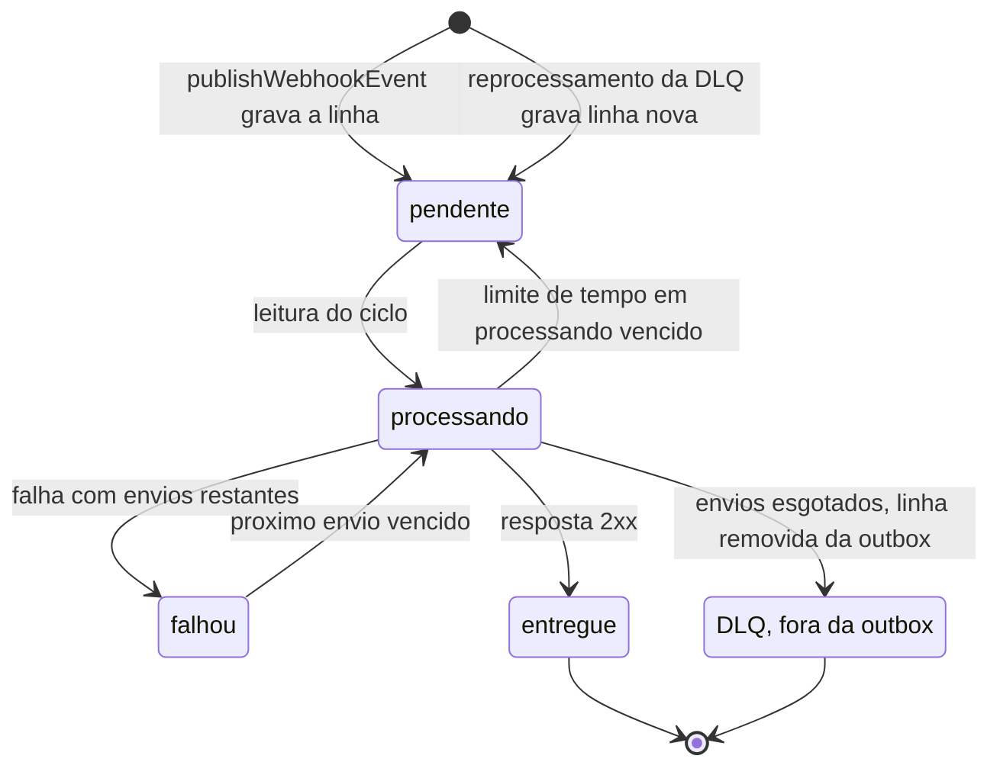
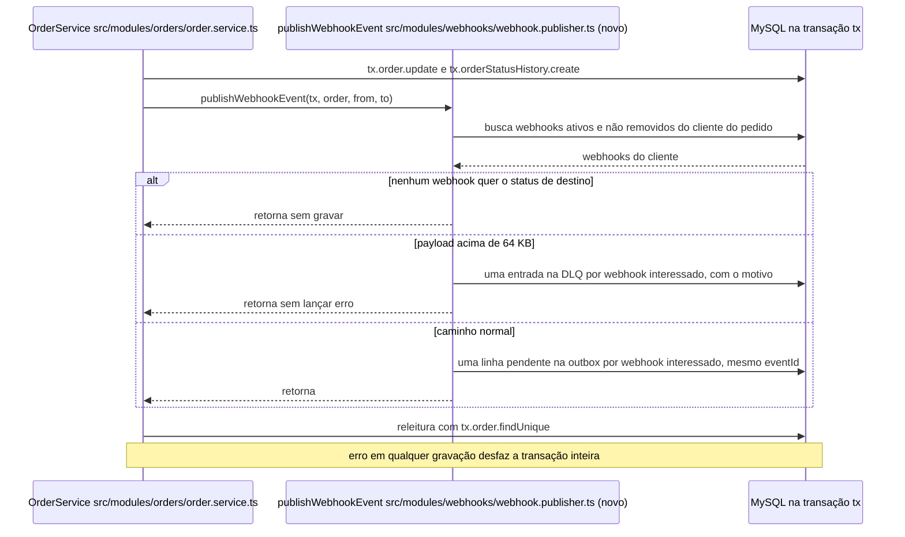
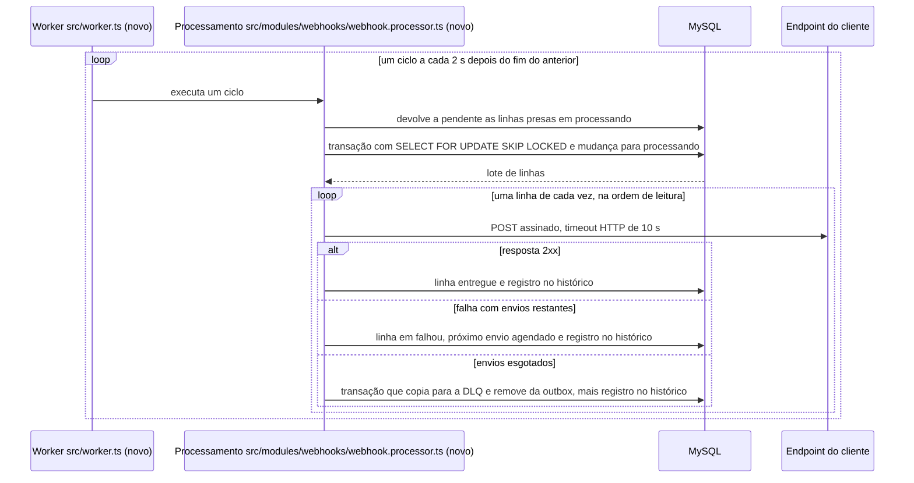
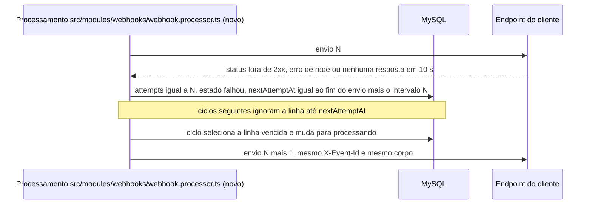
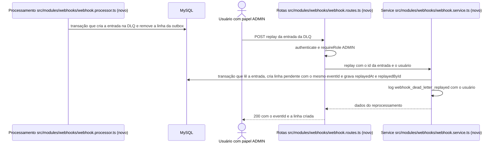

# FDD: Sistema de Webhooks de Notificação de Pedidos

| Campo | Valor |
| --- | --- |
| Versão | 1.0 |
| Data | 2026-10-19 (redação; reunião técnica de quinta-feira) |
| Autoria | Documento de design aberto pela Tech Lead, Larissa, com revisão de Bruno e Diego antes de codar (`[09:50] Larissa`) |
| Status | Em revisão |
| Documentos relacionados | [PRD](PRD.md), [RFC](RFC.md), [Decisões relacionadas (ADR-001 a ADR-007)](RFC.md#decisões-relacionadas) |

Convenções: **Proposta (a validar)** marca valor que a reunião não fixou, com a fala ou o caminho que a motiva e a questão ligada; **Hipótese** marca comportamento a confirmar, com o modo de confirmar. Caminho com `(novo)` ainda não existe. **Status do pedido** é o `OrderStatus` (`prisma/schema.prisma`); **estado da outbox** é o estado técnico da linha (pendente, processando, falhou, entregue). **Evento** é uma mudança de status do pedido, **linha da outbox** é o registro que o worker lê e **envio** é cada chamada HTTP ao cliente. **DLQ** é a tabela `webhook_dead_letter`. **Timestamp do payload** é o momento da mudança e **`X-Timestamp`** é o momento do envio. **Secret do endpoint** é a chave de um webhook, sem relação com o `JWT_SECRET` (`src/config/env.ts`).

## 1. Contexto e motivação técnica

`OrderService.changeStatus` (`src/modules/orders/order.service.ts`) roda inteiro numa transação interativa do Prisma: lê o pedido, valida a transição, debita ou repõe estoque só nas transições previstas em `src/modules/orders/order.status.ts`, atualiza o pedido e grava o histórico. Avisar o cliente dentro dessa transação faria um cliente lento travar a mudança de status de outros pedidos ([ADR-001](adrs/ADR-001-outbox-transacional-no-mysql.md)). O projeto não tem fila nem processo de background: a única entry-point é `src/server.ts`, e o `docker-compose.yml` sobe só o MySQL 8.0.

Três clientes B2B pedem notificação de mudança de status do pedido abaixo de 10 s, no lugar do polling em `GET /api/v1/orders` (negócio no [PRD](PRD.md)). A arquitetura está no [RFC](RFC.md) e nas decisões ADR-001 a ADR-007 ([Decisões relacionadas](RFC.md#decisões-relacionadas)). Este documento detalha tabelas, fluxos e contratos para implementar essas decisões.

## 2. Objetivos técnicos

- **FDD-OBJ-01**: numa mudança de status feita pelo `changeStatus` com pelo menos um webhook interessado, a linha da outbox existe se, e somente se, a transação da mudança foi confirmada ([ADR-001](adrs/ADR-001-outbox-transacional-no-mysql.md)) (`[09:06] Diego`, `[09:40] Bruno`). Vale para payload de até 64 KB; acima disso, na proposta do FDD-FLUXO-02, o evento confirmado vai para a DLQ em vez da outbox (questão 2 do [ADR-007](adrs/ADR-007-payload-snapshot-e-filtro-na-insercao.md)).
- **FDD-OBJ-02**: no caminho feliz (fila sem linhas à frente e cliente respondendo), o primeiro envio acontece até 2 s depois da gravação da linha, atraso causado pelo intervalo de polling ([ADR-002](adrs/ADR-002-worker-separado-com-polling.md)) (`[09:10] Larissa`). Na proposta de ciclos sem sobreposição (FDD-FLUXO-03, passo 3; FDD-PARAM-01), soma-se a duração do ciclo anterior, que com a fila vazia é só a leitura das linhas. Esse atraso serve à meta de notificação abaixo de 10 s (`[09:02] Marcos`), cujo alcance (só o primeiro envio ou todo evento) está em aberto na [RFC-QA-07](RFC.md#questões-em-aberto).
- **FDD-OBJ-03**: envio que falha, inclusive por timeout HTTP de 10 s (`[09:42] Diego`), é repetido com backoff nos intervalos 1 min, 5 min, 30 min, 2 h e 12 h até o teto de "5 tentativas", e o evento vai para a DLQ quando os envios se esgotam ([ADR-003](adrs/ADR-003-retry-com-backoff-e-dlq.md)) (`[09:17] Larissa`). A contagem está em aberto ([RFC-QA-08](RFC.md#questões-em-aberto)); só na proposta do FDD-FLUXO-04 (6 envios) os cinco intervalos são usados. O timeout HTTP de 10 s não tem relação com a meta de notificação de 10 s do FDD-OBJ-02.
- **FDD-OBJ-04**: todo envio leva no `X-Signature` o HMAC-SHA256 do corpo com a secret do endpoint, verificável pelo cliente ([ADR-004](adrs/ADR-004-assinatura-hmac-sha256-por-endpoint.md)) (`[09:22] Sofia`).
- **FDD-OBJ-05**: todos os envios de uma linha da outbox levam o mesmo identificador do evento em `X-Event-Id` e em `event_id`, gerado na inserção ([ADR-005](adrs/ADR-005-entrega-at-least-once-com-x-event-id.md)) (`[09:25] Diego`).
- **FDD-OBJ-06**: a feature usa só o MySQL e a stack existentes e reaproveita módulo, erros, validação Zod, autenticação e Pino, sem dependência nova para essas funções ([ADR-006](adrs/ADR-006-reuso-dos-padroes-do-projeto.md)) (`[09:30] Larissa`, `[09:36] Larissa`, `[09:07] Diego`).

## 3. Escopo e exclusões

### Incluído

- **FDD-ESC-01**: gravação do evento na outbox dentro da transação do `changeStatus`, por `publishWebhookEvent` ([ADR-001](adrs/ADR-001-outbox-transacional-no-mysql.md)) (`[09:40] Bruno`, `[09:41] Bruno`).
- **FDD-ESC-02**: worker em processo próprio, com entry-point `src/worker.ts` (novo) e script `npm run worker` ([ADR-002](adrs/ADR-002-worker-separado-com-polling.md)) (`[09:11] Larissa`).
- **FDD-ESC-03**: retry com backoff, DLQ em tabela separada e reprocessamento manual por ADMIN com registro de quem fez ([ADR-003](adrs/ADR-003-retry-com-backoff-e-dlq.md)) (`[09:17] Larissa`, `[09:36] Larissa`, `[09:36] Sofia`).
- **FDD-ESC-04**: assinatura HMAC-SHA256 com secret por endpoint gerada pela plataforma e rotação com 24 h de convivência ([ADR-004](adrs/ADR-004-assinatura-hmac-sha256-por-endpoint.md)) (`[09:22] Sofia`, `[09:31] Marcos`).
- **FDD-ESC-05**: API de configuração com cadastro, listagem por cliente, edição e remoção (`[09:31] Marcos`, `[09:33] Bruno`), e consulta do histórico de entregas (`[09:34] Marcos`).
- **FDD-ESC-06**: módulo `src/modules/webhooks/` (novo) na estrutura dos módulos existentes ([ADR-006](adrs/ADR-006-reuso-dos-padroes-do-projeto.md)) (`[09:27] Bruno`).

### Excluído

- **FDD-ESC-07**: webhooks de entrada; os clientes só recebem (`[09:02] Marcos`).
- **FDD-ESC-08**: aviso por e-mail ao cliente sobre falhas do webhook, deixado para uma fase futura (`[09:37] Larissa`). Não é um caminho de entrega do evento.
- **FDD-ESC-09**: painel visual para o cliente, projeto separado do time de frontend (`[09:40] Larissa`).
- **FDD-ESC-10**: rate limiting de envios por cliente, em observação ([RFC-QA-02](RFC.md#questões-em-aberto)) (`[09:39] Larissa`).
- **FDD-ESC-11**: arquivamento das linhas entregues da outbox, sem prazo definido (`[09:08] Diego`).
- **FDD-ESC-12**: mais de um worker rodando ao mesmo tempo, com particionamento por pedido ou lock pessimista ([RFC-QA-03](RFC.md#questões-em-aberto)) (`[09:13] Diego`).
- **FDD-ESC-13**: permissões mais restritas no CRUD de configuração ([RFC-QA-04](RFC.md#questões-em-aberto)) (`[09:37] Sofia`).
- **FDD-ESC-14**: **Proposta (a validar):** a criação do pedido não gera evento nesta fase; só o `changeStatus` publica, único ponto de integração citado (`[09:40] Bruno`). Questão 1 do [ADR-001](adrs/ADR-001-outbox-transacional-no-mysql.md). Se a resposta for "sim", `OrderService.create` ganha uma segunda chamada a `publishWebhookEvent` com `from_status` nulo, e a assinatura e a pré-condição do FDD-CONTRATO-09 passam a aceitar `fromStatus` nulo.
- **FDD-ESC-15**: **Proposta (a validar):** mudanças de status do pedido feitas fora do `changeStatus`, como o seed (`prisma/seed.ts`, que grava pedidos e histórico direto no banco) ou SQL manual, não geram evento, e a regra fica documentada para quem opera o banco; o `changeStatus` é o único ponto de integração citado (`[09:40] Bruno`). Questão 2 do [ADR-001](adrs/ADR-001-outbox-transacional-no-mysql.md). Se a questão escolher a checagem periódica, entra um job novo de comparação entre histórico e outbox; a trigger mudaria o FDD-FLUXO-01.

## 4. Modelo de dados

O schema atual (`prisma/schema.prisma`) usa `id String @id @default(uuid()) @db.Char(36)` nas entidades de domínio (a exceção é `OrderNumberSequence`, com id `Int`), modelos em PascalCase com `@@map` para tabela em snake_case, colunas em camelCase, índices simples com `@@index` e `createdAt`/`updatedAt`. O id UUID está decidido para a outbox (`[09:51] Larissa`); nas outras três tabelas é **Proposta (a validar)** pelo mesmo padrão (`prisma/schema.prisma`). Id auto incremental foi considerado e descartado por fugir do padrão UUID (`[09:51] Larissa`). **Proposta (a validar):** nomes de modelos, tabelas e colunas não ditos na reunião seguem o schema atual, com colunas em camelCase; o snake_case fica só no payload entregue ao cliente (`[09:43] Diego`). Lacuna, sem questão aberta no RFC.

### FDD-DADOS-01: Configuração do webhook (`webhook_endpoints`)

Guarda url, secret, cliente e estado ativo de cada endpoint (`[09:21] Bruno`, confirmado em `[09:21] Sofia`). **Proposta (a validar):** modelo `WebhookEndpoint` na tabela `webhook_endpoints`, nome não dito na reunião (`prisma/schema.prisma` como padrão).

| Coluna | Tipo Prisma | Regra | Origem |
| --- | --- | --- | --- |
| `id` | `String @id @default(uuid()) @db.Char(36)` | **Proposta (a validar):** UUID como as entidades de domínio | `prisma/schema.prisma` |
| `customerId` | `String @db.Char(36)` | cliente dono do webhook; **Proposta (a validar):** relação com `Customer` e `@@index([customerId])` para o filtro na inserção ([ADR-007-CONS-11](adrs/ADR-007-payload-snapshot-e-filtro-na-insercao.md)) | `[09:21] Bruno` |
| `url` | `String @db.Text` | só `https` (validação na seção 6.1) | `[09:21] Bruno`, `[09:23] Sofia` |
| `secret` | `String @db.Text` | secret do endpoint gerada pela plataforma; o formato de armazenamento (em claro ou cifrado) depende da questão 4 do [ADR-004](adrs/ADR-004-assinatura-hmac-sha256-por-endpoint.md); a coluna existe nos dois casos | `[09:21] Sofia`, `[09:31] Marcos` |
| `previousSecret` | `String? @db.Text` | **Proposta (a validar):** secret anterior, válida até `previousSecretExpiresAt` | `[09:21] Sofia` |
| `previousSecretExpiresAt` | `DateTime?` | **Proposta (a validar):** momento da rotação mais 24 h | `[09:21] Sofia` |
| `statuses` | `Json` | **Proposta (a validar):** lista de valores de `OrderStatus` que o webhook quer ouvir, em coluna `Json` como `Customer.address` | `[09:33] Marcos`, `prisma/schema.prisma` |
| `active` | `Boolean @default(true)` | estado ativo; **Proposta (a validar):** webhook com `active` falso não conta no filtro (questão 3 do [ADR-007](adrs/ADR-007-payload-snapshot-e-filtro-na-insercao.md)) | `[09:21] Bruno` |
| `deletedAt` | `DateTime?` | **Proposta (a validar):** remoção lógica pelo `DELETE`; webhook removido sai do filtro e da listagem, e URL e secret ficam para as linhas já gravadas (questão 3 do [ADR-007](adrs/ADR-007-payload-snapshot-e-filtro-na-insercao.md)) | `[09:33] Bruno` |
| `createdAt`, `updatedAt` | `DateTime @default(now())`, `DateTime @updatedAt` | **Proposta (a validar):** como os modelos atuais | `prisma/schema.prisma` |

### FDD-DADOS-02: Outbox (`webhook_outbox`)

Tabela da outbox no MySQL ([ADR-001](adrs/ADR-001-outbox-transacional-no-mysql.md)), com índice em status e em criação (`[09:08] Diego`) e payload em snapshot ([ADR-007](adrs/ADR-007-payload-snapshot-e-filtro-na-insercao.md)) (`[09:52] Bruno`). **Proposta (a validar):** uma linha por webhook de destino, todas com o mesmo `eventId`, com unicidade em (`eventId`, `webhookId`) (`[09:34] Bruno`, `[09:44] Sofia`; questão 2 do [ADR-005](adrs/ADR-005-entrega-at-least-once-com-x-event-id.md)). Com uma linha por evento, `webhookId` sairia da linha e o retry de um destino repetiria os outros.

| Coluna | Tipo Prisma | Regra | Origem |
| --- | --- | --- | --- |
| `id` | `String @id @default(uuid()) @db.Char(36)` | UUID, padrão do projeto | `[09:51] Larissa` |
| `eventId` | `String @db.Char(36)` | UUID gerado quando o evento entra na outbox, igual em `X-Event-Id` e `event_id` ([ADR-005](adrs/ADR-005-entrega-at-least-once-com-x-event-id.md)) | `[09:25] Diego` |
| `webhookId` | `String @db.Char(36)` | **Proposta (a validar):** webhook de destino, relação com `WebhookEndpoint`; `@@unique([eventId, webhookId])` | `[09:34] Bruno` |
| `orderId` | `String @db.Char(36)` | **Proposta (a validar):** pedido do evento, com `@@index([orderId])`, para a opção de segurar linhas por pedido continuar possível (questão 1 do [ADR-002](adrs/ADR-002-worker-separado-com-polling.md)) | `[09:12] Diego` |
| `payload` | `Json` | snapshot montado na inserção (seção 6.2) | `[09:52] Bruno` |
| `status` | `WebhookOutboxStatus @default(PENDING)` | estado da outbox (FDD-DADOS-05); `@@index([status])` | `[09:08] Diego` |
| `attempts` | `Int @default(0)` | **Proposta (a validar):** envios feitos, gravados na linha para sobreviver a reinício ([ADR-003-CONS-16](adrs/ADR-003-retry-com-backoff-e-dlq.md)) | `[09:17] Larissa` |
| `nextAttemptAt` | `DateTime @default(now())` | **Proposta (a validar):** momento a partir do qual a linha pode ser enviada ([ADR-003-CONS-16](adrs/ADR-003-retry-com-backoff-e-dlq.md)) | `[09:17] Larissa` |
| `processingStartedAt` | `DateTime?` | **Proposta (a validar):** momento de entrada em processando, usado para devolver linha presa (questão 7 do [ADR-002](adrs/ADR-002-worker-separado-com-polling.md)) | `src/server.ts` |
| `lastError` | `String? @db.Text` | **Proposta (a validar):** motivo do último envio que falhou, copiado para a DLQ | `[09:18] Diego` |
| `createdAt` | `DateTime @default(now())` | ordem de leitura do worker; `@@index([createdAt])` | `[09:08] Diego` |
| `updatedAt` | `DateTime @updatedAt` | **Proposta (a validar):** como os modelos atuais | `prisma/schema.prisma` |

Nota técnica: guardar só o id do pedido e montar o payload no envio foi descartado, porque o evento deixaria de refletir o estado de quando o status mudou (`[09:52] Larissa`).

### FDD-DADOS-03: Histórico de entregas (`webhook_deliveries`)

O cliente consulta os últimos 100 envios com sucesso ou falha, payload, response e tempo de resposta (`[09:34] Marcos`). Onde e por quanto tempo guardar não foi discutido. **Proposta (a validar):** tabela `webhook_deliveries`, uma linha por envio, sem política de retenção (risco na seção 13); lacuna, sem questão aberta no RFC.

| Coluna | Tipo Prisma | Regra | Origem |
| --- | --- | --- | --- |
| `id` | `String @id @default(uuid()) @db.Char(36)` | **Proposta (a validar):** UUID | `prisma/schema.prisma` |
| `webhookId` | `String @db.Char(36)` | **Proposta (a validar):** relação com `WebhookEndpoint`; `@@index([webhookId])` | `[09:34] Marcos` |
| `eventId` | `String @db.Char(36)` | **Proposta (a validar):** liga o envio ao `X-Event-Id` | `[09:25] Diego` |
| `attempt` | `Int` | **Proposta (a validar):** número do envio dentro da linha (1 para o envio inicial) | `[09:17] Larissa` |
| `payload` | `Json` | cópia do payload enviado | `[09:34] Marcos` |
| `responseStatus` | `Int?` | status HTTP da resposta; nulo em erro de rede ou timeout | `[09:34] Marcos` |
| `responseBody` | `String? @db.Text` | **Proposta (a validar):** corpo da resposta truncado em 4 KB | `[09:34] Marcos` |
| `durationMs` | `Int` | tempo de resposta em ms | `[09:34] Marcos` |
| `success` | `Boolean` | sucesso ou falha, pelo critério da seção 5.3 | `[09:34] Marcos` |
| `errorMessage` | `String? @db.Text` | **Proposta (a validar):** erro de rede ou timeout, quando não há resposta | `[09:42] Diego` |
| `createdAt` | `DateTime @default(now())` | momento do envio; `@@index([createdAt])` (**Proposta (a validar):**) | `prisma/schema.prisma` |

### FDD-DADOS-04: DLQ (`webhook_dead_letter`)

Tabela separada da outbox que guarda payload, motivo da falha e timestamp ([ADR-003](adrs/ADR-003-retry-com-backoff-e-dlq.md)) (`[09:18] Diego`).

| Coluna | Tipo Prisma | Regra | Origem |
| --- | --- | --- | --- |
| `id` | `String @id @default(uuid()) @db.Char(36)` | **Proposta (a validar):** UUID pelo padrão | `prisma/schema.prisma` |
| `eventId` | `String @db.Char(36)` | **Proposta (a validar):** identificador original, reaproveitado no reprocessamento ([RFC-QA-11](RFC.md#questões-em-aberto)) | `[09:18] Diego` |
| `webhookId` | `String @db.Char(36)` | **Proposta (a validar):** webhook de destino; `@@index([webhookId])` | `[09:34] Bruno` |
| `orderId` | `String @db.Char(36)` | **Proposta (a validar):** pedido do evento | `[09:12] Diego` |
| `payload` | `Json` | snapshot copiado da outbox | `[09:18] Diego` |
| `reason` | `String @db.Text` | motivo da falha: último status HTTP ou erro, ou tamanho acima de 64 KB (FDD-FLUXO-02) | `[09:18] Diego` |
| `attempts` | `Int` | **Proposta (a validar):** envios feitos; zero no caso de payload acima de 64 KB | `[09:24] Larissa` |
| `createdAt` | `DateTime @default(now())` | timestamp de entrada na DLQ; `@@index([createdAt])` (**Proposta (a validar):**) | `[09:18] Diego` |
| `replayedAt` | `DateTime?` | **Proposta (a validar):** quando foi reprocessado | `[09:36] Sofia` |
| `replayedById` | `String? @db.Char(36)` | **Proposta (a validar):** usuário que reprocessou, sem relação Prisma com `User` para não mexer no modelo existente | `[09:36] Sofia` |

### FDD-DADOS-05: Estados da outbox

**Proposta (a validar):** enum Prisma `WebhookOutboxStatus` com os quatro estados citados (`[09:08] Diego`) e o significado de falhou definido abaixo (questão 3 do [ADR-003](adrs/ADR-003-retry-com-backoff-e-dlq.md)). No texto, o estado aparece sempre em português, como "estado da outbox". `PENDING` e `PROCESSING` deste enum não têm relação com os valores de mesmo nome do `OrderStatus` (`prisma/schema.prisma`).

| Estado da outbox | Valor do enum | Significado | Origem |
| --- | --- | --- | --- |
| pendente | `PENDING` | linha que aguarda envio sem falha registrada: gravada por `publishWebhookEvent`, gravada pelo reprocessamento da DLQ ou devolvida pelo limite de tempo em processando (nesse caso, `attempts` pode ser maior que zero) | `[09:08] Diego` |
| processando | `PROCESSING` | linha lida por um ciclo, com `processingStartedAt` gravado | `[09:08] Diego` |
| falhou | `FAILED` | **Proposta (a validar):** o último envio falhou e a linha aguarda o próximo em `nextAttemptAt`; não é a DLQ | `[09:08] Diego`, `[09:18] Diego` |
| entregue | `DELIVERED` | o cliente respondeu 2xx; estado final | `[09:08] Diego` |

Esgotados os envios, a linha é copiada para a DLQ e removida da outbox na mesma transação (**Proposta (a validar):**, questão 3 do [ADR-003](adrs/ADR-003-retry-com-backoff-e-dlq.md)) (`[09:18] Diego`).



### FDD-DADOS-06: Sketch Prisma

**Proposta (a validar):** trecho novo do schema com os quatro modelos e o enum, relações com `Customer` e entre as tabelas novas (`prisma/schema.prisma` como padrão). A relação com `Customer` exige o campo de relação `webhookEndpoints WebhookEndpoint[]` no modelo `Customer`, sem coluna nova na tabela `customers`.

```prisma
// prisma/schema.prisma (novo trecho)

enum WebhookOutboxStatus {
  PENDING    // pendente
  PROCESSING // processando
  FAILED     // falhou
  DELIVERED  // entregue
}

model WebhookEndpoint {
  id                      String    @id @default(uuid()) @db.Char(36)
  customerId              String    @db.Char(36)
  url                     String    @db.Text
  secret                  String    @db.Text
  previousSecret          String?   @db.Text
  previousSecretExpiresAt DateTime?
  statuses                Json
  active                  Boolean   @default(true)
  deletedAt               DateTime?
  createdAt               DateTime  @default(now())
  updatedAt               DateTime  @updatedAt

  customer    Customer            @relation(fields: [customerId], references: [id])
  outbox      WebhookOutbox[]
  deliveries  WebhookDelivery[]
  deadLetters WebhookDeadLetter[]

  @@index([customerId])
  @@map("webhook_endpoints")
}

model WebhookOutbox {
  id                  String              @id @default(uuid()) @db.Char(36)
  eventId             String              @db.Char(36)
  webhookId           String              @db.Char(36)
  orderId             String              @db.Char(36)
  payload             Json
  status              WebhookOutboxStatus @default(PENDING)
  attempts            Int                 @default(0)
  nextAttemptAt       DateTime            @default(now())
  processingStartedAt DateTime?
  lastError           String?             @db.Text
  createdAt           DateTime            @default(now())
  updatedAt           DateTime            @updatedAt

  webhook WebhookEndpoint @relation(fields: [webhookId], references: [id])

  @@unique([eventId, webhookId])
  @@index([status])
  @@index([createdAt])
  @@index([orderId])
  @@map("webhook_outbox")
}

model WebhookDelivery {
  id             String   @id @default(uuid()) @db.Char(36)
  webhookId      String   @db.Char(36)
  eventId        String   @db.Char(36)
  attempt        Int
  payload        Json
  responseStatus Int?
  responseBody   String?  @db.Text
  durationMs     Int
  success        Boolean
  errorMessage   String?  @db.Text
  createdAt      DateTime @default(now())

  webhook WebhookEndpoint @relation(fields: [webhookId], references: [id])

  @@index([webhookId])
  @@index([createdAt])
  @@map("webhook_deliveries")
}

model WebhookDeadLetter {
  id           String    @id @default(uuid()) @db.Char(36)
  eventId      String    @db.Char(36)
  webhookId    String    @db.Char(36)
  orderId      String    @db.Char(36)
  payload      Json
  reason       String    @db.Text
  attempts     Int
  createdAt    DateTime  @default(now())
  replayedAt   DateTime?
  replayedById String?   @db.Char(36)

  webhook WebhookEndpoint @relation(fields: [webhookId], references: [id])

  @@index([webhookId])
  @@index([createdAt])
  @@map("webhook_dead_letter")
}

// model Customer (existente) ganha só o campo de relação:
//   webhookEndpoints WebhookEndpoint[]
```

As tabelas entram numa migração nova em `prisma/migrations/`, com nome gerado pelo Prisma (`npm run db:migrate`, `package.json`), sem alterar as tabelas existentes nem a migração inicial.

## 5. Fluxos detalhados

### 5.1 Criação do evento na outbox

**FDD-FLUXO-01**: gravação do evento dentro da transação do `changeStatus` ([ADR-001](adrs/ADR-001-outbox-transacional-no-mysql.md), [ADR-007](adrs/ADR-007-payload-snapshot-e-filtro-na-insercao.md)) (`[09:40] Bruno`).

1. `OrderService.changeStatus` (`src/modules/orders/order.service.ts`) valida a transição, mexe no estoque quando a transição pede, executa `tx.order.update` e `tx.orderStatusHistory.create`.
2. **Proposta (a validar):** logo depois de `tx.orderStatusHistory.create` e antes da releitura `tx.order.findUnique`, ainda no callback de `$transaction`, chama `publishWebhookEvent(tx, order, from, to)` (`[09:41] Bruno`; ponto escolhido em `src/modules/orders/order.service.ts`; lacuna, sem questão aberta no RFC). O `order` é o lido no início da transação, com `id`, `orderNumber`, `customerId` e `totalCents`.
3. `publishWebhookEvent` lê, com o `tx`, os webhooks do cliente do pedido (`customerId`) com `active` verdadeiro e `deletedAt` nulo (**Proposta (a validar):**, questão 3 do [ADR-007](adrs/ADR-007-payload-snapshot-e-filtro-na-insercao.md)) (`[09:21] Sofia`).
4. Filtra os webhooks cuja lista `statuses` contém o status do pedido de destino (`to`). Sem nenhum, retorna sem gravar (`[09:34] Bruno`). Nota técnica: filtrar na hora do envio foi descartado, porque grava linhas que ninguém vai receber (`[09:34] Bruno`).
5. Monta o payload uma vez (snapshot, seção 6.2) (`[09:52] Bruno`). O `event_id` é gerado com `v4` do pacote `uuid`, já declarado no `package.json` e usado em `src/middlewares/request-logger.middleware.ts` ([ADR-005](adrs/ADR-005-entrega-at-least-once-com-x-event-id.md)) (`[09:25] Diego`). **Proposta (a validar):** o `timestamp` do payload é o momento da gravação, em ISO 8601 UTC com milissegundos, para o cliente conseguir ordenar mudanças próximas ([RFC-QA-05](RFC.md#questões-em-aberto)) (`[09:43] Diego`).
6. Mede o tamanho do JSON serializado em bytes. Acima de 64 KB, segue o FDD-FLUXO-02.
7. **Proposta (a validar):** grava com `tx.webhookOutbox.createMany` uma linha por webhook interessado, todas com o mesmo `eventId`, estado da outbox pendente, `attempts` zero e `nextAttemptAt` igual ao momento da gravação (questão 2 do [ADR-005](adrs/ADR-005-entrega-at-least-once-com-x-event-id.md)) (`[09:34] Bruno`).
8. Erro em qualquer gravação propaga, e a transação inteira é desfeita: o status do pedido não muda (`[09:40] Bruno`). **Hipótese:** o Prisma 5.22.0 desfaz tudo o que o `tx` gravou quando o callback lança erro ([ADR-001-CONS-05](adrs/ADR-001-outbox-transacional-no-mysql.md)). Confirmar com um teste de integração no padrão de `tests/orders.test.ts` que força falha na gravação da outbox após `PATCH /api/v1/orders/:id/status` e confere a ausência da linha e o status do pedido antigo.

**FDD-FLUXO-02**: evento acima de 64 KB. O limite é de 64 KB, com erro caso ultrapasse (`[09:24] Larissa`). **Proposta (a validar):** a checagem fica em `publishWebhookEvent`, pelo tamanho em bytes do JSON serializado (64 × 1024 bytes); acima disso, grava uma entrada na DLQ por webhook interessado, com o motivo, `attempts` zero e o mesmo `eventId`, e não lança erro, para não desfazer a mudança de status do pedido (questão 2 do [ADR-007](adrs/ADR-007-payload-snapshot-e-filtro-na-insercao.md), [RFC-RISCO-06](RFC.md#riscos)). Esse evento fica fora do at-least-once ([ADR-005-CONS-12](adrs/ADR-005-entrega-at-least-once-com-x-event-id.md)). Se a questão escolher erro na inserção, o passo lança exceção e a mudança de status é desfeita. Nota técnica: truncar o payload foi descartado, porque payload desse tamanho indica erro (`[09:23] Sofia`).



### 5.2 Processamento pelo worker

**FDD-FLUXO-03**: ciclo do worker em processo separado da API, com polling de 2 s e worker único como premissa ([ADR-002](adrs/ADR-002-worker-separado-com-polling.md)) (`[09:10] Larissa`, `[09:11] Diego`).

1. A entry-point `src/worker.ts` (novo) segue o modelo de `src/server.ts`: `bootstrap`, logs de início e falha e tratamento de `SIGINT` e `SIGTERM` (`[09:11] Larissa`). O script é `npm run worker` (`[09:11] Larissa`). **Proposta (a validar):** `node --env-file=.env dist/worker.js`, compilado pelo mesmo `npm run build`, como o script `start` (`package.json`).
2. O worker usa a própria instância de `PrismaClient`, com a mesma `DATABASE_URL` (`[09:30] Bruno`): a instância `prisma` exportada por `src/config/database.ts`, criada por `createPrismaClient` quando o módulo é carregado, já é própria do processo do worker. **Proposta (a validar):** o worker importa esse `prisma` em vez de chamar `createPrismaClient` de novo, para não abrir uma segunda instância e um segundo pool no mesmo processo. Nota técnica: usar a mesma instância da API é impossível, porque o `PrismaClient` existe por processo (`[09:30] Bruno`). Importar `src/config/env.ts` exige as mesmas variáveis da API, inclusive `JWT_SECRET`.
3. **Proposta (a validar):** ciclos sem sobreposição; o próximo começa 2 s depois do fim do anterior (`[09:10] Larissa`; lacuna, sem questão aberta no RFC).
4. **Proposta (a validar):** no início do ciclo, linhas em processando com `processingStartedAt` mais antigo que 5 min voltam a pendente, sem contar envio, porque o resultado do envio é desconhecido; a duplicata possível é tolerada pelo [ADR-005](adrs/ADR-005-entrega-at-least-once-com-x-event-id.md) (questão 7 do [ADR-002](adrs/ADR-002-worker-separado-com-polling.md)) (`src/server.ts`, que encerra sem esperar o trabalho em andamento).
5. **Proposta (a validar):** em uma transação curta, seleciona até 10 linhas elegíveis (estado pendente ou falhou, `nextAttemptAt` vencido), da mais antiga para a mais nova por `createdAt` (`[09:12] Diego`), com `SELECT ... FOR UPDATE SKIP LOCKED` do MySQL 8.0, e muda essas linhas para processando, gravando `processingStartedAt` (questão 4 do [ADR-002](adrs/ADR-002-worker-separado-com-polling.md); tamanho do lote: "batch pequeno", `[09:08] Diego`, lacuna sem questão aberta no RFC). O tamanho do lote é parâmetro configurável. A API do Prisma Client 5.22.0 não tem opção de leitura com trava, mas o cliente da transação mantém `$queryRaw`, porque a lista de métodos negados nele é só `$connect`, `$disconnect`, `$on`, `$transaction`, `$use` e `$extends` (pacote `@prisma/client` 5.22.0, `runtime/library.d.ts`, https://registry.npmjs.org/@prisma/client/-/client-5.22.0.tgz). Por isso a seleção vai por `tx.$queryRaw` e a mudança de estado por `tx.webhookOutbox.updateMany`. O envio HTTP acontece fora dessa transação.
6. Lê, para as linhas do lote, o webhook de destino (URL e secrets), inclusive se estiver desativado ou removido depois da gravação: a linha é entregue mesmo assim (**Proposta (a validar):**, questão 3 do [ADR-007](adrs/ADR-007-payload-snapshot-e-filtro-na-insercao.md)) (`[09:33] Bruno`).
7. **Proposta (a validar):** envia uma linha de cada vez, na ordem de leitura ([RFC-QA-06](RFC.md#questões-em-aberto)) (`[09:42] Diego`). Com esse modo, um endpoint que não responde segura o ciclo por até 10 s por linha ([ADR-002-CONS-11](adrs/ADR-002-worker-separado-com-polling.md)).
8. Cada envio serializa o payload uma vez, assina o corpo (seção 5.5) e chama `fetch` com `signal: AbortSignal.timeout(10_000)`, timeout HTTP de 10 s (`[09:42] Diego`). O `fetch` global existe no Node 20 sem flag desde a v18 (marcado como experimental na documentação da v20) e `AbortSignal.timeout` existe desde a v17.3.0 (Node.js v20, "Global objects", https://nodejs.org/docs/latest-v20.x/api/globals.html), sem dependência nova.
9. Grava o resultado e uma linha em `webhook_deliveries`, na mesma transação (**Proposta (a validar):**): resposta 2xx deixa a linha entregue; falha com envios restantes deixa a linha em falhou com `nextAttemptAt` da seção 5.3; envios esgotados seguem o FDD-FLUXO-05. Em todos os casos `attempts` aumenta 1 e `processingStartedAt` volta a nulo.
10. **Proposta (a validar):** ao receber `SIGINT` ou `SIGTERM`, o worker não inicia novo ciclo, espera o ciclo em andamento terminar e só então chama `$disconnect` e encerra (questão 8 do [ADR-002](adrs/ADR-002-worker-separado-com-polling.md)) (`src/server.ts`).

Com retry, reprocessamento ou linha devolvida, eventos do mesmo pedido podem chegar fora de ordem. **Proposta (a validar):** o worker não segura as linhas seguintes de um pedido; o cliente ordena pelo `timestamp` do payload, e o `orderId` indexado mantém possível a opção de segurar ([RFC-QA-05](RFC.md#questões-em-aberto)) (`[09:12] Diego`, `[09:43] Diego`).



### 5.3 Retry com backoff

**FDD-FLUXO-04**: reentrega com backoff exponencial nos intervalos 1 min, 5 min, 30 min, 2 h e 12 h ([ADR-003](adrs/ADR-003-retry-com-backoff-e-dlq.md)) (`[09:17] Larissa`). **Proposta (a validar):** "5 tentativas" é lido como envio inicial mais 5 retentativas, 6 envios, único modo que usa os cinco intervalos e fecha a janela de quase 15 h (`[09:17] Diego`) ([RFC-QA-08](RFC.md#questões-em-aberto)).

| Envio | Momento do próximo envio após falha |
| --- | --- |
| 1 (inicial) | fim do envio mais 1 min |
| 2 (1ª retentativa) | fim do envio mais 5 min |
| 3 (2ª retentativa) | fim do envio mais 30 min |
| 4 (3ª retentativa) | fim do envio mais 2 h |
| 5 (4ª retentativa) | fim do envio mais 12 h |
| 6 (5ª retentativa) | nenhum: a linha vai para a DLQ (FDD-FLUXO-05) |

A janela entre a primeira falha e o último envio soma 876 min, cerca de 14,6 h (1 + 5 + 30 + 120 + 720), mais a duração dos envios. Na alternativa de 5 envios no total, a falha do envio 5 leva à DLQ, o intervalo de 12 h não é usado e a janela cai para 156 min, cerca de 2,6 h ([ADR-003-CONS-05](adrs/ADR-003-retry-com-backoff-e-dlq.md)).

1. **Proposta (a validar):** o momento do próximo envio é o fim do envio que falhou mais o intervalo de número `attempts` (já contando esse envio; 1 é o intervalo de 1 min e 5 o de 12 h) na lista de intervalos, gravado em `nextAttemptAt` na linha, para sobreviver a reinício do worker ([ADR-003-CONS-16](adrs/ADR-003-retry-com-backoff-e-dlq.md)) (`[09:17] Larissa`; lacuna, sem questão aberta no RFC).
2. **Proposta (a validar):** resposta 2xx é entrega. Qualquer outro status HTTP, erro de rede ou timeout HTTP de 10 s é falha, repetida até o teto (questão 2 do [ADR-003](adrs/ADR-003-retry-com-backoff-e-dlq.md)) (`[09:42] Diego`). Se a questão mandar parte dos 4xx direto para a DLQ, o passo 2 do FDD-FLUXO-05 passa a aceitar esses códigos antes de esgotar os envios.
3. Todos os envios de uma linha reaproveitam o mesmo payload e o mesmo `X-Event-Id` ([ADR-005](adrs/ADR-005-entrega-at-least-once-com-x-event-id.md)) (`[09:25] Diego`).



### 5.4 DLQ e replay manual

**FDD-FLUXO-05**: movimento para a DLQ quando os envios se esgotam ([ADR-003](adrs/ADR-003-retry-com-backoff-e-dlq.md)) (`[09:18] Diego`).

1. O envio que esgota o teto falha (seção 5.3).
2. **Proposta (a validar):** numa transação, o worker cria a entrada em `webhook_dead_letter` com `eventId`, `webhookId`, `orderId`, `payload`, `attempts` e o motivo, e remove a linha da outbox (questão 3 do [ADR-003](adrs/ADR-003-retry-com-backoff-e-dlq.md)) (`[09:18] Diego`).
3. O motivo é o último status HTTP (ex.: `HTTP 503`) ou o erro (ex.: timeout HTTP de 10 s, erro de rede) (`[09:18] Diego`). **Proposta (a validar):** ele é gravado em `reason` no formato `CÓDIGO: detalhe`, com os códigos da seção 7 (ex.: `WEBHOOK_DELIVERY_HTTP_ERROR: HTTP 503`, `WEBHOOK_DELIVERY_TIMEOUT: sem resposta em 10 s`, `WEBHOOK_DELIVERY_NETWORK_ERROR: conexão recusada`); lacuna, sem questão aberta no RFC.

**FDD-FLUXO-06**: reprocessamento manual por `POST /api/v1/admin/webhooks/dead-letter/:id/replay`, que devolve o evento à outbox como pendente (`[09:18] Diego`, `[09:35] Diego`).

1. A rota exige `authenticate` e `requireRole('ADMIN')`, de `src/middlewares/auth.middleware.ts` (`[09:36] Larissa`).
2. **Proposta (a validar):** numa transação, o service lê a entrada da DLQ; recusa se ela não existe ou se `replayedAt` já está preenchido (segunda tentativa de reprocessar a mesma entrada).
3. **Proposta (a validar):** grava uma linha nova na outbox com o `eventId`, o `webhookId`, o `orderId` e o payload originais, estado da outbox pendente e `attempts` zero, e marca a entrada da DLQ com `replayedAt` e `replayedById` (`req.user.id`) ([RFC-QA-11](RFC.md#questões-em-aberto)) (`[09:18] Diego`, `[09:36] Sofia`). Com identificador novo, o passo reescreveria o `event_id` dentro do payload antes de gravar.
4. Registra em log quem reprocessou, para auditoria (`[09:36] Sofia`). **Proposta (a validar):** evento Pino `webhook_dead_letter_replayed` com `userId`, `email`, `deadLetterId` e `eventId`, pelo `logger` de `src/shared/logger/index.ts`, com o nome do evento em snake_case como `server_started` em `src/server.ts` e os campos em camelCase como `requestId` em `src/middlewares/request-logger.middleware.ts`.
5. **Proposta (a validar):** entrega o snapshot como está, mesmo que o pedido já tenha eventos mais novos entregues; o cliente ordena pelo `timestamp` do payload (questão 5 do [ADR-003](adrs/ADR-003-retry-com-backoff-e-dlq.md)) (`[09:18] Diego`).
6. **Proposta (a validar):** recusa a entrada gravada por tamanho acima de 64 KB (FDD-FLUXO-02), reconhecida por `attempts` igual a zero, único caso em que a DLQ recebe um evento sem envio, porque reenviá-la mandaria ao cliente um payload acima do limite (`[09:24] Larissa`; questão 2 do [ADR-007](adrs/ADR-007-payload-snapshot-e-filtro-na-insercao.md)).

O papel ADMIN não é controle forte, porque `POST /api/v1/auth/register` é público e aceita `role: 'ADMIN'` ([ADR-003-CONS-08](adrs/ADR-003-retry-com-backoff-e-dlq.md)).



### 5.5 Rotação de secret

**FDD-FLUXO-07**: rotação com 24 h de convivência entre a secret anterior e a nova ([ADR-004](adrs/ADR-004-assinatura-hmac-sha256-por-endpoint.md)) (`[09:21] Sofia`).

1. **Proposta (a validar):** o cliente chama `POST /api/v1/webhooks/:id/secret/rotate` (`[09:21] Sofia`; lacuna, sem questão aberta no RFC).
2. **Proposta (a validar):** o service gera a secret nova com `crypto.randomBytes(32)` em hexadecimal, 64 caracteres, do módulo nativo `crypto` do Node 20 (`package.json`, `engines.node`; lacuna, sem questão aberta no RFC).
3. Numa transação, a secret atual vai para `previousSecret`, `previousSecretExpiresAt` recebe o momento da rotação mais 24 h e a secret nova ocupa `secret` (`[09:21] Sofia`).
4. **Proposta (a validar):** uma nova rotação dentro das 24 h descarta a secret anterior mais antiga: a secret atual passa a ser a anterior, com nova expiração, e só duas secrets valem ao mesmo tempo (`[09:21] Sofia`; lacuna, sem questão aberta no RFC).
5. A resposta devolve a secret nova e o momento em que a anterior expira (seção 6.1).
6. **Proposta (a validar):** ao assinar, o worker compara `previousSecretExpiresAt` com o momento do envio. Se a anterior ainda vale, o `X-Signature` leva dois valores separados por vírgula, primeiro o da secret nova; senão, só o da secret atual. Nenhuma tarefa agendada apaga a secret expirada; ela fica sem efeito até a próxima rotação ([RFC-QA-09](RFC.md#questões-em-aberto)) (`[09:21] Sofia`, `[09:22] Sofia`). Se a questão escolher assinar só com a secret nova, o passo envia sempre um único valor.
7. **Proposta (a validar):** as secrets são lidas do cadastro no momento do envio, então uma linha gravada antes da rotação é assinada com as secrets vigentes quando é enviada (`[09:22] Sofia`).

## 6. Contratos públicos

### 6.1 API de configuração de webhooks

Regras comuns aos contratos desta seção:

- Prefixo `/api/v1` de `src/app.ts`, com as rotas montadas em `src/routes/index.ts`. **Proposta (a validar):** caminhos `POST /api/v1/webhooks`, `GET /api/v1/webhooks?customerId=`, `PATCH /api/v1/webhooks/:id` e `DELETE /api/v1/webhooks/:id`; a reunião disse só os métodos (`[09:31] Marcos`, `[09:33] Bruno`). Lacuna, sem questão aberta no RFC.
- **Proposta (a validar):** `customerId` vai no body do cadastro e na query da listagem, nunca do JWT (`[09:32] Larissa`), porque `src/routes/index.ts` monta um router por módulo e `GET /webhooks/:id/deliveries` já é rota plana (`[09:34] Marcos`) ([RFC-QA-01](RFC.md#questões-em-aberto)). Alternativa registrada: path `/api/v1/customers/:customerId/webhooks`, que tiraria `customerId` do body e da query.
- **Proposta (a validar):** campos em camelCase no request e no response, como `createOrderSchema` (`src/modules/orders/order.schemas.ts`); o snake_case fica só no payload entregue (`[09:43] Diego`). Lacuna, sem questão aberta no RFC.
- Qualquer usuário autenticado opera o CRUD nesta fase (`[09:37] Sofia`). Como `User` não tem vínculo com `Customer` (`prisma/schema.prisma`), esse usuário opera webhooks de qualquer cliente ([RFC-QA-04](RFC.md#questões-em-aberto)).
- Erros saem no formato `{ error: { code, message, details } }` de `src/middlewares/error.middleware.ts`. **Proposta (a validar):** os contratos citam códigos `WEBHOOK_*` que a matriz da seção 7 detalha, inclusive a forma de produzir cada um. `WEBHOOK_NOT_FOUND` e `WEBHOOK_INVALID_URL` foram citados na reunião (`[09:28] Bruno`); `WEBHOOK_VALIDATION_ERROR`, `WEBHOOK_INVALID_EVENT_FILTER`, `WEBHOOK_CUSTOMER_NOT_FOUND`, `WEBHOOK_DEAD_LETTER_NOT_FOUND`, `WEBHOOK_DEAD_LETTER_ALREADY_REPLAYED` e `WEBHOOK_PAYLOAD_TOO_LARGE` são proposta ([RFC-QA-12](RFC.md#questões-em-aberto), questão 2 do [ADR-006](adrs/ADR-006-reuso-dos-padroes-do-projeto.md)) (`[09:29] Larissa`). Se a RFC-QA-12 limitar o prefixo aos erros de domínio, os erros de schema e de recurso não encontrado voltam a `VALIDATION_ERROR` e `NOT_FOUND`. `401` e `403` saem hoje de `src/middlewares/auth.middleware.ts` com `UNAUTHORIZED` e `FORBIDDEN`.
- **Proposta (a validar):** nenhuma resposta além do cadastro e da rotação contém a secret (questão 5 do [ADR-004](adrs/ADR-004-assinatura-hmac-sha256-por-endpoint.md)) (`[09:31] Marcos`).

#### FDD-CONTRATO-01: POST /api/v1/webhooks

**Autorização**: `authenticate`, qualquer papel (`[09:37] Sofia`). Cadastro com URL, lista de status e secret gerada pela plataforma (`[09:31] Marcos`).

Request

```http
POST /api/v1/webhooks HTTP/1.1
Authorization: Bearer <token>
Content-Type: application/json

{
  "customerId": "5b0c9a1e-2f4d-4c8b-9e7a-1d3f6b8c0a2e",
  "url": "https://erp.cliente.example/webhooks/pedidos",
  "statuses": ["SHIPPED", "DELIVERED"]
}
```

Validação (Zod, padrão de `src/modules/orders/order.schemas.ts`):

- `customerId`: `z.string().uuid()`; o cliente precisa existir (**Proposta (a validar):**, como `CustomerService.getById` em `src/modules/customers/customer.service.ts`).
- `url`: URL válida com protocolo `https`; `http` é recusado com erro de validação (`[09:23] Sofia`).
- `statuses`: **Proposta (a validar):** `z.array(z.nativeEnum(OrderStatus)).min(1)`, sem repetição, valores de `OrderStatus` (`prisma/schema.prisma`) (`[09:33] Marcos`). PENDING é aceito, mas nunca dispara, porque nenhuma transição leva a PENDING (`src/modules/orders/order.status.ts`; questão 1 do [ADR-001](adrs/ADR-001-outbox-transacional-no-mysql.md)).
- O body não aceita secret: ela é gerada pela plataforma (`[09:31] Marcos`).

Response

```json
{
  "id": "8e2f4a6c-1b3d-4e5f-9a7b-2c4d6e8f0a1b",
  "customerId": "5b0c9a1e-2f4d-4c8b-9e7a-1d3f6b8c0a2e",
  "url": "https://erp.cliente.example/webhooks/pedidos",
  "statuses": ["SHIPPED", "DELIVERED"],
  "active": true,
  "previousSecretExpiresAt": null,
  "secret": "4a7d1ed414474e4033ac29ccb8653d9b4a7d1ed414474e4033ac29ccb8653d9b",
  "createdAt": "2026-10-19T12:00:00.000Z",
  "updatedAt": "2026-10-19T12:00:00.000Z"
}
```

Status:

- `201`: webhook criado, com a secret no corpo (como `create` em `src/modules/orders/order.controller.ts`).
- `400`: `WEBHOOK_INVALID_URL` para URL inválida ou sem `https` (`[09:28] Bruno`); `WEBHOOK_INVALID_EVENT_FILTER` para `statuses` vazio, com repetição ou com valor fora de `OrderStatus` (**Proposta (a validar):**, lacuna, sem questão aberta no RFC) (`[09:33] Marcos`); `WEBHOOK_VALIDATION_ERROR` para os demais erros de schema (**Proposta (a validar):**, [RFC-QA-12](RFC.md#questões-em-aberto)).
- `401`: `UNAUTHORIZED`, sem token ou token inválido.
- `404`: `WEBHOOK_CUSTOMER_NOT_FOUND`, `customerId` inexistente (**Proposta (a validar):**, [RFC-QA-12](RFC.md#questões-em-aberto)).

Semântica: grava uma linha em `webhook_endpoints` com `active` verdadeiro e a secret gerada (seção 5.5, passo 2). É a única resposta, além da rotação, que contém a secret.

#### FDD-CONTRATO-02: GET /api/v1/webhooks

**Autorização**: `authenticate`, qualquer papel (`[09:37] Sofia`). Lista os webhooks de um cliente (`[09:33] Bruno`).

Request

```http
GET /api/v1/webhooks?customerId=5b0c9a1e-2f4d-4c8b-9e7a-1d3f6b8c0a2e&page=1&pageSize=20 HTTP/1.1
Authorization: Bearer <token>
```

Validação: `customerId` obrigatório, `z.string().uuid()`; **Proposta (a validar):** `page` com mínimo 1 e default 1, `pageSize` de 1 a 100 com default 20, como `listOrdersQuerySchema` (`src/modules/orders/order.schemas.ts`).

Response

```json
{
  "data": [
    {
      "id": "8e2f4a6c-1b3d-4e5f-9a7b-2c4d6e8f0a1b",
      "customerId": "5b0c9a1e-2f4d-4c8b-9e7a-1d3f6b8c0a2e",
      "url": "https://erp.cliente.example/webhooks/pedidos",
      "statuses": ["SHIPPED", "DELIVERED"],
      "active": true,
      "previousSecretExpiresAt": null,
      "createdAt": "2026-10-19T12:00:00.000Z",
      "updatedAt": "2026-10-19T12:00:00.000Z"
    }
  ],
  "pagination": { "page": 1, "pageSize": 20, "total": 1, "totalPages": 1 }
}
```

Status:

- `200`: lista paginada no formato `{ data, pagination }` de `src/shared/http/response.ts`, mais recentes primeiro, como `orderBy: { createdAt: 'desc' }` em `src/modules/customers/customer.repository.ts` (**Proposta (a validar):**).
- `400`: `WEBHOOK_VALIDATION_ERROR`, `customerId` ausente ou não UUID, ou paginação fora da faixa (**Proposta (a validar):**, [RFC-QA-12](RFC.md#questões-em-aberto)).
- `401`: `UNAUTHORIZED`.

Semântica: leitura sem efeito no banco; webhooks removidos (`deletedAt` preenchido) não aparecem. A resposta nunca contém `secret` nem `previousSecret`.

#### FDD-CONTRATO-03: PATCH /api/v1/webhooks/:id

**Autorização**: `authenticate`, qualquer papel (`[09:37] Sofia`). Edição do webhook (`[09:33] Bruno`).

Request

```http
PATCH /api/v1/webhooks/8e2f4a6c-1b3d-4e5f-9a7b-2c4d6e8f0a1b HTTP/1.1
Authorization: Bearer <token>
Content-Type: application/json

{
  "statuses": ["PAID", "SHIPPED", "DELIVERED"],
  "active": false
}
```

Validação:

- `id`: `z.string().uuid()`, como `orderIdParamSchema` (`src/modules/orders/order.schemas.ts`).
- **Proposta (a validar):** body parcial com `url`, `statuses` e `active`, como `updateCustomerSchema` (`src/modules/customers/customer.schemas.ts`, que é `partial()` sem exigir campo); exigir pelo menos um campo é regra nova desta proposta; `url` só `https` (`[09:23] Sofia`); `statuses` com valores de `OrderStatus`. `customerId` e secret não são editáveis.

Response

```json
{
  "id": "8e2f4a6c-1b3d-4e5f-9a7b-2c4d6e8f0a1b",
  "customerId": "5b0c9a1e-2f4d-4c8b-9e7a-1d3f6b8c0a2e",
  "url": "https://erp.cliente.example/webhooks/pedidos",
  "statuses": ["PAID", "SHIPPED", "DELIVERED"],
  "active": false,
  "previousSecretExpiresAt": null,
  "createdAt": "2026-10-19T12:00:00.000Z",
  "updatedAt": "2026-10-19T12:30:00.000Z"
}
```

Status:

- `200`: webhook atualizado.
- `400`: `WEBHOOK_INVALID_URL` para URL inválida ou sem `https`; `WEBHOOK_INVALID_EVENT_FILTER` para `statuses` vazio, com repetição ou com valor fora de `OrderStatus` (**Proposta (a validar):**, lacuna, sem questão aberta no RFC) (`[09:33] Marcos`); `WEBHOOK_VALIDATION_ERROR` para os demais erros de schema (**Proposta (a validar):**, [RFC-QA-12](RFC.md#questões-em-aberto)).
- `401`: `UNAUTHORIZED`.
- `404`: `WEBHOOK_NOT_FOUND`, webhook inexistente ou removido (`[09:28] Bruno`).

Semântica: atualiza a linha em `webhook_endpoints`. A nova lista de status vale só para eventos gravados depois da edição ([ADR-007-CONS-05](adrs/ADR-007-payload-snapshot-e-filtro-na-insercao.md)). A resposta nunca contém a secret.

#### FDD-CONTRATO-04: DELETE /api/v1/webhooks/:id

**Autorização**: `authenticate`, qualquer papel (`[09:37] Sofia`). Remoção do webhook (`[09:33] Bruno`).

Request

```http
DELETE /api/v1/webhooks/8e2f4a6c-1b3d-4e5f-9a7b-2c4d6e8f0a1b HTTP/1.1
Authorization: Bearer <token>
```

Validação: `id` com `z.string().uuid()`.

Response

```json
{}
```

O corpo acima é ilustrativo: a resposta `204` não tem corpo, como `delete` em `src/modules/orders/order.controller.ts`.

Status:

- `204`: webhook removido.
- `400`: `WEBHOOK_VALIDATION_ERROR`, `id` não UUID (**Proposta (a validar):**, [RFC-QA-12](RFC.md#questões-em-aberto)).
- `401`: `UNAUTHORIZED`.
- `404`: `WEBHOOK_NOT_FOUND`, webhook inexistente ou já removido (`[09:28] Bruno`).

Semântica: **Proposta (a validar):** remoção lógica, que grava `deletedAt` e tira o webhook do filtro na inserção e da listagem; linhas já gravadas na outbox continuam e são entregues com a URL e a secret do cadastro (questão 3 do [ADR-007](adrs/ADR-007-payload-snapshot-e-filtro-na-insercao.md)) (`[09:33] Bruno`).

#### FDD-CONTRATO-05: POST /api/v1/webhooks/:id/secret/rotate

**Autorização**: `authenticate`, qualquer papel (`[09:37] Sofia`). Rotação da secret pela API (`[09:21] Sofia`); **Proposta (a validar):** caminho e contrato, lacuna sem questão aberta no RFC (decisão da rotação no [ADR-004](adrs/ADR-004-assinatura-hmac-sha256-por-endpoint.md)).

Request

```http
POST /api/v1/webhooks/8e2f4a6c-1b3d-4e5f-9a7b-2c4d6e8f0a1b/secret/rotate HTTP/1.1
Authorization: Bearer <token>
```

Validação: `id` com `z.string().uuid()`; sem body.

Response

```json
{
  "id": "8e2f4a6c-1b3d-4e5f-9a7b-2c4d6e8f0a1b",
  "secret": "9c1e5f0a7b3d2c4e6f8a0b1c3d5e7f9a9c1e5f0a7b3d2c4e6f8a0b1c3d5e7f9a",
  "previousSecretExpiresAt": "2026-10-20T12:00:00.000Z"
}
```

Status:

- `200`: secret rotacionada, com a secret nova e o momento em que a anterior expira.
- `400`: `WEBHOOK_VALIDATION_ERROR`, `id` não UUID (**Proposta (a validar):**, [RFC-QA-12](RFC.md#questões-em-aberto)).
- `401`: `UNAUTHORIZED`.
- `404`: `WEBHOOK_NOT_FOUND`, webhook inexistente ou removido (`[09:28] Bruno`).

Semântica: executa a seção 5.5 (passos 2 a 4). A secret anterior não aparece na resposta; ela vale por 24 h em paralelo e depois deixa de ser usada na assinatura (`[09:21] Sofia`).

#### FDD-CONTRATO-06: GET /api/v1/webhooks/:id/deliveries

**Autorização**: `authenticate`, qualquer papel (`[09:37] Sofia`). Histórico com sucesso ou falha, payload, response e tempo de resposta dos últimos 100 envios (`[09:34] Marcos`).

Request

```http
GET /api/v1/webhooks/8e2f4a6c-1b3d-4e5f-9a7b-2c4d6e8f0a1b/deliveries HTTP/1.1
Authorization: Bearer <token>
```

Validação: `id` com `z.string().uuid()`.

Response

```json
{
  "data": [
    {
      "id": "1a3c5e7f-9b2d-4f6a-8c0e-2b4d6f8a0c1e",
      "eventId": "0f8e6d4c-2b1a-4987-a6b5-c4d3e2f1a0b9",
      "attempt": 2,
      "success": true,
      "responseStatus": 200,
      "responseBody": "{\"received\":true}",
      "durationMs": 184,
      "errorMessage": null,
      "payload": { "event_id": "0f8e6d4c-2b1a-4987-a6b5-c4d3e2f1a0b9", "event_type": "order.status_changed" },
      "createdAt": "2026-10-19T12:01:05.120Z"
    }
  ]
}
```

O `payload` acima está abreviado; a resposta traz a cópia completa da seção 6.2.

Status:

- `200`: até 100 envios do webhook.
- `400`: `WEBHOOK_VALIDATION_ERROR`, `id` não UUID (**Proposta (a validar):**, [RFC-QA-12](RFC.md#questões-em-aberto)).
- `401`: `UNAUTHORIZED`.
- `404`: `WEBHOOK_NOT_FOUND`, webhook inexistente ou removido (`[09:28] Bruno`).

Semântica: **Proposta (a validar):** lê `webhook_deliveries` e devolve os últimos 100 envios do webhook, do mais recente para o mais antigo, sem paginação, com `responseBody` truncado em 4 KB (FDD-DADOS-03). Sem efeito no banco; a resposta nunca contém a secret nem os headers enviados.

#### FDD-CONTRATO-07: POST /api/v1/admin/webhooks/dead-letter/:id/replay

**Autorização**: `authenticate` e `requireRole('ADMIN')` (`src/middlewares/auth.middleware.ts`) (`[09:36] Larissa`), com log de quem reprocessou (`[09:36] Sofia`). Caminho dito na reunião sem o prefixo `/api/v1` (`[09:35] Diego`).

Request

```http
POST /api/v1/admin/webhooks/dead-letter/3d5f7a9c-1e2b-4c6d-8f0a-b2c4d6e8f0a3/replay HTTP/1.1
Authorization: Bearer <token de usuário ADMIN>
```

Validação: `id` com `z.string().uuid()`; sem body.

Response

```json
{
  "deadLetterId": "3d5f7a9c-1e2b-4c6d-8f0a-b2c4d6e8f0a3",
  "eventId": "0f8e6d4c-2b1a-4987-a6b5-c4d3e2f1a0b9",
  "outboxId": "7b9d1f3a-5c2e-4a8b-9d0f-1e3a5c7e9b2d",
  "replayedAt": "2026-10-20T09:15:00.000Z",
  "replayedById": "c2e4a6b8-0d1f-4a3c-8e5b-7f9a1c3e5d7b"
}
```

Status:

- `200`: evento devolvido à outbox como pendente (**Proposta (a validar):** `200`, como `changeStatus` em `src/modules/orders/order.controller.ts`).
- `400`: `WEBHOOK_VALIDATION_ERROR`, `id` não UUID (**Proposta (a validar):**, [RFC-QA-12](RFC.md#questões-em-aberto)).
- `401`: `UNAUTHORIZED`.
- `403`: `FORBIDDEN`, usuário sem papel ADMIN (`src/middlewares/auth.middleware.ts`).
- `404`: `WEBHOOK_DEAD_LETTER_NOT_FOUND`, entrada inexistente (**Proposta (a validar):**, [RFC-QA-12](RFC.md#questões-em-aberto)).
- `409`: `WEBHOOK_DEAD_LETTER_ALREADY_REPLAYED`, entrada já reprocessada (**Proposta (a validar):**, [RFC-QA-11](RFC.md#questões-em-aberto)).
- `422`: `WEBHOOK_PAYLOAD_TOO_LARGE`, entrada gravada por payload acima de 64 KB (**Proposta (a validar):**, FDD-FLUXO-06 passo 6).

Semântica: executa o FDD-FLUXO-06. **Proposta (a validar):** cria uma linha pendente na outbox com o `eventId` e o payload originais ([RFC-QA-11](RFC.md#questões-em-aberto)) e grava `replayedAt` e `replayedById` na entrada da DLQ. A resposta não contém o payload nem a secret do webhook.

### 6.2 Contrato de entrega (request enviado ao cliente)

#### FDD-CONTRATO-08: POST <URL cadastrada no webhook>

Request enviado pelo worker à URL do webhook, com os headers combinados na reunião (`[09:44] Diego`, `[09:44] Sofia`) e o corpo em snapshot ([ADR-007](adrs/ADR-007-payload-snapshot-e-filtro-na-insercao.md)).

| Header | Valor | Semântica | Origem |
| --- | --- | --- | --- |
| `Content-Type` | `application/json` | corpo JSON | `[09:44] Diego` |
| `X-Event-Id` | UUID do evento, igual ao `event_id` do corpo | chave de deduplicação, a mesma em todos os envios da linha ([ADR-005](adrs/ADR-005-entrega-at-least-once-com-x-event-id.md)) | `[09:25] Diego` |
| `X-Signature` | **Proposta (a validar):** HMAC-SHA256 do corpo bruto enviado, em hexadecimal minúsculo; durante a convivência de 24 h, dois valores separados por vírgula, primeiro o da secret nova ([RFC-QA-09](RFC.md#questões-em-aberto)). Sem esquema com timestamp no header | origem e integridade do corpo ([ADR-004](adrs/ADR-004-assinatura-hmac-sha256-por-endpoint.md)) | `[09:22] Sofia` |
| `X-Timestamp` | **Proposta (a validar):** momento do envio em ISO 8601 UTC; não entra no que é assinado ([RFC-QA-10](RFC.md#questões-em-aberto)) | momento do envio, diferente do `timestamp` do payload | `[09:44] Diego` |
| `X-Webhook-Id` | `id` do webhook em `webhook_endpoints` | diz ao cliente com vários cadastros qual webhook recebeu o envio | `[09:44] Sofia` |

Enquanto a [RFC-QA-10](RFC.md#questões-em-aberto) não for respondida, o `X-Timestamp` fica fora da assinatura, como decidido, e não protege contra o reenvio de uma requisição capturada ([ADR-004-CONS-07](adrs/ADR-004-assinatura-hmac-sha256-por-endpoint.md)) (`[09:22] Sofia`).

```http
POST /webhooks/pedidos HTTP/1.1
Host: erp.cliente.example
Content-Type: application/json
X-Event-Id: 0f8e6d4c-2b1a-4987-a6b5-c4d3e2f1a0b9
X-Webhook-Id: 8e2f4a6c-1b3d-4e5f-9a7b-2c4d6e8f0a1b
X-Timestamp: 2026-10-19T12:00:03.512Z
X-Signature: 3b8f2e9a1c7d4e6f0a5b9c2d8e1f4a7b3b8f2e9a1c7d4e6f0a5b9c2d8e1f4a7b

{"event_id":"0f8e6d4c-2b1a-4987-a6b5-c4d3e2f1a0b9","event_type":"order.status_changed","timestamp":"2026-10-19T12:00:01.734Z","order_id":"a1c3e5f7-9b2d-4f6a-8c0e-2d4f6a8c0e1b","order_number":"ORD-000123","from_status":"PAID","to_status":"PROCESSING","customer_id":"5b0c9a1e-2f4d-4c8b-9e7a-1d3f6b8c0a2e","total_cents":15990}
```

**Proposta (a validar):** o payload tem só os campos citados na reunião (questão 1 do [ADR-007](adrs/ADR-007-payload-snapshot-e-filtro-na-insercao.md)) (`[09:43] Diego`).

| Campo | Tipo | Exemplo | Origem |
| --- | --- | --- | --- |
| `event_id` | string, UUID | `"0f8e6d4c-2b1a-4987-a6b5-c4d3e2f1a0b9"` | `[09:43] Diego` |
| `event_type` | string | `"order.status_changed"` | `[09:43] Diego` |
| `timestamp` | string, ISO 8601 UTC (com milissegundos, **Proposta (a validar):**, [RFC-QA-05](RFC.md#questões-em-aberto)) | `"2026-10-19T12:00:01.734Z"` | `[09:43] Diego` |
| `order_id` | string, UUID (`Order.id`) | `"a1c3e5f7-9b2d-4f6a-8c0e-2d4f6a8c0e1b"` | `[09:43] Diego` |
| `order_number` | string, `ORD-` com 6 dígitos (`Order.orderNumber`) | `"ORD-000123"` | `src/modules/orders/order.service.ts` |
| `from_status` | string, valor de `OrderStatus` | `"PAID"` | `[09:43] Diego` |
| `to_status` | string, valor de `OrderStatus` | `"PROCESSING"` | `[09:43] Diego` |
| `customer_id` | string, UUID (`Order.customerId`) | `"5b0c9a1e-2f4d-4c8b-9e7a-1d3f6b8c0a2e"` | `[09:43] Diego` |
| `total_cents` | inteiro (`Order.totalCents`) | `15990` | `[09:43] Diego` |

Os itens do pedido não vão no payload; o cliente busca detalhes em `GET /api/v1/orders/:id` (`[09:43] Diego`).

Semântica da resposta: **Proposta (a validar):** resposta 2xx é entrega; qualquer outro status, erro de rede ou timeout HTTP de 10 s é falha (questão 2 do [ADR-003](adrs/ADR-003-retry-com-backoff-e-dlq.md)) (`[09:42] Diego`). O worker grava em `webhook_deliveries` o status HTTP, o corpo da resposta truncado em 4 KB (**Proposta (a validar):**, lacuna sem questão aberta no RFC), o tempo de resposta em ms e o resultado (`[09:34] Marcos`).

Verificação da assinatura do lado do cliente, sobre o corpo bruto recebido antes do parse do JSON, aceitando qualquer um dos valores do `X-Signature` (**Proposta (a validar):**, [RFC-QA-09](RFC.md#questões-em-aberto)) (`[09:20] Sofia`):

```ts
import { createHmac, timingSafeEqual } from 'node:crypto';

export function isValidSignature(rawBody: Buffer, header: string, secret: string): boolean {
  const expected = createHmac('sha256', secret).update(rawBody).digest();
  return header.split(',').some((value) => {
    const received = Buffer.from(value.trim(), 'hex');
    return received.length === expected.length && timingSafeEqual(received, expected);
  });
}
```

Deduplicação: o cliente descarta repetições pelo `X-Event-Id` ([ADR-005](adrs/ADR-005-entrega-at-least-once-com-x-event-id.md)) (`[09:25] Diego`). Com vários webhooks, o mesmo `event_id` chega a cada destino; na proposta de uma linha por webhook de destino (FDD-DADOS-02), a chave é o par `X-Webhook-Id` e `X-Event-Id` (questão 2 do [ADR-005](adrs/ADR-005-entrega-at-least-once-com-x-event-id.md)). No reprocessamento da DLQ, a deduplicação só cobre o reenvio se o identificador original for mantido ([RFC-QA-11](RFC.md#questões-em-aberto)).

### 6.3 Contrato interno publishWebhookEvent

#### FDD-CONTRATO-09: publishWebhookEvent(tx, order, fromStatus, toStatus)

Função que recebe o cliente da transação atual e é chamada pelo `changeStatus` ([ADR-001](adrs/ADR-001-outbox-transacional-no-mysql.md)) (`[09:41] Bruno`, `[09:41] Diego`). **Proposta (a validar):** arquivo `src/modules/webhooks/webhook.publisher.ts` (novo); o processamento do worker fica em `src/modules/webhooks/webhook.processor.ts` (novo), com `src/modules/webhooks/webhook.worker.ts` (novo) como alternativa em aberto levantada em `[09:28] Bruno`; controller, service, repository, routes e schemas seguem o padrão de nomes dos módulos, com `webhook.controller.ts`, `webhook.service.ts`, `webhook.repository.ts`, `webhook.routes.ts` e `webhook.schemas.ts` em `src/modules/webhooks/` (novo) (`[09:27] Bruno`).

```ts
// src/modules/webhooks/webhook.publisher.ts (novo)
import type { Order, OrderStatus, Prisma } from '@prisma/client';

export async function publishWebhookEvent(
  tx: Prisma.TransactionClient,
  order: Pick<Order, 'id' | 'orderNumber' | 'customerId' | 'totalCents'>,
  fromStatus: OrderStatus,
  toStatus: OrderStatus,
): Promise<void>;
```

O tipo do `tx` é `Prisma.TransactionClient`, porque o alias `TxClient` de `src/modules/orders/order.service.ts` não é exportado.

- **Pré-condições**: chamada dentro do callback de `$transaction` do `changeStatus`, depois de gravar status e histórico; `fromStatus` diferente de `toStatus` e transição já validada por `canTransition` (`src/modules/orders/order.status.ts`).
- **Efeitos**: nenhuma linha, se nenhum webhook ativo do cliente quer `toStatus`; senão, uma linha pendente na outbox por webhook interessado, com o mesmo `eventId` (FDD-FLUXO-01), ou uma entrada na DLQ por webhook interessado, se o payload passa de 64 KB (FDD-FLUXO-02).
- **Erros**: erro do Prisma em leitura ou gravação é lançado, e a transação é desfeita (`[09:40] Bruno`). **Proposta (a validar):** payload acima de 64 KB não lança erro (questão 2 do [ADR-007](adrs/ADR-007-payload-snapshot-e-filtro-na-insercao.md)).
- **Não faz**: não chama HTTP, não abre transação própria, não lê os itens do pedido e não loga a secret.

```ts
// src/modules/orders/order.service.ts (trecho alterado)
import { publishWebhookEvent } from '../webhooks/webhook.publisher.js'; // src/modules/webhooks/webhook.publisher.ts (novo)

      await tx.order.update({ where: { id }, data: { status: to } });
      await tx.orderStatusHistory.create({
        data: {
          orderId: id,
          fromStatus: from,
          toStatus: to,
          changedById: userId,
          reason: input.reason ?? null,
        },
      });
      await publishWebhookEvent(tx, order, from, to);

      const refreshed = await tx.order.findUnique({
        // releitura sem mudança
      });
```

Nota técnica: injetar um repository do webhook no `OrderService` foi descartado; basta a função que recebe o `tx` (`[09:41] Diego`).

## 7. Matriz de erros previstos

Os erros das rotas do módulo saem no formato `{ error: { code, message, details } }` de `src/middlewares/error.middleware.ts`. **Proposta (a validar):** os códigos chegam à resposta pela segunda opção da questão 1 do [ADR-006](adrs/ADR-006-reuso-dos-padroes-do-projeto.md) ([RFC-QA-12](RFC.md#questões-em-aberto)): `validate` (`src/middlewares/validate.middleware.ts`) ganha um segundo parâmetro opcional com o código padrão do schema e um código por campo, e os `404` saem de subclasses de `AppError` em `src/modules/webhooks/webhook.errors.ts` (novo), porque `NotFoundError` tem código fixo (`src/shared/errors/http-errors.ts`, `[09:29] Larissa`). `401` `UNAUTHORIZED` e `403` `FORBIDDEN` vêm de `src/middlewares/auth.middleware.ts`, e erro não tratado vira `500` `INTERNAL_SERVER_ERROR` pelo error middleware: ficam fora da matriz porque não têm o prefixo.

| ID | Código | HTTP | Classe base | Quando ocorre | Origem |
| --- | --- | --- | --- | --- | --- |
| FDD-ERRO-01 | `WEBHOOK_VALIDATION_ERROR` | 400 | `BadRequestError`, lançado pelo `validate` com o código padrão do schema | **Proposta (a validar):** body, query ou params fora do schema, fora dos campos `url` e `statuses`, em qualquer contrato da seção 6.1 (FDD-CONTRATO-01 a FDD-CONTRATO-07): `id` ou `customerId` que não é UUID, paginação fora da faixa no FDD-CONTRATO-02, body sem nenhum campo no FDD-CONTRATO-03 ([RFC-QA-12](RFC.md#questões-em-aberto)) | `[09:29] Larissa` |
| FDD-ERRO-02 | `WEBHOOK_INVALID_URL` | 400 | `BadRequestError`; **Proposta (a validar):** lançado pelo `validate` com o código do campo `url` ([RFC-QA-12](RFC.md#questões-em-aberto)) | `url` inválida ou sem `https` no FDD-CONTRATO-01 e no FDD-CONTRATO-03; o nome do código é da reunião, e a forma de produzi-lo é a proposta da abertura desta seção ([RFC-QA-12](RFC.md#questões-em-aberto)) | `[09:28] Bruno`, `[09:23] Sofia` |
| FDD-ERRO-03 | `WEBHOOK_INVALID_EVENT_FILTER` | 400 | `BadRequestError`, lançado pelo `validate` com o código do campo `statuses` | **Proposta (a validar):** `statuses` vazio, com valor repetido ou com valor fora de `OrderStatus` (`prisma/schema.prisma`) no FDD-CONTRATO-01 e no FDD-CONTRATO-03; nome não dito, lacuna, sem questão aberta no RFC | `[09:33] Marcos` |
| FDD-ERRO-04 | `WEBHOOK_NOT_FOUND` | 404 | `AppError`; **Proposta (a validar):** pela subclasse `WebhookNotFoundError` em `src/modules/webhooks/webhook.errors.ts` (novo) ([RFC-QA-12](RFC.md#questões-em-aberto)) | webhook inexistente ou removido (**Proposta (a validar):** remoção lógica com `deletedAt` preenchido, questão 3 do [ADR-007](adrs/ADR-007-payload-snapshot-e-filtro-na-insercao.md)) no FDD-CONTRATO-03, no FDD-CONTRATO-04, no FDD-CONTRATO-05 e no FDD-CONTRATO-06 | `[09:28] Bruno` |
| FDD-ERRO-05 | `WEBHOOK_CUSTOMER_NOT_FOUND` | 404 | `AppError`, pela subclasse `WebhookCustomerNotFoundError` em `src/modules/webhooks/webhook.errors.ts` (novo) | **Proposta (a validar):** `customerId` sem cliente correspondente no FDD-CONTRATO-01, checado como `CustomerService.getById` (`src/modules/customers/customer.service.ts`) ([RFC-QA-12](RFC.md#questões-em-aberto)) | `[09:32] Larissa` |
| FDD-ERRO-06 | `WEBHOOK_DEAD_LETTER_NOT_FOUND` | 404 | `AppError`, pela subclasse `WebhookDeadLetterNotFoundError` em `src/modules/webhooks/webhook.errors.ts` (novo) | **Proposta (a validar):** entrada da DLQ inexistente no FDD-CONTRATO-07 ([RFC-QA-12](RFC.md#questões-em-aberto)) | `[09:18] Diego` |
| FDD-ERRO-07 | `WEBHOOK_DEAD_LETTER_ALREADY_REPLAYED` | 409 | `ConflictError` | **Proposta (a validar):** entrada da DLQ com `replayedAt` preenchido no FDD-CONTRATO-07 ([RFC-QA-11](RFC.md#questões-em-aberto)) | `[09:18] Diego` |
| FDD-ERRO-08 | `WEBHOOK_PAYLOAD_TOO_LARGE` | 422 | `UnprocessableEntityError` | **Proposta (a validar):** reprocessamento, no FDD-CONTRATO-07, de entrada gravada por payload acima de 64 KB, reconhecida por `attempts` igual a zero (FDD-FLUXO-06, passo 6; questão 2 do [ADR-007](adrs/ADR-007-payload-snapshot-e-filtro-na-insercao.md)) | `[09:24] Larissa` |

Com a primeira opção da questão 1 do [ADR-006](adrs/ADR-006-reuso-dos-padroes-do-projeto.md), o `validate` não muda, a regra de `https` sai do schema e o service lança `BadRequestError` com `WEBHOOK_INVALID_URL`. Com a terceira, os erros de schema voltam a `VALIDATION_ERROR` e os de recurso não encontrado a `NOT_FOUND`, e só FDD-ERRO-07 e FDD-ERRO-08 mantêm o prefixo.

### Motivos de falha gravados

**Proposta (a validar):** motivo de falha não é resposta HTTP. É o texto que o worker ou `publishWebhookEvent` grava em `lastError` da outbox, em `reason` da DLQ e, só quando não há resposta, em `errorMessage` do histórico (FDD-DADOS-03), no formato `CÓDIGO: detalhe`, como `WEBHOOK_DELIVERY_HTTP_ERROR: HTTP 503` (`[09:18] Diego`, `[09:42] Diego`). Nomes e formato são lacuna, sem questão aberta no RFC.

| ID | Código | Onde é gravado | Quando ocorre | Efeito | Origem |
| --- | --- | --- | --- | --- | --- |
| FDD-ERRO-09 | `WEBHOOK_DELIVERY_TIMEOUT` | `lastError`; `reason` se for o último envio; `errorMessage` no histórico | **Proposta (a validar):** nome do motivo de um envio sem resposta em 10 s (timeout HTTP, `AbortSignal.timeout`) | envio falho: estado da outbox falhou com próximo envio agendado (FDD-FLUXO-04) ou, sem envios restantes, DLQ (FDD-FLUXO-05) ([ADR-003](adrs/ADR-003-retry-com-backoff-e-dlq.md)) | `[09:42] Diego` |
| FDD-ERRO-10 | `WEBHOOK_DELIVERY_HTTP_ERROR` | `lastError`; `reason` se for o último envio; no histórico, `responseStatus` e `responseBody`, sem `errorMessage` | **Proposta (a validar):** resposta com status fora de 2xx (questão 2 do [ADR-003](adrs/ADR-003-retry-com-backoff-e-dlq.md)) | o mesmo do FDD-ERRO-09 | `[09:42] Diego` |
| FDD-ERRO-11 | `WEBHOOK_DELIVERY_NETWORK_ERROR` | `lastError`; `reason` se for o último envio; `errorMessage` no histórico | **Proposta (a validar):** o `fetch` falha sem resposta: DNS, conexão recusada, falha de TLS | o mesmo do FDD-ERRO-09 | `[09:42] Diego` |
| FDD-ERRO-12 | `WEBHOOK_SECRET_REQUIRED` | `lastError`; `reason` se for o último envio; `errorMessage` no histórico | **Proposta (a validar):** o webhook não tem secret utilizável no momento de assinar: coluna `secret` vazia por edição direta no banco, ou falha ao decifrar se a questão 4 do [ADR-004](adrs/ADR-004-assinatura-hmac-sha256-por-endpoint.md) escolher cifrar | o worker não envia sem assinatura e não faz a chamada HTTP; a falha conta em `attempts` como um envio e o histórico ganha uma linha com `responseStatus` nulo, `durationMs` 0 e o motivo em `errorMessage`, seguindo o retry. Nunca é resposta da API, porque a secret é gerada pela plataforma. Alternativa registrada: descartar o código (questão 2 do [ADR-006](adrs/ADR-006-reuso-dos-padroes-do-projeto.md)) | `[09:28] Bruno`, `[09:31] Marcos` |
| FDD-ERRO-13 | `WEBHOOK_PAYLOAD_TOO_LARGE` | `reason` da DLQ, gravado por `publishWebhookEvent` | **Proposta (a validar):** snapshot com mais de 64 KB no momento da gravação (FDD-FLUXO-02, questão 2 do [ADR-007](adrs/ADR-007-payload-snapshot-e-filtro-na-insercao.md)) | entrada na DLQ com `attempts` zero, sem envio e sem erro na transação do `changeStatus`; o reprocessamento dela é recusado com o FDD-ERRO-08 | `[09:24] Larissa` |

### Como os códigos são produzidos

**Proposta (a validar):** subclasse de `AppError` para recurso não encontrado e chamada de `validate` com o parâmetro novo. Sem o parâmetro, `validate` mantém `ValidationError` com `VALIDATION_ERROR` nos outros módulos. Quando mais de um campo falha, vale o código do primeiro campo com código próprio na lista de erros do Zod, e `details` traz todos (questão 1 do [ADR-006](adrs/ADR-006-reuso-dos-padroes-do-projeto.md)) (`[09:29] Larissa`).

```ts
// src/modules/webhooks/webhook.errors.ts (novo)
import { AppError } from '../../shared/errors/index.js';

export class WebhookNotFoundError extends AppError {
  constructor() {
    super('Webhook not found', 404, 'WEBHOOK_NOT_FOUND');
  }
}
```

```ts
// src/modules/webhooks/webhook.routes.ts (novo), com o validate de src/middlewares/validate.middleware.ts (trecho alterado)
router.post(
  '/',
  validate(
    { body: createWebhookSchema },
    {
      defaultCode: 'WEBHOOK_VALIDATION_ERROR',
      fieldCodes: { url: 'WEBHOOK_INVALID_URL', statuses: 'WEBHOOK_INVALID_EVENT_FILTER' },
    },
  ),
  controller.create,
);
```

## 8. Estratégias de resiliência

- **FDD-RES-01**: timeout HTTP de 10 s em todo envio, com `AbortSignal.timeout` no `fetch`; o envio abortado conta como falha com o motivo do FDD-ERRO-09 (seção 5.2, passo 8) ([ADR-003](adrs/ADR-003-retry-com-backoff-e-dlq.md)) (`[09:42] Diego`). Não tem relação com a meta de notificação abaixo de 10 s do FDD-OBJ-02.
- **FDD-RES-02**: retry com backoff nos intervalos 1 min, 5 min, 30 min, 2 h e 12 h, pela tabela da seção 5.3 ([ADR-003](adrs/ADR-003-retry-com-backoff-e-dlq.md)) (`[09:17] Larissa`). **Proposta (a validar):** 6 envios por linha, envio inicial mais 5 retentativas ([RFC-QA-08](RFC.md#questões-em-aberto)), e falha é qualquer resposta fora de 2xx, erro de rede ou timeout HTTP (questão 2 do [ADR-003](adrs/ADR-003-retry-com-backoff-e-dlq.md)) (`[09:42] Diego`).
- **FDD-RES-03**: DLQ em tabela separada quando os envios se esgotam (seção 5.4, FDD-FLUXO-05) ([ADR-003](adrs/ADR-003-retry-com-backoff-e-dlq.md)) (`[09:18] Diego`). **Proposta (a validar):** a linha é copiada para a DLQ e removida da outbox na mesma transação, e o estado da outbox falhou significa "aguarda o próximo envio", não DLQ (questão 3 do [ADR-003](adrs/ADR-003-retry-com-backoff-e-dlq.md)).
- **FDD-RES-04**: o reprocessamento manual por ADMIN devolve o evento à outbox como pendente (FDD-FLUXO-06) ([ADR-003](adrs/ADR-003-retry-com-backoff-e-dlq.md)) (`[09:18] Diego`). **Proposta (a validar):** mesmo `eventId` e mesmo payload ([RFC-QA-11](RFC.md#questões-em-aberto)), snapshot entregue como está (questão 5 do [ADR-003](adrs/ADR-003-retry-com-backoff-e-dlq.md)) e recusa da segunda tentativa sobre a mesma entrada (FDD-ERRO-07).
- **FDD-RES-05**: **Proposta (a validar):** linha em processando há mais de 5 min volta a pendente no início do ciclo, sem contar envio (FDD-FLUXO-03, passo 4; questão 7 do [ADR-002](adrs/ADR-002-worker-separado-com-polling.md)) (`src/server.ts`). A duplicata possível é tolerada pelo [ADR-005](adrs/ADR-005-entrega-at-least-once-com-x-event-id.md).
- **FDD-RES-06**: **Proposta (a validar):** no `SIGINT` ou `SIGTERM`, o worker não inicia novo ciclo, espera o ciclo em andamento e desconecta do banco (FDD-FLUXO-03, passo 10; questão 8 do [ADR-002](adrs/ADR-002-worker-separado-com-polling.md)) (`src/server.ts`). Um supervisor que mate o processo antes disso deixa linhas em processando, que caem no FDD-RES-05.
- **FDD-RES-07**: **Proposta (a validar):** erro inesperado dentro de um ciclo (falha de consulta, erro ao gravar o resultado) é capturado pelo loop, que loga `webhook_cycle_failed` com o erro, não encerra o processo e tenta de novo no próximo ciclo; linhas que ficaram em processando voltam pelo FDD-RES-05. Erro na conexão com o banco no início do worker (`prisma.$connect()` no `bootstrap`) encerra o processo com o log `bootstrap_failed` em nível fatal e código de saída 1, como `src/server.ts`. O error middleware não atua no worker, que trata e loga os próprios erros (`src/middlewares/error.middleware.ts`; [ADR-006-CONS-05](adrs/ADR-006-reuso-dos-padroes-do-projeto.md)). Lacuna, sem questão aberta no RFC.
- **FDD-RES-08**: invariante (a): uma linha pendente é gravada na outbox para um webhook se, e somente se, uma mudança de status do pedido feita pelo `changeStatus` foi confirmada e esse webhook estava interessado nela ([ADR-001](adrs/ADR-001-outbox-transacional-no-mysql.md)) (`[09:40] Bruno`). Exceções criadas por propostas: payload acima de 64 KB vai para a DLQ, e não para a outbox (FDD-FLUXO-02, questão 2 do [ADR-007](adrs/ADR-007-payload-snapshot-e-filtro-na-insercao.md)); mudanças fora do `changeStatus` não geram linha (FDD-ESC-15, questão 2 do [ADR-001](adrs/ADR-001-outbox-transacional-no-mysql.md)); o reprocessamento grava linha sem mudança de status nova (FDD-FLUXO-06, [RFC-QA-11](RFC.md#questões-em-aberto)).
- **FDD-RES-09**: invariante (b): nenhuma linha sai da outbox sem estar entregue ou copiada para a DLQ na mesma transação ([ADR-003](adrs/ADR-003-retry-com-backoff-e-dlq.md)). **Proposta (a validar):** a única remoção é a do FDD-FLUXO-05 (questão 3 do [ADR-003](adrs/ADR-003-retry-com-backoff-e-dlq.md)); linhas entregues ficam na tabela, porque o arquivamento está fora do escopo (FDD-ESC-11) (`[09:18] Diego`, `[09:08] Diego`).
- **FDD-RES-10**: invariante (c): todos os envios de uma linha usam o mesmo `eventId` e o mesmo corpo, lidos do snapshot gravado ([ADR-005](adrs/ADR-005-entrega-at-least-once-com-x-event-id.md), [ADR-007](adrs/ADR-007-payload-snapshot-e-filtro-na-insercao.md)) (`[09:25] Diego`). O `X-Timestamp` muda a cada envio e, na proposta do FDD-FLUXO-07 (passo 7, [RFC-QA-09](RFC.md#questões-em-aberto)), o `X-Signature` muda se a secret for rotacionada entre dois envios.
- **FDD-RES-11**: o fallback atual é a DLQ mais o reprocessamento manual ([ADR-003](adrs/ADR-003-retry-com-backoff-e-dlq.md)) (`[09:18] Diego`). O aviso por e-mail ao cliente é fase futura e não é caminho de entrega nem fallback (FDD-ESC-08) (`[09:37] Larissa`).
- **FDD-RES-12**: limitação: **Proposta (a validar):** com o envio de uma linha de cada vez ([RFC-QA-06](RFC.md#questões-em-aberto)), um endpoint que não responde segura o ciclo por até 10 s por linha, e as linhas de outros clientes que estão atrás passam da meta de 10 s ([ADR-002-CONS-11](adrs/ADR-002-worker-separado-com-polling.md)) (`[09:42] Diego`). Risco no FDD-RISCO-01.

## 9. Observabilidade

### Logs

**FDD-OBS-01**: **Proposta (a validar):** eventos de log do worker e do módulo pelo `logger` Pino de `src/shared/logger/index.ts`, com nome em snake_case como `server_started` em `src/server.ts` e campos em camelCase como `requestId` em `src/middlewares/request-logger.middleware.ts`. Campos mínimos dos eventos de envio: `eventId`, `webhookId`, `orderId`, `outboxId`, `attempt`, `statusCode`, `durationMs` e `reason`. Nomes e níveis são lacuna, sem questão aberta no RFC.

| Evento | Quem loga | Nível | Campos | Origem |
| --- | --- | --- | --- | --- |
| `webhook_worker_started` | `src/worker.ts` (novo) | `info` | `pollIntervalMs`, `batchSize` | `src/server.ts` |
| `webhook_worker_stopped` | `src/worker.ts` (novo) | `info` | `signal` | `src/server.ts` |
| `webhook_cycle_completed` | `src/modules/webhooks/webhook.processor.ts` (novo) | `info` | `selected`, `delivered`, `failed`, `deadLettered`, `released`, `durationMs`; serve de sinal de vida (FDD-OBS-11) | `src/server.ts` |
| `webhook_cycle_failed` | `src/modules/webhooks/webhook.processor.ts` (novo) | `error` | `err` (FDD-RES-07) | `src/server.ts` |
| `webhook_stuck_rows_released` | `src/modules/webhooks/webhook.processor.ts` (novo) | `warn` | `count` das linhas devolvidas a pendente (FDD-RES-05) | `src/server.ts` |
| `webhook_delivery_succeeded` | `src/modules/webhooks/webhook.processor.ts` (novo) | `info` | `eventId`, `webhookId`, `orderId`, `outboxId`, `attempt`, `statusCode`, `durationMs` | `src/middlewares/request-logger.middleware.ts` |
| `webhook_delivery_failed` | `src/modules/webhooks/webhook.processor.ts` (novo) | `warn` | `eventId`, `webhookId`, `orderId`, `outboxId`, `attempt`, `statusCode` (quando há resposta), `durationMs`, `reason` | `src/middlewares/request-logger.middleware.ts` |
| `webhook_dead_lettered` | `src/modules/webhooks/webhook.processor.ts` (novo) | `warn` | `eventId`, `webhookId`, `orderId`, `outboxId`, `attempt`, `reason`, `deadLetterId` | `[09:18] Diego` |
| `webhook_dead_letter_replayed` | `src/modules/webhooks/webhook.service.ts` (novo), no processo da API | `info` | `userId`, `email`, `deadLetterId`, `eventId` (FDD-FLUXO-06, passo 4) | `[09:36] Sofia` |

**FDD-OBS-02**: **Proposta (a validar):** o worker usa `logger.child({ component: 'webhook-worker' })` sobre o `logger` de `src/shared/logger/index.ts`, sem alterar o `base.service`, que continua `order-management-api`; os logs do worker se separam pelo campo `component` ([ADR-006-CONS-09](adrs/ADR-006-reuso-dos-padroes-do-projeto.md)) (`src/shared/logger/index.ts`). Lacuna, sem questão aberta no RFC.

**FDD-OBS-03**: **Proposta (a validar):** as duas opções da questão 3 do [ADR-004](adrs/ADR-004-assinatura-hmac-sha256-por-endpoint.md) juntas: `secret`, `previousSecret`, `*.secret` e `*.previousSecret` entram no `redactPaths` de `src/shared/logger/index.ts`, e o módulo nunca loga o cadastro completo do webhook nem os headers enviados, inclusive o `X-Signature` (`[09:22] Diego`). **Hipótese:** no formato de caminhos do `redact` do Pino, `*.secret` cobre a chave um nível abaixo da raiz do objeto logado, e não no primeiro nível, por isso entram também `secret` e `previousSecret`; confirmar no teste do FDD-CA-16.

**FDD-OBS-04**: a auditoria do reprocessamento registra o usuário que o fez (`[09:36] Sofia`), pelo evento `webhook_dead_letter_replayed` descrito no FDD-FLUXO-06, passo 4. O log `http_request` da mesma requisição já traz `userId` (`src/middlewares/request-logger.middleware.ts`).

**FDD-OBS-05**: **Proposta (a validar):** `publishWebhookEvent` não loga, porque um log dentro da transação registraria evento de uma mudança de status que ainda pode ser desfeita (`[09:40] Bruno`). A entrada gravada na DLQ por payload acima de 64 KB é percebida pela consulta das entradas sem reprocessamento (FDD-OBS-06), reconhecível por `attempts` igual a zero, e o FDD-CONTRATO-09 continua com retorno `Promise<void>`. Lacuna, sem questão aberta no RFC.

### Métricas

**FDD-OBS-06**: o projeto não tem biblioteca de métricas (`package.json`). **Proposta (a validar):** as métricas desta fase são consultas SQL às tabelas novas e as contagens do log `webhook_cycle_completed`, ligadas ao que a reunião pede medir no histórico de entregas (`[09:34] Marcos`); nenhuma tem percentual, SLA ou limiar além do FDD-OBS-11. Lacuna, sem questão aberta no RFC.

| Métrica | Como medir | Para quê | Origem |
| --- | --- | --- | --- |
| Linhas por estado da outbox | contagem de `webhook_outbox` agrupada por `status` | volume e acúmulo de linhas pendentes e em falhou | `[09:08] Diego` |
| Idade da linha elegível mais antiga | diferença entre o momento da consulta e o menor `nextAttemptAt` das linhas em estado da outbox pendente ou falhou com `nextAttemptAt` vencido | worker parado ou atrasado (FDD-OBS-11) | `[09:10] Larissa` |
| Atraso até o primeiro envio | para cada linha, diferença entre o `createdAt` da linha e o `createdAt` do primeiro registro em `webhook_deliveries` com o mesmo `eventId` e `webhookId` gravado depois dela | acompanhar a meta de notificação abaixo de 10 s, cujo alcance está em aberto na [RFC-QA-07](RFC.md#questões-em-aberto) | `[09:02] Marcos` |
| Taxa de sucesso por webhook | proporção de registros com `success` verdadeiro em `webhook_deliveries`, por `webhookId` e período | sucesso ou falha das entregas, o que o histórico mostra ao cliente | `[09:34] Marcos` |
| Tempo de resposta por webhook | média e máximo de `durationMs` em `webhook_deliveries`, por `webhookId` e período | tempo de resposta dos endpoints, inclusive os que chegam ao timeout HTTP de 10 s | `[09:34] Marcos` |
| Entradas na DLQ sem reprocessamento | contagem de `webhook_dead_letter` com `replayedAt` nulo, separando as com `attempts` igual a zero (FDD-OBS-05) | volume na DLQ e entradas que aguardam um ADMIN | `[09:18] Diego` |
| Contagens por ciclo | campos `selected`, `delivered`, `failed`, `deadLettered` e `released` do log `webhook_cycle_completed` | carga do worker por ciclo | `src/server.ts` |

**FDD-OBS-07**: **Proposta (a validar):** biblioteca de métricas fica fora desta fase, como proposta futura, porque o projeto não tem nenhuma e a feature segue o reuso máximo (`package.json`, `[09:30] Larissa`); lacuna, sem questão aberta no RFC.

### Tracing

**FDD-OBS-08**: não há tracing distribuído; a correlação é pelo `eventId`, presente em `webhook_outbox`, `webhook_deliveries`, `webhook_dead_letter`, nos logs do worker e no header `X-Event-Id` que o cliente recebe ([ADR-005](adrs/ADR-005-entrega-at-least-once-com-x-event-id.md)) (`[09:25] Diego`). O `orderId` da linha liga o evento ao log `http_request` da requisição que mudou o status, cujo `path` contém o id do pedido, junto com o `requestId` do `X-Request-Id` (`src/middlewares/request-logger.middleware.ts`).

**FDD-OBS-09**: **Proposta (a validar):** o `requestId` não é gravado na outbox, porque exigiria mudar a assinatura de `publishWebhookEvent` decidida na reunião (`[09:41] Bruno`). Lacuna, sem questão aberta no RFC.

**FDD-OBS-10**: **Proposta (a validar):** tracing distribuído (OpenTelemetry) fica fora desta fase, como proposta futura; o projeto não tem dependência de tracing (`package.json`); lacuna, sem questão aberta no RFC.

### Detecção de worker parado e acompanhamento da DLQ

**FDD-OBS-11**: **Proposta (a validar):** primeira opção da questão 6 do [ADR-002](adrs/ADR-002-worker-separado-com-polling.md), o log `webhook_cycle_completed` a cada ciclo como sinal de vida, mais a consulta da idade da linha elegível mais antiga (FDD-OBS-06) com limiar de 1 min, 30 ciclos de 2 s (`[09:10] Larissa`). O limiar também dispara com o worker vivo e atrasado, como no FDD-RES-12. Quem lê os logs e roda a consulta depende da questão 5 do [ADR-002](adrs/ADR-002-worker-separado-com-polling.md) e fica como dependência.

**FDD-OBS-12**: **Proposta (a validar):** segunda opção da questão 4 do [ADR-003](adrs/ADR-003-retry-com-backoff-e-dlq.md), o log `webhook_dead_lettered` a cada entrada na DLQ, mais a consulta das entradas sem reprocessamento (FDD-OBS-06) (`[09:18] Diego`). Quem acompanha depende da mesma questão 5 do [ADR-002](adrs/ADR-002-worker-separado-com-polling.md); o projeto não tem ferramenta de alerta (`package.json`).

## 10. Dependências e compatibilidade

- **FDD-DEP-01**: Node `>=20` (`package.json`, `engines.node`). O `fetch` global existe no Node 20 sem flag, marcado como experimental na documentação da v20, e `AbortSignal.timeout` existe desde a v17.3.0 (Node.js v20, "Global objects", https://nodejs.org/docs/latest-v20.x/api/globals.html). HMAC-SHA256 e geração de secret usam o módulo nativo `crypto`: `crypto.createHmac`, `crypto.randomBytes` e `crypto.timingSafeEqual` estão na documentação da v20 (Node.js v20, "Crypto", https://nodejs.org/docs/latest-v20.x/api/crypto.html), sem dependência nova ([ADR-004](adrs/ADR-004-assinatura-hmac-sha256-por-endpoint.md)) (`[09:20] Sofia`).
- **FDD-DEP-02**: MySQL 8.0, imagem `mysql:8.0` do `docker-compose.yml`, o banco que o projeto já usa ([ADR-001](adrs/ADR-001-outbox-transacional-no-mysql.md)) (`[09:07] Diego`). `SELECT ... FOR UPDATE SKIP LOCKED` existe no MySQL 8.0 e exige transação (MySQL 8.0 Reference Manual, "Locking Reads", https://dev.mysql.com/doc/refman/8.0/en/innodb-locking-reads.html); colunas `Json` já são usadas em `Customer.address` (`prisma/schema.prisma`).
- **FDD-DEP-03**: Prisma 5.22.0 (`@prisma/client` e `prisma` no `package.json`). O cliente da transação mantém `$queryRaw`, usado na leitura com trava (FDD-FLUXO-03, passo 5), e as tabelas novas entram numa migração nova por `npm run db:migrate` (`prisma migrate dev`). O worker usa a própria instância de `PrismaClient`, com a mesma `DATABASE_URL` ([ADR-002](adrs/ADR-002-worker-separado-com-polling.md)) (`[09:30] Bruno`); na proposta do FDD-FLUXO-03 (passo 2; lacuna, sem questão aberta no RFC), é o `prisma` exportado por `src/config/database.ts`. Nota técnica: usar a mesma instância da API é impossível, porque o `PrismaClient` existe por processo (`[09:30] Bruno`).
- **FDD-DEP-04**: `uuid` 11.0.3 (`v4` para o `eventId`, já usado em `src/middlewares/request-logger.middleware.ts`), `zod` 3.23.8 (schemas do módulo) e `pino` 9.5.0 (`logger.child` do FDD-OBS-02), todos já no `package.json` ([ADR-005](adrs/ADR-005-entrega-at-least-once-com-x-event-id.md), [ADR-006](adrs/ADR-006-reuso-dos-padroes-do-projeto.md)) (`[09:25] Diego`, `[09:29] Bruno`).
- **FDD-DEP-05**: nenhuma dependência nova: cliente HTTP, HMAC e geração de secret vêm do Node 20, e log, validação e erros vêm do que o projeto já tem ([ADR-006](adrs/ADR-006-reuso-dos-padroes-do-projeto.md)) (`[09:30] Larissa`).
- **FDD-DEP-06**: o worker importa `src/config/env.ts`, por meio de `src/config/database.ts` e `src/shared/logger/index.ts`, e por isso precisa das mesmas variáveis da API, inclusive `JWT_SECRET` com pelo menos 16 caracteres, mesmo sem usar JWT; `npm run worker` lê o mesmo `.env` (FDD-FLUXO-03, passo 1) (`src/config/env.ts`, `[09:30] Bruno`).
- **FDD-DEP-07**: cada instância de `PrismaClient` tem o próprio pool, e o worker soma um segundo pool ao da API ([ADR-002-CONS-15](adrs/ADR-002-worker-separado-com-polling.md)). Na 5.22.0, o tamanho padrão é núcleos físicos × 2 + 1 conexões por instância, e ele vale aqui porque a `DATABASE_URL` do `.env.example` não define `connection_limit` (código do motor de consultas do Prisma na versão 5.22.0, `quaint/src/pooled.rs`, https://raw.githubusercontent.com/prisma/prisma-engines/5.22.0/quaint/src/pooled.rs). O `max_connections` padrão do MySQL 8.0 é 151 (MySQL 8.0 Reference Manual, "Server System Variables", https://dev.mysql.com/doc/refman/8.0/en/server-system-variables.html), e o `docker-compose.yml` não o altera. **Hipótese:** em produção, a soma dos dois pools fica abaixo do `max_connections`; falta o número de núcleos físicos das máquinas da API e do worker e a configuração do MySQL de produção, que não estão no repositório. Confirmar com a plataforma junto com a questão 5 do [ADR-002](adrs/ADR-002-worker-separado-com-polling.md).
- **FDD-DEP-08**: exclusão de cliente com webhook. **Proposta (a validar):** nenhuma mudança nesta fase. A relação obrigatória de `WebhookEndpoint` com `Customer`, sem `onDelete` (FDD-DADOS-06), recebe a ação padrão `Restrict` (Prisma, "Referential actions", https://www.prisma.io/docs/orm/prisma-schema/data-model/relations/referential-actions), como a FK de `orders` para `customers`, que a migração inicial grava com `ON DELETE RESTRICT` (`prisma/migrations/20260519182739_init/migration.sql`). `DELETE /api/v1/customers/:id` passa a falhar para cliente com webhook, inclusive removido logicamente, como já falha para cliente com pedido. O MySQL recusa com o erro 1451, que o Prisma 5.22.0 converte em `P2003` (código do motor na versão 5.22.0, `quaint/src/connector/mysql/error.rs` e `libs/user-facing-errors/src/query_engine/mod.rs`, https://github.com/prisma/prisma-engines/tree/5.22.0), e `src/middlewares/error.middleware.ts`, que trata só `P2002` e `P2025`, responde `500` (`src/modules/customers/customer.service.ts`). Lacuna, sem questão aberta no RFC; risco no FDD-RISCO-12.
- **FDD-DEP-09**: **Proposta (a validar):** os parâmetros do worker e do módulo (Apêndice) são constantes em `src/modules/webhooks/webhook.config.ts` (novo), sem variável de ambiente nova nesta fase; torná-los variáveis exige mudar o `envSchema` de `src/config/env.ts`. Lacuna, sem questão aberta no RFC.
- **FDD-DEP-10**: compatibilidade: nenhuma rota ou resposta existente muda. `PATCH /api/v1/orders/:id/status` mantém o contrato e ganha, dentro da transação, a leitura dos webhooks do cliente e a gravação na outbox ([ADR-001](adrs/ADR-001-outbox-transacional-no-mysql.md), [ADR-007](adrs/ADR-007-payload-snapshot-e-filtro-na-insercao.md)) (`[09:40] Bruno`). A migração nova não altera tabelas existentes; o modelo `Customer` ganha só o campo de relação (FDD-DADOS-06).

## 11. Integração com o sistema existente

| ID | Caminho | Hoje | Como muda | Origem |
| --- | --- | --- | --- | --- |
| FDD-INT-01 | `src/modules/orders/order.service.ts` | `changeStatus` roda numa transação: valida a transição, mexe no estoque quando a transição pede, grava status e histórico e relê o pedido | chama `publishWebhookEvent(tx, order, from, to)` depois de `tx.orderStatusHistory.create` e antes da releitura (**Proposta (a validar):** ponto exato, FDD-FLUXO-01, lacuna, sem questão aberta no RFC) ([ADR-001](adrs/ADR-001-outbox-transacional-no-mysql.md)); o construtor não muda, porque injetar repository foi descartado (`[09:41] Diego`) | `[09:40] Bruno`, `src/modules/orders/order.service.ts` |
| FDD-INT-02 | `src/modules/orders/order.status.ts` | `transitions` define as transições válidas; nenhuma leva a PENDING | sem alteração; define quais `to_status` geram evento, e um filtro com PENDING nunca dispara (**Proposta (a validar):**, questão 1 do [ADR-001](adrs/ADR-001-outbox-transacional-no-mysql.md)) | `src/modules/orders/order.status.ts` |
| FDD-INT-03 | `src/shared/errors/app-error.ts` | `AppError` com `statusCode`, `errorCode` e `details` | sem alteração; base das subclasses de `src/modules/webhooks/webhook.errors.ts` (novo) (seção 7) ([ADR-006](adrs/ADR-006-reuso-dos-padroes-do-projeto.md)) | `[09:28] Bruno`, `src/shared/errors/app-error.ts` |
| FDD-INT-04 | `src/shared/errors/http-errors.ts` | `BadRequestError`, `ConflictError` e `UnprocessableEntityError` aceitam código; `NotFoundError` e `ValidationError` têm código fixo | sem alteração; o módulo usa as três classes que aceitam código e cria subclasses próprias para os `404` (**Proposta (a validar):**, questão 1 do [ADR-006](adrs/ADR-006-reuso-dos-padroes-do-projeto.md)) | `src/shared/errors/http-errors.ts` |
| FDD-INT-05 | `src/middlewares/validate.middleware.ts` | todo erro de schema vira `ValidationError` com `VALIDATION_ERROR` | **Proposta (a validar):** ganha um segundo parâmetro opcional com o código padrão do schema e um código por campo; sem ele, nada muda para os outros módulos (seção 7, [RFC-QA-12](RFC.md#questões-em-aberto)) ([ADR-006](adrs/ADR-006-reuso-dos-padroes-do-projeto.md)) | `[09:29] Larissa`, `src/middlewares/validate.middleware.ts` |
| FDD-INT-06 | `src/middlewares/auth.middleware.ts` | `authenticate` e `requireRole`, usado hoje só em `GET /api/v1/users/:id` | sem alteração; `authenticate` em todas as rotas do módulo e `requireRole('ADMIN')` no reprocessamento ([ADR-003](adrs/ADR-003-retry-com-backoff-e-dlq.md)) | `[09:36] Larissa`, `src/middlewares/auth.middleware.ts` |
| FDD-INT-07 | `src/middlewares/error.middleware.ts` | formata `AppError`, `ZodError`, `P2002` e `P2025`; o resto vira `500` | sem alteração; formata os erros das rotas do módulo e não atua no worker, que trata os próprios erros (FDD-RES-07) ([ADR-006](adrs/ADR-006-reuso-dos-padroes-do-projeto.md)) | `[09:29] Bruno`, `src/middlewares/error.middleware.ts` |
| FDD-INT-08 | `src/middlewares/request-logger.middleware.ts` | log `http_request` com `requestId`, `path` e `userId` | sem alteração; serve à correlação com o pedido (FDD-OBS-08) | `src/middlewares/request-logger.middleware.ts` |
| FDD-INT-09 | `src/shared/logger/index.ts` | `logger` Pino com `redactPaths` sem `secret` e `base.service` fixo | **Proposta (a validar):** `redactPaths` ganha `secret`, `previousSecret`, `*.secret` e `*.previousSecret` (FDD-OBS-03, questão 3 do [ADR-004](adrs/ADR-004-assinatura-hmac-sha256-por-endpoint.md)); o worker usa `logger.child` (FDD-OBS-02, lacuna, sem questão aberta no RFC) | `[09:22] Diego`, `src/shared/logger/index.ts` |
| FDD-INT-10 | `src/server.ts` | entry-point única da API, com `bootstrap`, `SIGINT`, `SIGTERM` e `bootstrap_failed` | sem alteração; modelo de `src/worker.ts` (novo) ([ADR-002](adrs/ADR-002-worker-separado-com-polling.md)) | `[09:11] Larissa`, `src/server.ts` |
| FDD-INT-11 | `src/app.ts` | `buildControllers` monta repository, service e controller de cada módulo | **Proposta (a validar):** monta também os do módulo de webhooks e devolve a chave `webhooks` (lacuna, sem questão aberta no RFC) ([ADR-006](adrs/ADR-006-reuso-dos-padroes-do-projeto.md)) | `[09:27] Bruno`, `src/app.ts` |
| FDD-INT-12 | `src/routes/index.ts` | monta `/auth`, `/users`, `/customers`, `/products` e `/orders`; não há `/admin` | **Proposta (a validar):** monta `/webhooks` e `/admin/webhooks` com o router do módulo e ganha a chave `webhooks` em `Controllers` (lacuna, sem questão aberta no RFC) ([ADR-003](adrs/ADR-003-retry-com-backoff-e-dlq.md), [ADR-006](adrs/ADR-006-reuso-dos-padroes-do-projeto.md)) | `[09:35] Diego`, `src/routes/index.ts` |
| FDD-INT-13 | `src/config/database.ts` | exporta o `prisma` criado na carga do módulo | sem alteração; na proposta do FDD-FLUXO-03 (passo 2; lacuna, sem questão aberta no RFC), o worker importa o mesmo módulo e ganha uma instância própria no seu processo ([ADR-002](adrs/ADR-002-worker-separado-com-polling.md)) | `[09:30] Bruno`, `src/config/database.ts` |
| FDD-INT-14 | `src/config/env.ts` | `envSchema` com `DATABASE_URL` e `JWT_SECRET` obrigatórios | sem alteração; o worker exige as mesmas variáveis (FDD-DEP-06), e, na proposta do FDD-DEP-09 (lacuna, sem questão aberta no RFC), os parâmetros não viram variáveis nesta fase | `src/config/env.ts` |
| FDD-INT-15 | `prisma/schema.prisma` | modelos de domínio com UUID, `@@map` e colunas em camelCase | ganha o enum e os quatro modelos do FDD-DADOS-06 e o campo de relação `webhookEndpoints` em `Customer` ([ADR-001](adrs/ADR-001-outbox-transacional-no-mysql.md), [ADR-003](adrs/ADR-003-retry-com-backoff-e-dlq.md)) | `[09:08] Diego`, `prisma/schema.prisma` |
| FDD-INT-16 | `package.json` | sem script `worker` | ganha `npm run worker` (FDD-FLUXO-03, passo 1) ([ADR-002](adrs/ADR-002-worker-separado-com-polling.md)) | `[09:11] Larissa`, `package.json` |
| FDD-INT-17 | `tests/setup.ts` | o `beforeEach` apaga histórico, itens, pedidos, sequência, produtos, clientes e usuários | **Proposta (a validar):** apaga `webhookDelivery`, `webhookDeadLetter`, `webhookOutbox` e `webhookEndpoint` antes de `customer`, porque a relação com `Customer` recusa a exclusão do cliente (FDD-DEP-08); lacuna, sem questão aberta no RFC | `tests/setup.ts` |
| FDD-INT-18 | `tests/orders.test.ts` | testes de integração com `supertest` e `vitest` contra o MySQL real, conferindo status, `error.code` e o banco | sem alteração; é o padrão dos testes novos em `tests/webhooks.test.ts` (novo) (seção 12) e continua passando | `tests/orders.test.ts` |
| FDD-INT-19 | `tests/helpers/factories.ts` | `getTestApp`, `bootstrapAuthenticatedUser`, `createTestCustomer` e `createTestProduct` | **Proposta (a validar):** ganha `createTestWebhook`, que grava o webhook direto no banco e por isso aceita a URL `http` de um servidor local de teste, fora do schema da API; lacuna, sem questão aberta no RFC | `tests/helpers/factories.ts` |
| FDD-INT-20 | `src/modules/customers/customer.service.ts` | `delete` chama `getById` e remove o cliente | **Proposta (a validar):** sem alteração nesta fase (lacuna, sem questão aberta no RFC); a exclusão de cliente com webhook responde `500` (FDD-DEP-08, FDD-RISCO-12) | `src/modules/customers/customer.service.ts` |
| FDD-INT-21 | `prisma/seed.ts` | `main` apaga as tabelas antes de semear, com `customer` antes de `user` | **Proposta (a validar):** apaga as quatro tabelas novas antes de `customer`, pelo mesmo motivo do FDD-INT-17; lacuna, sem questão aberta no RFC | `prisma/seed.ts` |

Arquivos novos (**Proposta (a validar):** nomes pelo padrão dos módulos, `[09:27] Bruno`; lacuna, sem questão aberta no RFC):

- `src/worker.ts` (novo): entry-point do worker (`[09:11] Larissa`).
- `src/modules/webhooks/` (novo), com `webhook.controller.ts` (novo), `webhook.service.ts` (novo), `webhook.repository.ts` (novo), `webhook.routes.ts` (novo) e `webhook.schemas.ts` (novo).
- `src/modules/webhooks/webhook.publisher.ts` (novo): `publishWebhookEvent` (FDD-CONTRATO-09).
- `src/modules/webhooks/webhook.processor.ts` (novo): processamento do worker; `src/modules/webhooks/webhook.worker.ts` (novo) fica como alternativa em aberto (`[09:28] Bruno`).
- `src/modules/webhooks/webhook.errors.ts` (novo): subclasses de `AppError` (seção 7).
- `src/modules/webhooks/webhook.config.ts` (novo): parâmetros do Apêndice (FDD-DEP-09).
- `tests/webhooks.test.ts` (novo): testes da seção 12.
- subpasta da migração nova dentro de `prisma/migrations/`, com nome gerado pelo Prisma (nova).

## 12. Critérios de aceite técnicos

**Proposta (a validar):** os testes novos ficam em `tests/webhooks.test.ts` (novo), no padrão de `tests/orders.test.ts` (`supertest`, `vitest`, MySQL real, conferência de `res.body.error.code` e do banco por `prisma`). Os critérios do worker chamam direto a função que executa um ciclo em `src/modules/webhooks/webhook.processor.ts` (novo), sem o loop (salvo o FDD-CA-04, que roda o loop para medir o intervalo entre ciclos), contra um servidor HTTP local criado com `node:http`, e capturam logs com `vi.spyOn` sobre o `logger`; lacuna, sem questão aberta no RFC. O `testTimeout` de 30 s de `vitest.config.ts` comporta o timeout HTTP de 10 s.

- **FDD-CA-01**: depois de `PATCH /api/v1/orders/:id/status` para um status que um webhook ativo do cliente quer, existe linha em `webhook_outbox` em estado da outbox pendente; **Proposta (a validar):** uma linha por webhook interessado, com `attempts` zero e o mesmo `eventId` nas linhas (questão 2 do [ADR-005](adrs/ADR-005-entrega-at-least-once-com-x-event-id.md)); teste de integração com consulta ao banco (seção 5.1, FDD-FLUXO-01) (`[09:40] Bruno`).
- **FDD-CA-02**: quando a gravação na outbox falha dentro do `changeStatus` (falha forçada com `vi.mock` do módulo `src/modules/webhooks/webhook.publisher.ts` (novo), fazendo `publishWebhookEvent` lançar erro), a resposta é de erro, o pedido mantém o status antigo e nenhuma linha existe na outbox; confirma a hipótese do FDD-FLUXO-01, passo 8 ([ADR-001-CONS-05](adrs/ADR-001-outbox-transacional-no-mysql.md)) (`[09:40] Bruno`).
- **FDD-CA-03**: mudança para um status que nenhum webhook do cliente quer não grava nada na outbox (`[09:34] Bruno`); **Proposta (a validar):** com uma linha por webhook interessado (seção 5.1, passo 7), webhook cuja lista `statuses` não contém o status de destino não ganha linha, e webhook com `active` falso ou `deletedAt` preenchido também não (questão 3 do [ADR-007](adrs/ADR-007-payload-snapshot-e-filtro-na-insercao.md)); teste de integração (seção 5.1, passos 3, 4 e 7).
- **FDD-CA-04**: no caminho feliz, o primeiro envio acontece até 2 s depois da gravação da linha, mais o tempo do envio: o `createdAt` do primeiro registro em `webhook_deliveries` menos o `createdAt` da linha é no máximo 2 s mais `durationMs`, mais o `durationMs` do ciclo vazio anterior registrado em `webhook_cycle_completed`, porque, na proposta de ciclos sem sobreposição (FDD-PARAM-01), o intervalo conta a partir do fim do ciclo; teste com o worker em loop contra servidor local que responde `200` (seção 5.2) (`[09:10] Larissa`). O critério não promete a meta de 10 s para eventos com retry ([RFC-QA-07](RFC.md#questões-em-aberto)).
- **FDD-CA-05**: endpoint que não responde em 10 s gera envio falho; **Proposta (a validar):** com `lastError` iniciado por `WEBHOOK_DELIVERY_TIMEOUT` (lacuna, sem questão aberta no RFC), estado da outbox falhou (questão 3 do [ADR-003](adrs/ADR-003-retry-com-backoff-e-dlq.md)) e `nextAttemptAt` igual ao fim do envio mais 1 min (cálculo a partir do fim do envio, seção 5.3); teste com servidor local que não responde (seções 5.2 e 5.3, FDD-ERRO-09) (`[09:42] Diego`).
- **FDD-CA-06**: o momento do próximo envio segue a tabela da seção 5.3 para os envios 1 a 5 e, **Proposta (a validar):** com 6 envios por linha ([RFC-QA-08](RFC.md#questões-em-aberto)), a falha do envio 6 leva à DLQ; teste da função de cálculo do próximo envio e do ciclo com `nextAttemptAt` ajustado no banco (FDD-FLUXO-04) (`[09:17] Larissa`).
- **FDD-CA-07**: esgotados os envios, existe uma entrada em `webhook_dead_letter` com o `eventId`, o payload, `attempts` e o motivo, e a linha não está mais em `webhook_outbox` (**Proposta (a validar):**, questão 3 do [ADR-003](adrs/ADR-003-retry-com-backoff-e-dlq.md)); consulta ao banco após o último envio falho (seção 5.4, FDD-FLUXO-05) (`[09:18] Diego`).
- **FDD-CA-08**: o servidor local valida o `X-Signature` recebido com a secret do endpoint pela função `isValidSignature` do FDD-CONTRATO-08; **Proposta (a validar):** depois de uma rotação, dentro das 24 h, o header traz dois valores e a função aceita o request com a secret nova e com a anterior ([RFC-QA-09](RFC.md#questões-em-aberto)) (seções 5.5 e 6.2) (`[09:22] Sofia`).
- **FDD-CA-09**: o `X-Event-Id` é igual ao `event_id` do corpo e não muda entre os envios de uma linha, que levam corpo idêntico; teste com dois envios da mesma linha (seção 6.2, FDD-RES-10) (`[09:25] Diego`).
- **FDD-CA-10**: **Proposta (a validar):** payload acima de 64 KB não desfaz a mudança de status: com o limite reduzido por `vi.mock` de `src/modules/webhooks/webhook.config.ts` (novo), o `PATCH` responde `200`, o pedido muda de status, nenhuma linha entra na outbox e a DLQ recebe a entrada com `attempts` zero e motivo `WEBHOOK_PAYLOAD_TOO_LARGE` (FDD-FLUXO-02, questão 2 do [ADR-007](adrs/ADR-007-payload-snapshot-e-filtro-na-insercao.md)) (`[09:24] Larissa`).
- **FDD-CA-11**: `POST /api/v1/webhooks` com URL `http` é recusado com `400` (`[09:23] Sofia`); o código é `WEBHOOK_INVALID_URL` (`[09:28] Bruno`) na proposta da seção 7 ([RFC-QA-12](RFC.md#questões-em-aberto)) (FDD-CONTRATO-01, FDD-ERRO-02).
- **FDD-CA-12**: **Proposta (a validar):** `POST /api/v1/webhooks` com `statuses` vazio, repetido ou com valor fora de `OrderStatus` responde `400` com `WEBHOOK_INVALID_EVENT_FILTER` (FDD-CONTRATO-01, FDD-ERRO-03; lacuna, sem questão aberta no RFC) (`[09:33] Marcos`).
- **FDD-CA-13**: o reprocessamento por usuário sem papel ADMIN responde `403` com `FORBIDDEN`; por ADMIN é aceito e registra em log quem reprocessou (`[09:36] Larissa`, `[09:36] Sofia`); **Proposta (a validar):** com `200` e o evento `webhook_dead_letter_replayed` com o `userId` do usuário (FDD-CONTRATO-07, FDD-FLUXO-06; lacuna, sem questão aberta no RFC).
- **FDD-CA-14**: **Proposta (a validar):** o reprocessamento grava linha pendente com o `eventId` e o payload originais, e um segundo reprocessamento da mesma entrada responde `409` com `WEBHOOK_DEAD_LETTER_ALREADY_REPLAYED` ([RFC-QA-11](RFC.md#questões-em-aberto)) (FDD-FLUXO-06) (`[09:18] Diego`).
- **FDD-CA-15**: **Proposta (a validar):** a secret aparece só nas respostas do cadastro e da rotação; listagem, edição e histórico não têm as chaves `secret` nem `previousSecret` (questão 5 do [ADR-004](adrs/ADR-004-assinatura-hmac-sha256-por-endpoint.md)) (seção 6.1) (`[09:31] Marcos`).
- **FDD-CA-16**: **Proposta (a validar):** nenhum log capturado durante cadastro, rotação e envio contém o valor da secret, e um objeto logado com a chave `secret`, no primeiro nível ou um nível abaixo, sai como `[REDACTED]` (FDD-OBS-03, questão 3 do [ADR-004](adrs/ADR-004-assinatura-hmac-sha256-por-endpoint.md)) (`[09:22] Diego`).
- **FDD-CA-17**: com mais de 100 registros em `webhook_deliveries` para um webhook, `GET /api/v1/webhooks/:id/deliveries` devolve 100, do mais recente para o mais antigo (ordem: **Proposta (a validar):** lacuna, sem questão aberta no RFC) (FDD-CONTRATO-06) (`[09:34] Marcos`).
- **FDD-CA-18**: **Proposta (a validar):** linha em processando com `processingStartedAt` de mais de 5 min atrás volta a pendente no início do ciclo, com `attempts` inalterado e log `webhook_stuck_rows_released` (FDD-FLUXO-03, passo 4; questão 7 do [ADR-002](adrs/ADR-002-worker-separado-com-polling.md)) (`src/server.ts`).
- **FDD-CA-19**: `npm test` (`vitest run`, `package.json`) continua passando, com `tests/orders.test.ts` e `tests/auth.test.ts` sem alteração e a limpeza de `tests/setup.ts` ajustada (FDD-INT-17).

## 13. Riscos e mitigação

**Proposta (a validar):** probabilidade e impacto de cada risco são estimativa da redação, não números da reunião.

### FDD-RISCO-01: Endpoint lento segura o ciclo

Com o envio de uma linha de cada vez (**Proposta (a validar):**, [RFC-QA-06](RFC.md#questões-em-aberto)), um endpoint que não responde ocupa o worker por até 10 s por linha, e as linhas de outros clientes passam da meta de 10 s ([ADR-002-CONS-11](adrs/ADR-002-worker-separado-com-polling.md)) (`[09:42] Diego`).

**Probabilidade**: média.

**Impacto**: alto para os outros clientes do mesmo ciclo.

**Mitigação**:
- lote pequeno e configurável (FDD-PARAM-03);
- métricas de tempo de resposta e de idade da linha elegível mais antiga (FDD-OBS-06).

**Plano de contingência**: reduzir o lote em `src/modules/webhooks/webhook.config.ts` (novo) e levar à [RFC-QA-06](RFC.md#questões-em-aberto) o envio de várias linhas ao mesmo tempo.

### FDD-RISCO-02: Linha presa em processando

Um worker encerrado no meio do ciclo deixa linhas em processando (`src/server.ts`; questão 7 do [ADR-002](adrs/ADR-002-worker-separado-com-polling.md)).

**Probabilidade**: média, a cada implantação ou queda do worker.

**Impacto**: médio: atraso até o limite em processando e envio duplicado.

**Mitigação**:
- **Proposta (a validar):** devolução a pendente depois de 5 min (FDD-RES-05, questão 7 do [ADR-002](adrs/ADR-002-worker-separado-com-polling.md));
- **Proposta (a validar):** desligamento que espera o ciclo em andamento (FDD-RES-06, questão 8 do [ADR-002](adrs/ADR-002-worker-separado-com-polling.md)).

**Plano de contingência**: devolver as linhas a pendente por SQL, com o worker parado, e contar com a deduplicação pelo `X-Event-Id` ([ADR-005](adrs/ADR-005-entrega-at-least-once-com-x-event-id.md)).

### FDD-RISCO-03: Dois workers rodando

O worker único é premissa sem garantia: deploy com sobreposição ou execução manual sobem um segundo worker ([RFC-RISCO-04](RFC.md#riscos)) (`[09:12] Diego`).

**Probabilidade**: média.

**Impacto**: médio: duplicatas e perda de ordem por pedido.

**Mitigação**:
- **Proposta (a validar):** `SELECT ... FOR UPDATE SKIP LOCKED` evita que dois workers leiam a mesma linha (FDD-FLUXO-03, passo 5; questão 4 do [ADR-002](adrs/ADR-002-worker-separado-com-polling.md));
- log `webhook_worker_started` a cada início, para ver instâncias sobrepostas (FDD-OBS-01).

**Plano de contingência**: parar a instância extra; as duplicatas têm o mesmo `X-Event-Id`.

### FDD-RISCO-04: Worker parado sem ninguém perceber

Sem servidor HTTP, o worker não tem health check, e a API continua gravando linhas ([ADR-002-CONS-13](adrs/ADR-002-worker-separado-com-polling.md)) (`[09:10] Larissa`).

**Probabilidade**: média.

**Impacto**: alto: nenhum evento entregue enquanto o worker estiver parado.

**Mitigação**:
- **Proposta (a validar):** sinal de vida pelo log `webhook_cycle_completed` e limiar de 1 min na idade da linha elegível mais antiga (FDD-OBS-11, questão 6 do [ADR-002](adrs/ADR-002-worker-separado-com-polling.md)).

**Plano de contingência**: reiniciar o worker; as linhas acumuladas são enviadas na ordem de gravação. Quem acompanha depende da questão 5 do [ADR-002](adrs/ADR-002-worker-separado-com-polling.md).

### FDD-RISCO-05: Vazamento da secret

A secret pode vazar por log, por acesso ao banco ou do lado do cliente, como já aconteceu (`[09:22] Diego`; questões 3 e 4 do [ADR-004](adrs/ADR-004-assinatura-hmac-sha256-por-endpoint.md)).

**Probabilidade**: média.

**Impacto**: alto para o endpoint afetado: terceiros conseguem assinar requests falsos.

**Mitigação**:
- **Proposta (a validar):** redaction e nenhum log do cadastro completo (FDD-OBS-03, questão 3 do [ADR-004](adrs/ADR-004-assinatura-hmac-sha256-por-endpoint.md));
- **Proposta (a validar):** secret só nas respostas de criação e rotação (FDD-CA-15, questão 5 do [ADR-004](adrs/ADR-004-assinatura-hmac-sha256-por-endpoint.md));
- formato de armazenamento dependente da questão 4 do [ADR-004](adrs/ADR-004-assinatura-hmac-sha256-por-endpoint.md);
- revisão de segurança de pelo menos 2 dias úteis antes do deploy (`[09:46] Sofia`).

**Plano de contingência**: rotação pelo FDD-CONTRATO-05; a secret anterior ainda vale por 24 h (`[09:21] Sofia`).

### FDD-RISCO-06: Crescimento sem retenção

Outbox, histórico e DLQ crescem sem política de retenção ([RFC-RISCO-03](RFC.md#riscos), FDD-DADOS-03); o arquivamento das linhas entregues ficou fora do escopo, sem prazo (`[09:08] Diego`).

**Probabilidade**: alta, com o tempo.

**Impacto**: médio: consultas do worker e do histórico mais lentas e mais espaço em disco.

**Mitigação**:
- índices em `status`, `createdAt` e `webhookId` (FDD-DADOS-06);
- histórico limitado aos últimos 100 envios na leitura (FDD-CONTRATO-06);
- métrica de linhas por estado da outbox (FDD-OBS-06).

**Plano de contingência**: definir o arquivamento numa fase futura, com prazo decidido pelo time.

### FDD-RISCO-07: Cliente que não deduplica

O cliente que ignora o `X-Event-Id` processa duas vezes o mesmo evento ([ADR-005](adrs/ADR-005-entrega-at-least-once-com-x-event-id.md)) (`[09:25] Diego`).

**Probabilidade**: média.

**Impacto**: médio, do lado do cliente.

**Mitigação**:
- documentação com destaque no portal (`[09:26] Marcos`);
- `X-Event-Id` estável entre envios e, na proposta do FDD-CA-14, no reprocessamento ([RFC-QA-11](RFC.md#questões-em-aberto)).

**Plano de contingência**: mostrar ao cliente os envios repetidos pelo histórico de entregas do webhook (FDD-CONTRATO-06).

### FDD-RISCO-08: Perda de ordem por pedido no retry e no reprocessamento

Retry, reprocessamento e linha devolvida entregam eventos de um pedido fora de ordem ([RFC-QA-05](RFC.md#questões-em-aberto)) (`[09:12] Diego`).

**Probabilidade**: média, sempre que um envio falha.

**Impacto**: médio: um cliente que aplica o evento sem conferir a ordem volta o pedido a um status antigo.

**Mitigação**:
- **Proposta (a validar):** `timestamp` do payload com milissegundos para o cliente ordenar (seção 6.2, [RFC-QA-05](RFC.md#questões-em-aberto));
- **Proposta (a validar):** `orderId` indexado na outbox para a opção de segurar linhas por pedido (FDD-DADOS-02, questão 1 do [ADR-002](adrs/ADR-002-worker-separado-com-polling.md)).

**Plano de contingência**: se a [RFC-QA-05](RFC.md#questões-em-aberto) escolher segurar as linhas, o passo 5 do FDD-FLUXO-03 passa a excluir pedidos com linha em falhou.

### FDD-RISCO-09: Registro público que aceita ADMIN

`POST /api/v1/auth/register` é público e aceita `role: 'ADMIN'`, então `requireRole('ADMIN')` no reprocessamento não é controle forte ([RFC-RISCO-02](RFC.md#riscos)) (`src/modules/auth/auth.schemas.ts`).

**Probabilidade**: média.

**Impacto**: médio: qualquer pessoa reprocessa entradas da DLQ.

**Mitigação**:
- log de auditoria com o usuário (FDD-OBS-04);
- recusa do segundo reprocessamento da mesma entrada (FDD-ERRO-07);
- **Proposta (a validar):** inclusão do risco na revisão de segurança, primeira opção da questão 6 do [ADR-003](adrs/ADR-003-retry-com-backoff-e-dlq.md).

**Plano de contingência**: fechar o registro de ADMIN no módulo de autenticação, fora do escopo desta feature.

### FDD-RISCO-10: Evento acima de 64 KB fora do at-least-once

**Proposta (a validar):** o evento acima de 64 KB vai direto para a DLQ, sem envio ([RFC-RISCO-06](RFC.md#riscos), [ADR-005-CONS-12](adrs/ADR-005-entrega-at-least-once-com-x-event-id.md)) (`[09:24] Larissa`).

**Probabilidade**: baixa: o payload tem só os campos da seção 6.2.

**Impacto**: médio: o cliente não recebe a mudança.

**Mitigação**:
- consulta das entradas sem reprocessamento com `attempts` igual a zero (FDD-OBS-06).

**Plano de contingência**: corrigir a causa do tamanho; o reprocessamento da entrada é recusado (FDD-ERRO-08), e o cliente busca o estado em `GET /api/v1/orders/:id`.

### FDD-RISCO-11: Transação do changeStatus mais longa

A transação do `changeStatus` ganha a leitura dos webhooks do cliente e a gravação na outbox ([ADR-001-CONS-04](adrs/ADR-001-outbox-transacional-no-mysql.md), [ADR-007-CONS-05](adrs/ADR-007-payload-snapshot-e-filtro-na-insercao.md)) (`[09:40] Bruno`).

**Probabilidade**: alta: a leitura dos webhooks acontece em toda mudança de status pelo `changeStatus`; a gravação, só com webhook interessado.

**Impacto**: baixo a médio: transação mais demorada e uma nova causa de rollback.

**Mitigação**:
- índice em `customerId` na configuração (FDD-DADOS-01);
- uma leitura e uma gravação em lote por mudança (FDD-FLUXO-01);
- nenhuma chamada HTTP e nenhum log dentro da transação (FDD-OBS-05).

**Plano de contingência**: comparar o `durationMs` do log `http_request` de `PATCH /api/v1/orders/:id/status` antes e depois da feature.

### FDD-RISCO-12: Exclusão de cliente com webhook responde 500

**Proposta (a validar):** sem mudança nesta fase (lacuna, sem questão aberta no RFC), `DELETE /api/v1/customers/:id` de cliente com webhook falha com `P2003` e responde `500` (FDD-DEP-08) (`src/middlewares/error.middleware.ts`).

**Probabilidade**: baixa.

**Impacto**: baixo: erro genérico em vez de mensagem clara, como já acontece com cliente com pedido.

**Mitigação**:
- registro da limitação nesta seção e no FDD-INT-20.

**Plano de contingência**: tratar o caso no service de clientes numa fase futura, com um `ConflictError` antes da exclusão.

### FDD-RISCO-13: fetch marcado como experimental no Node 20

O `fetch` global aparece como experimental na documentação da v20 (Node.js v20, "Global objects", https://nodejs.org/docs/latest-v20.x/api/globals.html) (`package.json`).

**Probabilidade**: baixa.

**Impacto**: médio: uma mudança de comportamento numa atualização do Node quebraria o envio.

**Mitigação**:
- versão do Node fixada no ambiente e testes do worker com servidor local (seção 12).

**Plano de contingência**: trocar pelo módulo nativo `node:https`, sem dependência nova.

## Apêndice: parâmetros configuráveis e defaults

**Proposta (a validar):** os parâmetros ficam como constantes em `src/modules/webhooks/webhook.config.ts` (novo), sem variável de ambiente nova nesta fase (FDD-DEP-09).

| ID | Parâmetro | Valor | Decidido ou proposta | Onde é usado | Origem |
| --- | --- | --- | --- | --- | --- |
| FDD-PARAM-01 | Intervalo de polling | 2 s, contados a partir do fim do ciclo anterior | decidido (o intervalo); **Proposta (a validar):** a contagem a partir do fim do ciclo, lacuna, sem questão aberta no RFC | FDD-FLUXO-03 | `[09:10] Larissa` |
| FDD-PARAM-02 | Workers simultâneos | 1 | decidido | FDD-FLUXO-03, FDD-RISCO-03 | `[09:12] Diego` |
| FDD-PARAM-03 | Linhas por ciclo | 10 | **Proposta (a validar):** "batch pequeno", lacuna, sem questão aberta no RFC | FDD-FLUXO-03, passo 5 | `[09:08] Diego` |
| FDD-PARAM-04 | Limite em processando | 5 min | **Proposta (a validar):** questão 7 do [ADR-002](adrs/ADR-002-worker-separado-com-polling.md) | FDD-FLUXO-03, passo 4; FDD-RES-05 | `src/server.ts` |
| FDD-PARAM-05 | Timeout HTTP | 10 s | decidido | FDD-FLUXO-03, passo 8; FDD-RES-01 | `[09:42] Diego` |
| FDD-PARAM-06 | Teto de envios por linha | 6 | **Proposta (a validar):** "5 tentativas" lido como envio inicial mais 5 retentativas, [RFC-QA-08](RFC.md#questões-em-aberto) | FDD-FLUXO-04, FDD-FLUXO-05 | `[09:17] Larissa` |
| FDD-PARAM-07 | Intervalos do backoff | 1 min, 5 min, 30 min, 2 h, 12 h | decidido | FDD-FLUXO-04 | `[09:17] Larissa` |
| FDD-PARAM-08 | Limite do payload | 64 KB (64 × 1024 bytes do JSON serializado) | decidido (o limite); **Proposta (a validar):** a medida em bytes e o destino do evento, questão 2 do [ADR-007](adrs/ADR-007-payload-snapshot-e-filtro-na-insercao.md) | FDD-FLUXO-02 | `[09:24] Larissa` |
| FDD-PARAM-09 | Convivência da secret anterior | 24 h | decidido | FDD-FLUXO-07 | `[09:22] Sofia` |
| FDD-PARAM-10 | Tamanho da secret | 32 bytes (64 caracteres hexadecimais) | **Proposta (a validar):** lacuna, sem questão aberta no RFC | FDD-FLUXO-07, passo 2 | `package.json` |
| FDD-PARAM-11 | Envios no histórico | 100 | decidido | FDD-CONTRATO-06 | `[09:34] Marcos` |
| FDD-PARAM-12 | Corpo da resposta guardado | 4 KB | **Proposta (a validar):** lacuna, sem questão aberta no RFC | FDD-DADOS-03 | `[09:34] Marcos` |
| FDD-PARAM-13 | `pageSize` padrão da listagem | 20 | **Proposta (a validar):** como `listOrdersQuerySchema`, lacuna, sem questão aberta no RFC | FDD-CONTRATO-02 | `src/modules/orders/order.schemas.ts` |
| FDD-PARAM-14 | `pageSize` máximo da listagem | 100 | **Proposta (a validar):** como `listOrdersQuerySchema`, lacuna, sem questão aberta no RFC | FDD-CONTRATO-02 | `src/modules/orders/order.schemas.ts` |
| FDD-PARAM-15 | Limiar de worker parado | 1 min, 30 ciclos de 2 s | **Proposta (a validar):** questão 6 do [ADR-002](adrs/ADR-002-worker-separado-com-polling.md) | FDD-OBS-11 | `[09:10] Larissa` |
