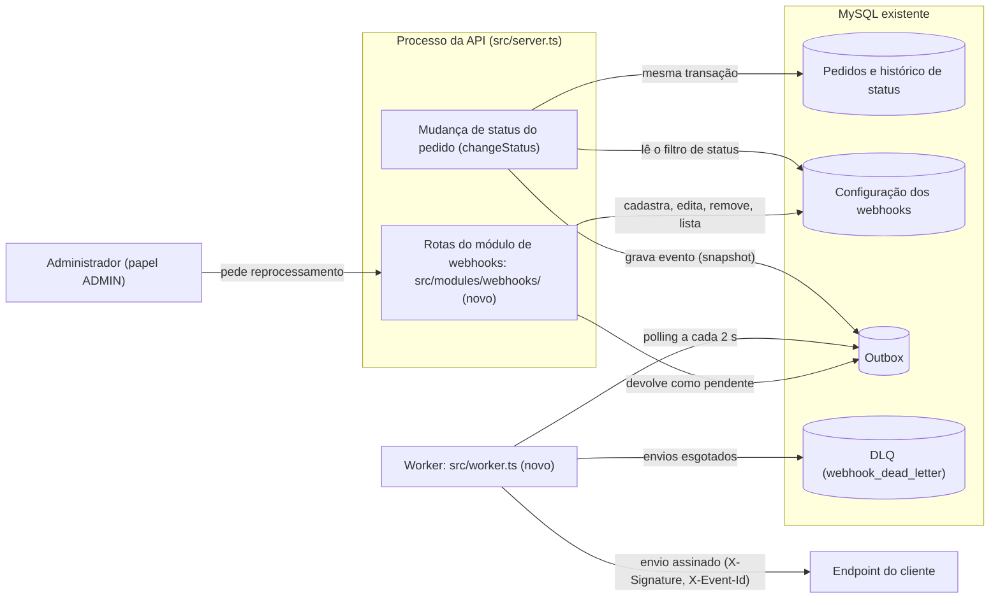

# RFC-001: Sistema de Webhooks de Notificação de Pedidos

## Metadados

| Campo | Valor |
| --- | --- |
| Autor | Larissa (Tech Lead), que abre o documento de design (`[09:50] Larissa`) |
| Status | Em revisão: sessão com Bruno e Diego antes de codar (`[09:50] Larissa`) |
| Data | 2026-10-18 (redação; reunião técnica de quinta-feira) |
| Revisores | Bruno (Engenheiro Pleno, Pedidos) e Diego (Engenheiro Sênior, Plataforma): sessão de revisão técnica. Sofia (Engenheira de Segurança): segurança, foco em HMAC e geração de secret (`[09:46] Sofia`). Marcos (Product Manager): responde ou aceita RFC-QA-05, RFC-QA-07 e RFC-QA-08. Larissa (Tech Lead): autora |
| Documentos relacionados | [PRD](PRD.md), [FDD](FDD.md), [Decisões relacionadas](#decisões-relacionadas) |

## Resumo executivo (TL;DR)

Três clientes B2B pedem notificação de mudança de status do pedido abaixo de 10 s (`[09:02] Marcos`). A proposta grava numa outbox no MySQL, na mesma transação, cada mudança de status que algum webhook quer receber, e um worker em processo separado lê a outbox a cada 2 s e chama o endpoint do cliente. O envio tem retry com DLQ, assinatura por endpoint e entrega at-least-once com deduplicação pelo cliente (ADR-001 a ADR-005, em [Decisões relacionadas](#decisões-relacionadas)). Oito questões afetam o núcleo das decisões (RFC-QA-05 a RFC-QA-12). O prazo combinado é de 3 sprints, com a revisão de segurança no fim (`[09:47] Larissa`).

## Contexto e problema

Os clientes consultam `GET /orders` periodicamente, o que deixa a integração lenta e cara (`[09:00] Marcos`; negócio no [PRD](PRD.md)).

Neste RFC, **status do pedido** é o `OrderStatus` (`prisma/schema.prisma`) e **estado da outbox** é o estado técnico da linha (pendente, processando, falhou, entregue); não têm relação. A mudança de status roda numa transação já pesada em `OrderService.changeStatus` (`src/modules/orders/order.service.ts`), e uma chamada HTTP dentro dela faria um cliente lento travar outros pedidos ([ADR-001](adrs/ADR-001-outbox-transacional-no-mysql.md)). O projeto não tem fila nem worker: o `docker-compose.yml` sobe só o MySQL e a única entry-point é `src/server.ts`. **Objetivo técnico**: entregar cada evento ao endpoint do cliente abaixo de 10 s (`[09:02] Marcos`), meta que o desenho atende só no caminho feliz ([ADR-002-CONS-12](adrs/ADR-002-worker-separado-com-polling.md)).

## Proposta técnica

### Visão geral

Só MySQL e stack existentes: a API grava o evento na outbox dentro da transação do `changeStatus` ([ADR-001](adrs/ADR-001-outbox-transacional-no-mysql.md)); o worker, com entry-point `src/worker.ts` (novo), faz a chamada HTTP fora dela ([ADR-002](adrs/ADR-002-worker-separado-com-polling.md)); o módulo `src/modules/webhooks/` (novo) expõe configuração e consulta ([ADR-006](adrs/ADR-006-reuso-dos-padroes-do-projeto.md)).

### Componentes

### Fluxo de um evento

1. **RFC-PROP-01**: o `changeStatus` grava o evento na outbox na transação da mudança de status; falha na gravação desfaz tudo ([ADR-001](adrs/ADR-001-outbox-transacional-no-mysql.md)).
2. **RFC-PROP-02**: só grava se algum webhook do cliente quer aquele status do pedido, e guarda o payload montado (snapshot), sem os itens ([ADR-007](adrs/ADR-007-payload-snapshot-e-filtro-na-insercao.md)).
3. **RFC-PROP-03**: a cada 2 s, o worker busca as linhas pendentes mais antigas; worker único (premissa, não garantia) dá ordem por pedido, salvo reentrega e envio concorrente (RFC-QA-05, RFC-QA-06) ([ADR-002](adrs/ADR-002-worker-separado-com-polling.md)).
4. **RFC-PROP-04**: o envio leva o HMAC-SHA256 do corpo em `X-Signature`, com secret por endpoint rotacionável com 24 h de convivência (forma em aberto: RFC-QA-09, RFC-QA-10; [ADR-004](adrs/ADR-004-assinatura-hmac-sha256-por-endpoint.md)), e o UUID do evento, gerado na inserção, em `X-Event-Id` ([ADR-005](adrs/ADR-005-entrega-at-least-once-com-x-event-id.md)).
5. **RFC-PROP-05**: envio que falha, inclusive por timeout HTTP de 10 s, é repetido com backoff de 1 min, 5 min, 30 min, 2 h e 12 h, até "5 tentativas", contagem em aberto (RFC-QA-08) ([ADR-003](adrs/ADR-003-retry-com-backoff-e-dlq.md)).
6. **RFC-PROP-06**: esgotados os envios, o evento vai para a DLQ (`webhook_dead_letter`), e um ADMIN pode devolvê-lo à outbox como pendente, com registro de quem o fez ([ADR-003](adrs/ADR-003-retry-com-backoff-e-dlq.md)).
7. **RFC-PROP-07**: a entrega é at-least-once, e o cliente descarta repetições pelo `X-Event-Id`; no reprocessamento, depende da RFC-QA-11 ([ADR-005](adrs/ADR-005-entrega-at-least-once-com-x-event-id.md)).

### Módulo, API de configuração e limites

**RFC-PROP-08**: o módulo segue a estrutura dos existentes, reaproveita erros, Zod, autenticação, controle de papel e Pino, e usa o prefixo `WEBHOOK_` nos códigos de erro, com alcance na RFC-QA-12 ([ADR-006](adrs/ADR-006-reuso-dos-padroes-do-projeto.md)).

**RFC-PROP-09**: a API de configuração e consulta permite:

- cadastrar webhook com URL https, recebendo a secret gerada pela plataforma (`[09:31] Marcos`, `[09:23] Sofia`);
- listar os webhooks de um cliente, editar e remover (`[09:33] Bruno`);
- escolher os status do pedido que cada webhook recebe ([ADR-007](adrs/ADR-007-payload-snapshot-e-filtro-na-insercao.md));
- consultar os últimos 100 envios (`[09:34] Marcos`);
- rotacionar a secret ([ADR-004](adrs/ADR-004-assinatura-hmac-sha256-por-endpoint.md));
- reprocessar a DLQ, só com papel ADMIN ([ADR-003](adrs/ADR-003-retry-com-backoff-e-dlq.md)).

As demais operações aceitam qualquer usuário autenticado nesta fase (`[09:37] Sofia`).

**RFC-PROP-10**: fora desta proposta: webhooks de entrada (`[09:02] Marcos`); aviso de falhas por e-mail (`[09:37] Larissa`); painel visual (`[09:40] Larissa`); arquivamento das linhas entregues, sem prazo (`[09:08] Diego`); múltiplos workers (`[09:13] Diego`).

## Alternativas consideradas

### RFC-ALT-01: Disparo síncrono no changeStatus

- **O que é**: chamar o endpoint do cliente dentro do `changeStatus`.
- **Levantada por**: `[09:03] Larissa`.
- **Descartada por**: `[09:04] Bruno`: cliente lento travaria a mudança de status de outros pedidos.
- **Trade-off**: **Derivada:** ganha envio imediato sem tabela nem processo novos; paga prendendo a mudança de status à disponibilidade do cliente ([ADR-001](adrs/ADR-001-outbox-transacional-no-mysql.md)).

### RFC-ALT-02: Redis Streams

- **O que é**: publicar os eventos em Redis Streams.
- **Levantada por**: `[09:07] Larissa`.
- **Descartada por**: `[09:07] Diego`: infraestrutura nova, overengineering para time pequeno.
- **Trade-off**: **Derivada:** ganha fila dedicada fora do banco transacional; paga subindo e operando um Redis Cluster ([ADR-001](adrs/ADR-001-outbox-transacional-no-mysql.md)).

### RFC-ALT-03: Trigger do MySQL

- **O que é**: uma trigger avisaria o worker a cada inserção.
- **Levantada por**: `[09:09] Bruno`.
- **Descartada por**: `[09:09] Diego`: o MySQL não notifica processo externo, e o polling de 2 s atende a meta.
- **Trade-off**: ganha reatividade, sem o atraso de até 2 s causado pelo polling; paga com um improviso, como escrever em arquivo ([ADR-002](adrs/ADR-002-worker-separado-com-polling.md)).

### RFC-ALT-04: Worker no processo da API

- **O que é**: rodar o worker dentro do processo da API.
- **Levantada por**: `[09:11] Diego`.
- **Descartada por**: `[09:11] Diego`: se a API reinicia, o worker para junto.
- **Trade-off**: **Derivada:** ganha um processo só para implantar; paga com a entrega parada a cada reinício da API ([ADR-002](adrs/ADR-002-worker-separado-com-polling.md)).

### RFC-ALT-05: Exactly-once

- **O que é**: entregar cada evento exatamente uma vez.
- **Levantada por**: `[09:25] Diego`.
- **Descartada por**: `[09:25] Diego`: exige coordenação dos dois lados.
- **Trade-off**: **Derivada:** ganha cliente sem deduplicação; paga com coordenação entre plataforma e cliente a cada entrega ([ADR-005](adrs/ADR-005-entrega-at-least-once-com-x-event-id.md)).

## Questões em aberto

Estado `lacuna`: ponto não levantado na reunião, identificado na redação; a origem é a fala que o deixou sem definição. **Proposta (a validar):** gatilhos sem fala e quem responde as RFC-QA-01 a RFC-QA-04 são sugestão deste RFC; para as lacunas, propõe-se a sessão de revisão antes de codar (`[09:50] Larissa`), com quem responde cada uma.

| ID | Pergunta | Origem | Estado | Gatilho de decisão | Responde |
| --- | --- | --- | --- | --- | --- |
| RFC-QA-01 | O `customer_id` do cadastro vai no body ou no path? | Levantada por `[09:32] Larissa` | não decidido | antes do contrato da API no FDD | arquitetura (Larissa) |
| RFC-QA-02 | É preciso limitar a taxa de envios por cliente? | Levantada por `[09:38] Diego` | observar e decidir depois (`[09:39] Larissa`) | "se virar problema" (`[09:39] Diego`) | plataforma (Diego) |
| RFC-QA-03 | Para ter vários workers, particionar por pedido ou usar lock pessimista? | Levantada por `[09:13] Bruno` | adiado (`[09:13] Diego`) | antes de rodar um segundo worker | plataforma (Diego) |
| RFC-QA-04 | O CRUD de configuração deve exigir papel específico? | Levantada por `[09:37] Sofia` | adiado | "mais pra frente" (`[09:37] Sofia`) | segurança (Sofia) |
| RFC-QA-05 | No retry, aceitar a reordenação (cliente ordena pelo `timestamp` do payload) ou segurar os eventos seguintes do pedido? | `[09:12] Diego`; [ADR-002](adrs/ADR-002-worker-separado-com-polling.md), questão 1 | lacuna | sessão | produto (Marcos) e arquitetura (Larissa) |
| RFC-QA-06 | O worker envia as linhas de um ciclo uma de cada vez ou várias ao mesmo tempo? | `[09:42] Diego`; [ADR-002](adrs/ADR-002-worker-separado-com-polling.md), questão 2 | lacuna | sessão | arquitetura (Larissa) com plataforma (Diego) |
| RFC-QA-07 | A meta de 10 s vale só para eventos entregues no primeiro envio? | `[09:02] Marcos`; [ADR-002](adrs/ADR-002-worker-separado-com-polling.md), questão 3 | lacuna | sessão | produto (Marcos) |
| RFC-QA-08 | "5 tentativas" são 5 envios no total ou envio inicial mais 5 retentativas? | `[09:17] Larissa`; [ADR-003](adrs/ADR-003-retry-com-backoff-e-dlq.md), questão 1 | lacuna | sessão | arquitetura (Larissa), com aceite de produto (Marcos) |
| RFC-QA-09 | Nas 24 h de convivência, enviar duas assinaturas, só a da secret nova ou a da anterior até o cliente confirmar a nova? | `[09:21] Sofia`; [ADR-004](adrs/ADR-004-assinatura-hmac-sha256-por-endpoint.md), questão 1 | lacuna | sessão | segurança (Sofia) |
| RFC-QA-10 | O `X-Timestamp` entra no que é assinado? | `[09:44] Diego`; [ADR-004](adrs/ADR-004-assinatura-hmac-sha256-por-endpoint.md), questão 2 | lacuna | sessão | segurança (Sofia) |
| RFC-QA-11 | O reprocessamento da DLQ mantém o identificador original do evento? | `[09:18] Diego`; [ADR-005](adrs/ADR-005-entrega-at-least-once-com-x-event-id.md), questão 1 | lacuna | sessão | arquitetura (Larissa) |
| RFC-QA-12 | Erros de validação e de recurso não encontrado ganham o prefixo `WEBHOOK_` ou ele fica só nos erros de domínio? | `[09:29] Larissa`; [ADR-006](adrs/ADR-006-reuso-dos-padroes-do-projeto.md), questão 1 | lacuna | sessão | arquitetura (Larissa) com Pedidos (Bruno) |

**Dependências**: a RFC-QA-07 delimita as RFC-QA-05 e RFC-QA-06; a RFC-QA-08 muda o atraso dos eventos segurados na RFC-QA-05; as RFC-QA-09 e RFC-QA-10 mexem no formato da assinatura; a RFC-QA-11 anda junto com a ordem do reprocessamento (questão 5 do [ADR-003](adrs/ADR-003-retry-com-backoff-e-dlq.md)).

As demais questões dos ADRs afetam detalhes ou operação e ficam neles.

## Impacto e riscos

### Impacto

- **RFC-IMP-01**: a transação do `changeStatus` ganha escrita na outbox, leitura da configuração dos webhooks e nova causa de rollback ([ADR-001-CONS-04](adrs/ADR-001-outbox-transacional-no-mysql.md), [ADR-007-CONS-05](adrs/ADR-007-payload-snapshot-e-filtro-na-insercao.md)).
- **RFC-IMP-02**: a operação ganha um segundo processo para implantar, supervisionar e monitorar, e o MySQL compartilhado, carga contínua (ADR-002-CONS-08 e CONS-15, [ADR-002](adrs/ADR-002-worker-separado-com-polling.md)).
- **RFC-IMP-03**: o cliente precisa verificar a assinatura, deduplicar e lidar com eventos fora de ordem ([ADR-004-CONS-05](adrs/ADR-004-assinatura-hmac-sha256-por-endpoint.md), [ADR-005-CONS-04](adrs/ADR-005-entrega-at-least-once-com-x-event-id.md), [ADR-002-CONS-07](adrs/ADR-002-worker-separado-com-polling.md)), com documentação no portal (`[09:26] Marcos`, `[09:40] Marcos`).
- **RFC-IMP-04**: o prazo é de 3 sprints com a revisão de segurança de pelo menos 2 dias úteis no fim (`[09:47] Larissa`, `[09:46] Sofia`); a Atlas pede fim de novembro (`[09:45] Marcos`), e Marcos confirma o prazo com ela (`[09:47] Marcos`).

### Riscos

- **RFC-RISCO-01**: a estimativa por bloco (1, 1, 0,5 e 0,5 sprint) já fecha 3 sprints antes do "mais um pouco" de HMAC, schemas e validações e da revisão de segurança (`[09:46] Larissa`).
- **RFC-RISCO-02**: o reprocessamento por ADMIN não é controle forte, porque o registro é público (`src/modules/auth/auth.routes.ts`) e aceita papel ADMIN (ADR-003-CONS-08; opções na questão 6, [ADR-003](adrs/ADR-003-retry-com-backoff-e-dlq.md)).
- **RFC-RISCO-03**: outbox e DLQ crescem sem política de retenção ([ADR-001-CONS-06](adrs/ADR-001-outbox-transacional-no-mysql.md), [ADR-003-CONS-15](adrs/ADR-003-retry-com-backoff-e-dlq.md)).
- **RFC-RISCO-04**: nada garante o worker único: dois workers duplicam envios e perdem a ordem; worker parado não é percebido (ADR-002-CONS-10 e CONS-13; opções nas questões 4 e 6, [ADR-002](adrs/ADR-002-worker-separado-com-polling.md)).
- **RFC-RISCO-05**: a meta de 10 s só é atendida no caminho feliz: evento cujo primeiro envio falha espera pelo menos 1 min ([ADR-002-CONS-12](adrs/ADR-002-worker-separado-com-polling.md)); ver RFC-QA-07.
- **RFC-RISCO-06**: se o limite de 64 KB for checado na inserção com erro, a mudança de status do pedido é desfeita pelo tamanho do payload (ADR-007-CONS-09; opções na questão 2, [ADR-007](adrs/ADR-007-payload-snapshot-e-filtro-na-insercao.md)).

## Decisões relacionadas

| ADR | Decisão | Status |
| --- | --- | --- |
| [ADR-001](adrs/ADR-001-outbox-transacional-no-mysql.md) | Outbox no MySQL na transação da mudança de status | Aceito |
| [ADR-002](adrs/ADR-002-worker-separado-com-polling.md) | Worker separado, polling de 2 s, worker único | Aceito, com questões de núcleo em aberto (RFC-QA-05, RFC-QA-06, RFC-QA-07) |
| [ADR-003](adrs/ADR-003-retry-com-backoff-e-dlq.md) | Retry com backoff, DLQ separada, reprocessamento por ADMIN | Aceito, com questões de núcleo em aberto (RFC-QA-08) |
| [ADR-004](adrs/ADR-004-assinatura-hmac-sha256-por-endpoint.md) | HMAC-SHA256 com secret por endpoint e rotação | Aceito, com questões de núcleo em aberto (RFC-QA-09, RFC-QA-10) |
| [ADR-005](adrs/ADR-005-entrega-at-least-once-com-x-event-id.md) | At-least-once com `X-Event-Id` | Aceito, com questões de núcleo em aberto (RFC-QA-11) |
| [ADR-006](adrs/ADR-006-reuso-dos-padroes-do-projeto.md) | Módulo na base existente com os padrões do projeto | Aceito, com questões de núcleo em aberto (RFC-QA-12) |
| [ADR-007](adrs/ADR-007-payload-snapshot-e-filtro-na-insercao.md) | Payload em snapshot e filtro na inserção | Aceito |
